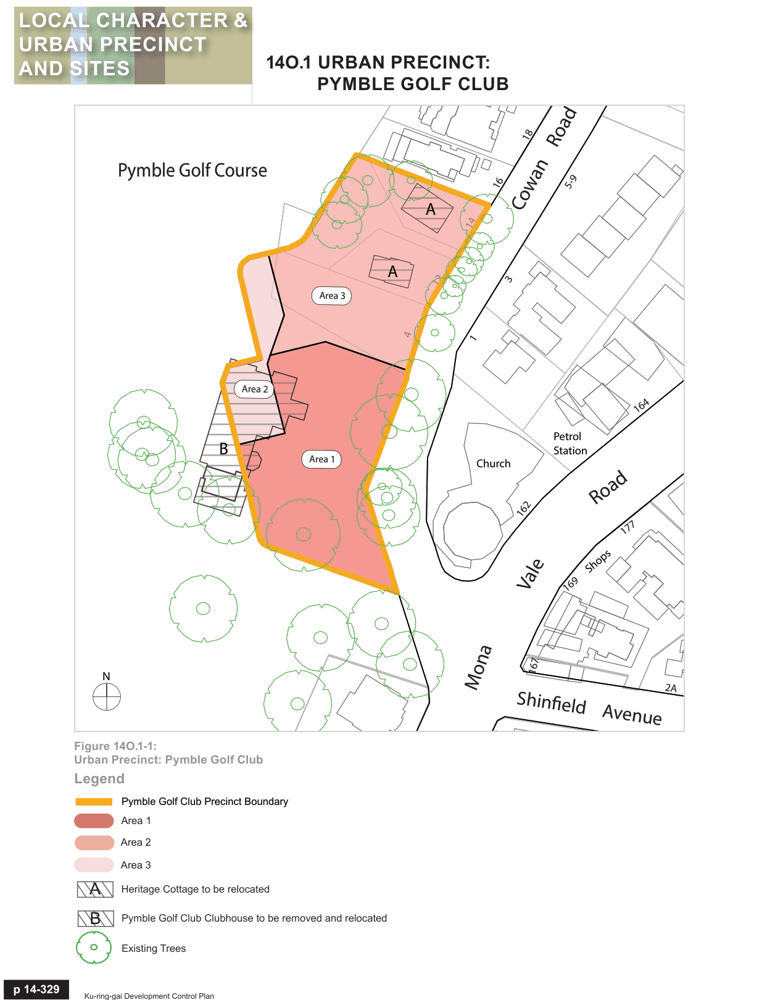

# Ku-ring-gai Development Control Plan - Part 14O 4, 12 and 14 Cowan Road, St Ives (Pymble Golf Club)

> This chapter is split into 5 section file(s), one per numbered heading, in the order they appear in the PDF.

Source PDF: [kdcp-section-b-part-14o-pymble-golf-club.pdf](https://planfortomorrow.sharepoint.com/sites/Planfortomorrow/Shared%20Documents/00%20NSW-Planning-Resources/dcp/ku-ring-gai-development-control-plan/part-14o-4-12-and-14-cowan-road-st-ives-pymble-golf-club/kdcp-section-b-part-14o-pymble-golf-club.pdf)

#### 4, 12 and 14 Cowan Road, St Ives

(Pymble Golf Club)

14O.1 	 Urban Precinct

14O.2 	 Pedestrian and Vehicular Access 14O.3 	 Building Setbacks 14O.4 	 Built Form

14O.5	 Heritage

### 14O

### PART

### PYMBLE GOLF CLUB

Ku-ring-gai Development Control Plan p 14-328

> [Picture on page 2: a map, saved as a picture (images/part-14o-4-12-and-14-cowan-road-st-ives-pymble-golf-club-page-2-1.gif, 150 dpi); the street names and other small labels are on the picture.]
> Words printed on the picture (title and legend, copied from the PDF):
> Urban Precinct: Pymble Golf Club
> Pymble Golf Club Precinct Boundary
> Heritage Cottage to be relocated
> Pymble Golf Club Clubhouse to be removed and relocated

Figure 14O.1-1:

<!-- sections -->
## Sections

1. [14O.1 URBAN PRECINCT:](01-14o-1-urban-precinct.md)
2. [14O.2 PEDESTRIAN AND VEHICULAR ACCESS](02-14o-2-pedestrian-and-vehicular-access.md)
3. [14O.3 BUILDING SETBACKS](03-14o-3-building-setbacks.md)
4. [14O.4 BUILT FORM](04-14o-4-built-form.md)
5. [14O.5 HERITAGE](05-14o-5-heritage.md)
