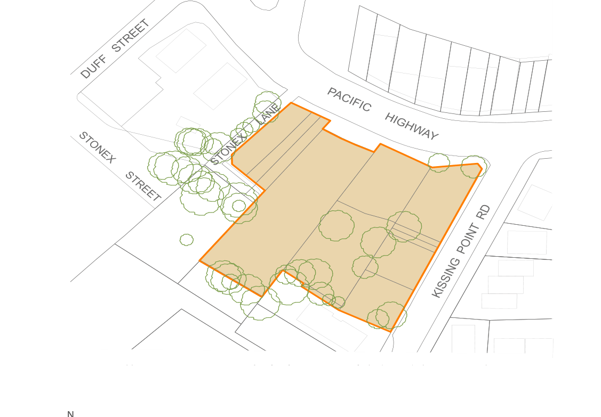
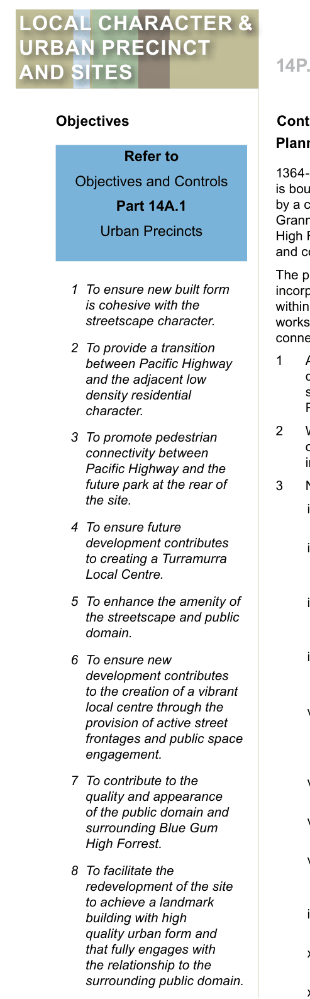
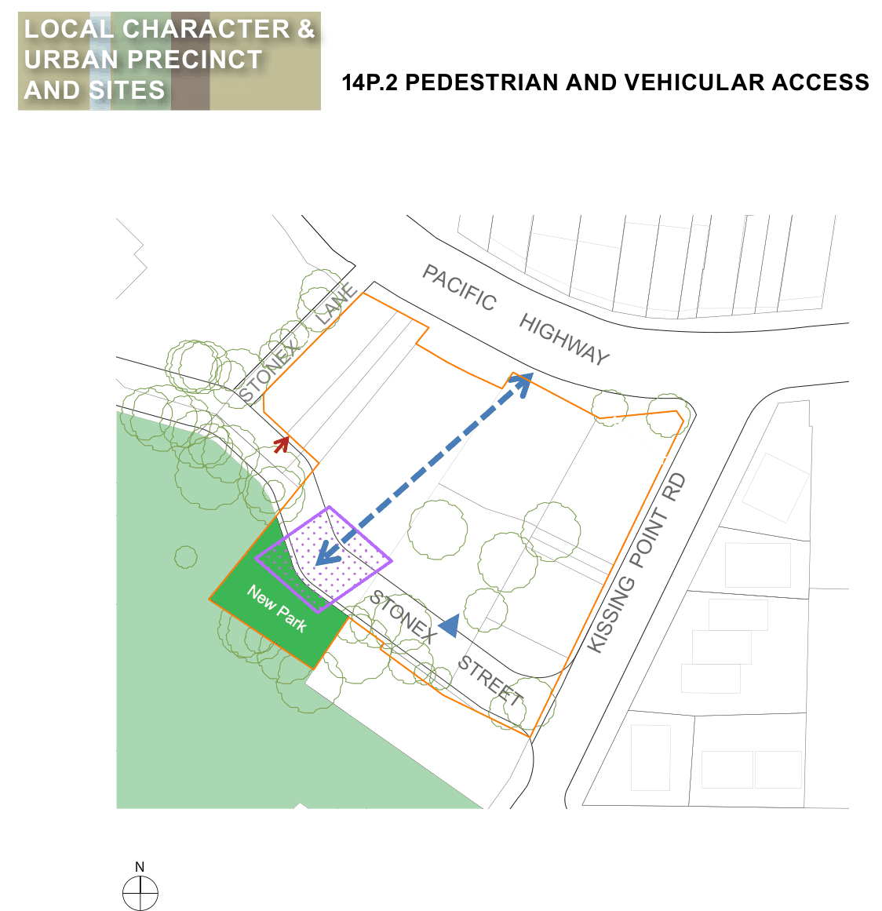

#### 14X.1 URBAN PRECINCT:

#### 1364-1396 Pacific Highway; and 1, 1A, 3 and 3A

#### Kissing Point Road, Turramurra.

### 14P.1 URBAN PRECINCT:

### TURRAMURRA PLAZA

> [Picture on page 2: a picture, saved as a picture (images/part-14p-turramurra-plaza-1364-1396-pacific-highway-1-1a-3-page-2-14.gif, 150 dpi).]
> Words printed on the picture (title and legend, copied from the PDF):
> DUFF   STREET
> PACIFIC     HIGHWAY
> STONEX      LANE
> STONEX      STREET
> KISSING  POINT  RD
> Planned Future Character Plan
> Legend
> 1364-1396 Pacific Highway, and 1, 1A and 3A Kissing Point Road, Turramurr
> a
> N

Figure 14X.1-1:

Existing Trees

New Site Boundary

#### Figure 14P.1-1:

#### Urban Precinct: Turramurra Plaza

#### Legend

Existing site

Existing trees

> [Picture on page 3: a map, saved as a picture (images/part-14p-turramurra-plaza-1364-1396-pacific-highway-1-1a-3-page-3-1.gif, 150 dpi); the street names and other small labels are on the picture.]
> Words printed on the picture (title and legend, copied from the PDF):
> Objectives and Controls
> is cohesive with the
> between Pacific Highway
> and the adjacent low
> 3	 To promote pedestrian
> Pacific Highway and the
> 4	 To ensure future
> to creating a Turramurra
> the streetscape and public
> 6	 To ensure new
> local centre through the
> provision of active street
> frontages and public space
> quality and appearance
> surrounding Blue Gum
> 8	 To facilitate the
> redevelopment of the site
> to achieve a landmark
> building with high
> quality urban form and
> that fully engages with
> the relationship to the
> surrounding public domain.

#### Objectives

Refer to

#### Part 14A.1

1	 To ensure new built form

2	 To provide a transition

future park at the rear of

5	 To enhance the amenity of

to the creation of a vibrant

7	 To contribute to the

of the public domain and

### 14P.1 URBAN PRECINCT:

### TURRAMURRA PLAZA (continued)

#### Controls Planned Future Character

1364-1396 Pacific Highway and 1, 1A, 3, 3A Kissing Point Road, Turramurra

is bound by Pacific Highway and Kissing Point Road. It is currently occupied

by a commercial/ retail building and carparking. The south of the site adjoins

Granny Springs Reserve, an area of bushland with pockets of Blue Gum

High Forest. The Hillview Heritage Conservation Area is located to the east

and contains a mix of low‑scale residential and commercial buildings. The planned future character of the site is for a mixed-use development

incorporating retail, supermarket, community space and shop top housing

within a new site boundary resulting from land dedication for public domain

works. Stonex Street will provide access through the site and carpark,

connecting Duff Street and Kissing Point Road.

1 All development within the site, as outlined in Figure 14P.1-1, is to be

designed to support and enhance the planned future character of the

site. This is to be done through compliance with the requirements of

Part 14P and other relevant parts of Section A, B, C of the DCP. 2 Where there is an inconsistency between Part 14P and other sections

of the DCP, the controls in Part 14P will prevail to the extent of that

inconsistency.

3 New development is to include the following key elements:

i) Ensure new development is cohesive with the street character,

including the future character of Turramurra Local Centre.

ii)	 Ensure new development provides active street frontages to both

Pacific Highway, Kissing Point Road, New Stonex Street, Stonex

Lane and through site link.

iii)	 Ensure new development is appropriately sited and designed to

appropriately manage amenity and visual impacts to adjoining

residential properties.

iv)	 Create a mixed use development providing a range of uses on

site including residential apartments, retail, commercial and a

community centre.

v)	 Provision of a new public street “New Stonex Street” behind the

site to connect Duff Street and Kissing Point Road for improved

local traffic circulation. Extend Stonex Drive to provide access to

the rear of the site and Kissing Point Road.

vi)	 Provision of Stonex Lane to facilitate and buffer development from

### TURRAMURRA   PLAZA

the adjacent petrol station.

vii)	 Deliver a new community approximately 700m2 park west of New

Stonex Street adjacent to Granny Springs Reserve.

viii)	Ensure new development is appropriately sited and designed to

manage amenity and visual impacts to neighboring residential

properties.

ix)	 Promote pedestrian activity between Pacific Highway and the

future park at the rear of the site.

x)	 Retain, protect and enhance the adjacent Blue Gum High Forest

and Lane Cove River water catchment area.

xi)	 Consistency with the Turramurra Public Domain Plan.

Indicative carpark entry

> [Picture on page 4: a picture, saved as a picture (images/part-14p-turramurra-plaza-1364-1396-pacific-highway-1-1a-3-page-4-2.gif, 150 dpi).]
> Words printed on the picture (title and legend, copied from the PDF):
> Indicative shared zone
> Existing Trees
> New Park
> New Park
> N

### 14P.2 PEDESTRIAN AND VEHICULAR ACCESS

#### DUFF    STREET

#### PACIFIC     HIGHWAY

#### STONEX      LANE

#### KISSING  POINT  RD

#### STONEX      STREET

#### Figure 14P.2-1:

#### Pedestrian and Vehicular Access: Turramurra Plaza

#### Legend

Vehicular access to carpark

Vehicular access to service and loading bay facilities

Pedestrian through-site link

Shared zone - pedestrian and vehicle

Existing trees
