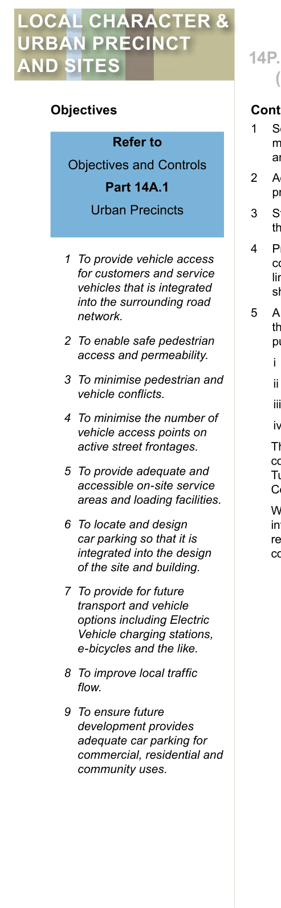
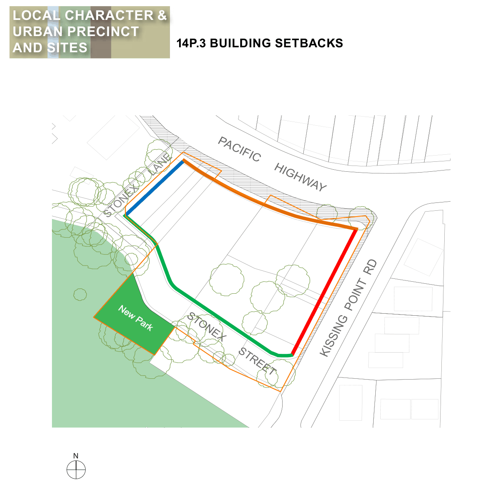

### 14P.2 PEDESTRIAN AND VEHICULAR ACCESS

> [Picture on page 5: a map, saved as a picture (images/part-14p-turramurra-plaza-1364-1396-pacific-highway-1-1a-3-page-5-2.gif, 150 dpi); the street names and other small labels are on the picture.]
> Words printed on the picture (title and legend, copied from the PDF):
> Objectives and Controls
> for customers and service
> vehicles that is integrated
> into the surrounding road
> access and permeability.
> vehicle access points on
> active street frontages.
> accessible on-site service
> areas and loading facilities.
> integrated into the design
> transport and vehicle
> options including Electric
> Vehicle charging stations,
> e-bicycles and the like.
> 9	 To ensure future
> adequate car parking for
> commercial, residential and

#### Objectives

Refer to

#### Part 14A.1

1	 To provide vehicle access

2	 To enable safe pedestrian

3	 To minimise pedestrian and

4	 To minimise the number of

5	 To provide adequate and

6	 To locate and design

car parking so that it is

of the site and building. 7	 To provide for future

8	 To improve local traffic

### (continued)

#### Controls

1 Service/loading areas are to be located in the basement to

minimise conflict between pedestrians and vehicles, and minimise

amenity impacts to adjoining residential properties. 2 Access to basement carparking and loading/services docks is to be

provided off New Stonex Street at the rear of the site. 3 Stonex Lane and the pedestrian through site link are to be open to

the sky.

4 Provide a pedestrian and vehicular shared zone on Stonex Street

connecting the end of the open to sky pedestrian through site

link with the new park. Minimise vehicular movements across the

shared zone.

5 A new public street “Stonex Street” is to be provided at the rear of

the site, connecting Kissing Point Road and Duff Street. The new

public street is to provide:

i two-way traffic

ii on street parking (one side)

iii footpath (east side)

iv shared path (west side)

The new public street is to be a nominal width of 13m wide

consistent with the relevant plan and cross section in the

Turramurra Public Domain Plan and street elements included in the

Contributions Plan.

Whilst the width of the new public street may change at

intersections and key pedestrian crossing locations, the road

reserve is to be designed to avoid creating awkward or irregular lot

configurations along the street frontage.

### TURRAMURRA   PLAZA

> [Picture on page 6: a picture, saved as a picture (images/part-14p-turramurra-plaza-1364-1396-pacific-highway-1-1a-3-page-6-1.gif, 150 dpi).]
> Words printed on the picture (title and legend, copied from the PDF):
> New Park
> New Park
> N
