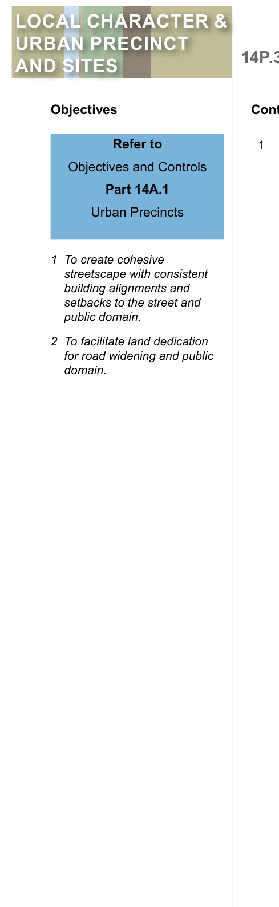
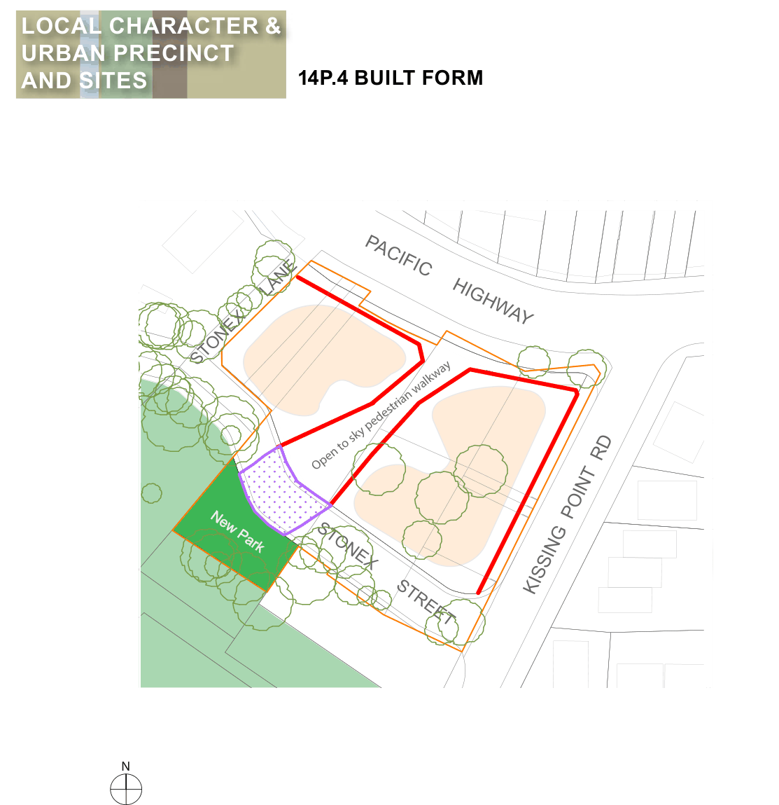

### 14P.3 BUILDING SETBACKS

#### PACIFIC     HIGHWAY

#### STONEX      LANE

#### KISSING  POINT  RD

#### STONEX      STREET

#### Figure 14P.3-1:

#### Setbacks: Turramurra Plaza

#### Legend

#### Setbacks

15m minimum setback for delivery of Stonex Street 3m setback from existing site boundary to Stonex Lane 3.5m setback from road widening area on Pacific Highway 3.5m setback from road widening area on Kissing Point Road Road widening area

Existing trees

> [Picture on page 7: a picture, saved as a picture (images/part-14p-turramurra-plaza-1364-1396-pacific-highway-1-1a-3-page-7-1.gif, 150 dpi).]
> Words printed on the picture (title and legend, copied from the PDF):
> Objectives and Controls
> Urban Precincts
> 1	 To create cohesive
> streetscape with consistent
> building alignments and
> public domain.
> domain.

#### Objectives

Refer to

#### Part 14A.1

setbacks to the street and

2	 To facilitate land dedication

for road widening and public

### 14P.3 BUILDING SETBACKS (continued)

#### Controls

1 Building setbacks are to be in accordance with Figure 14P-3 and

as follows:

i) A variable setback is to be provided along Pacific Highway

to facilitate the required land dedication. This setback is to

result in a building setback of 3.5m from the land dedication

zone on Pacific Highway which will form the new 3.5m

public footpath. Refer to Figure 14K.5-1

ii)	 A 3.5m setback is to be provided to Kissing Point Road,

consisting of 1.5m for road widening and 2.0m for the new

public footpath.

iii)	 A setback of 3.0m from the existing boundary with Stonex

Lane.

iv)	 A minimum setback of 15.0m along the southern boundary

to allow for delivery of the Stonex Street road extension.

### TURRAMURRA   PLAZA

> [Picture on page 8: a picture, saved as a picture (images/part-14p-turramurra-plaza-1364-1396-pacific-highway-1-1a-3-page-8-1.gif, 150 dpi).]
> Words printed on the picture (title and legend, copied from the PDF):
> Open to sky pedestrian walkway
> New Park
> N
