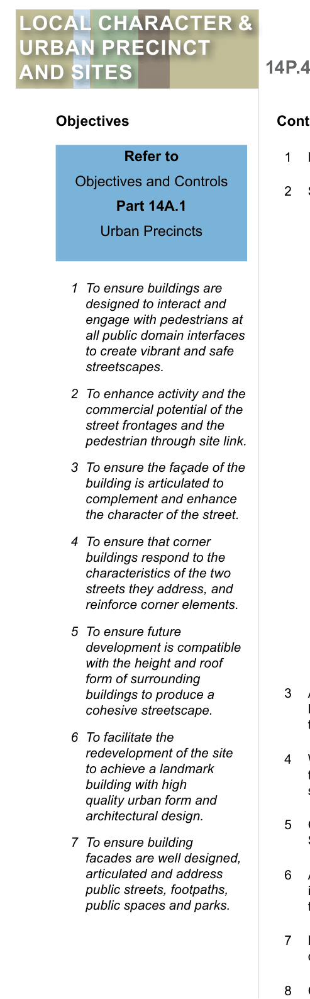
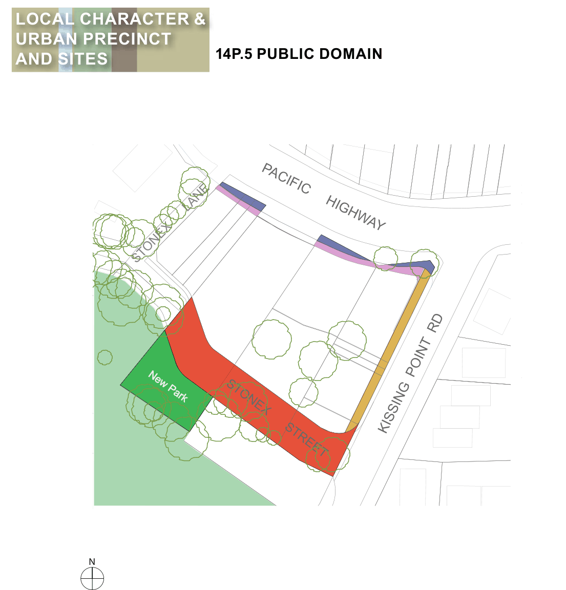

### 14P.4 BUILT FORM

#### PACIFIC     HIGHWAY

#### STONEX      LANE

#### KISSING  POINT  RD

#### STONEX      STREET

#### Figure 14P.4-1:

#### Built Form: Turramurra Plaza

#### Legend

Active frontage

Indicative built form

Shared zone - pedestrian and vehicle

Existing trees

### 14P.4 BUILT FORM (continued)

> [Picture on page 9: a map, saved as a picture (images/part-14p-turramurra-plaza-1364-1396-pacific-highway-1-1a-3-page-9-2.gif, 150 dpi); the street names and other small labels are on the picture.]
> Words printed on the picture (title and legend, copied from the PDF):
> Objectives and Controls
> designed to interact and
> engage with pedestrians at
> all public domain interfaces
> commercial potential of the
> street frontages and the
> pedestrian through site link.
> building is articulated to
> complement and enhance
> buildings respond to the
> characteristics of the two
> streets they address, and
> reinforce corner elements.
> 5	 To ensure future
> development is compatible
> form of surrounding
> buildings to produce a
> 6	 To facilitate the
> redevelopment of the site
> to achieve a landmark
> building with high
> quality urban form and
> 7	 To ensure building
> facades are well designed,
> articulated and address
> public streets, footpaths,
> public spaces and parks.

#### Objectives

#### Controls

1 Provide a minimum 5% affordable housing in perpetuity.

Refer to

2 Site design and built form is to comply with the following:

#### Part 14A.1

i) A 3 story street wall is to be provided along Pacific Highway

ii)	 A minimum 4.0m step-back is to be provided above the

street wall height

iii)	 A pedestrian through site link open to the sky is to be

provided between Pacific Highway and Stonex Street.

iv)	 Provide clearly visible entry points that contribute to the

building facade design and enhance active street frontages.

v)	 All plant and services are to be integrated into the built

1	 To ensure buildings are

to create vibrant and safe

form and/or roof and not be visible from the public domain

including distant views.

vi)	 The building tower footprints are to ensure a level of

articulation which minimises the perceived visual bulk.

2	 To enhance activity and the

vii)	Built form is to provide a high standard of external finishes,

appropriate level of architectural detail and minimise opaque

and blank walls at ground level.

viii)	Development is to ensure compliance with the NSW

3	 To ensure the façade of the

the character of the street.

Government Apartment Design Guideline especially

demonstrating compliance with solar access requirements

to public spaces, providing for a high level of comfort and

amenity for pedestrians and to enable use for outdoor dining

throughout the year including at lunch time in midwinter.

ix)	 A detailed Site Investigation is to be submitted with any DA.

4	 To ensure that corner

x)	 The design is to demonstrate compatibility with adjoining

Heritage Conservation Areas and nearby Heritage Items,

and reflect the character of the Turramurra Local Centre.

with the height and roof

3 Active street frontages are to be provided to Pacific Highway,

Kissing Point Road, New Stonex Street, Stonex Lane and the

through site link.

4 Where it is demonstrated there are constraints due to the site

topography and resulting building design, the extent of the active

street frontage to Kissing Point may be varied.

### TURRAMURRA   PLAZA

5 Outdoor dining is encouraged to the rear of site, fronting Stonex

Street and the new park.

6 A minimum of 7% deep soil area with minimum 2.0m dimension

is to be located adjacent to the Stonex Street frontage of the

through site pedestrian link.

7 Landscaping is to consist of predominantly native plants

consistent with the Blue Gum High Forest Community.

8 Consultation with an ecologist and arborist is required to

minimise the impact on bushland reserve.

> [Picture on page 10: a picture, saved as a picture (images/part-14p-turramurra-plaza-1364-1396-pacific-highway-1-1a-3-page-10-1.gif, 150 dpi).]
> Words printed on the picture (title and legend, copied from the PDF):
> New Park
> Public Domain Controls
> New park (approx. 708m2)
> N
> Extended Stonex Street (approx.1,434m2)

Figure 14K.5-1
