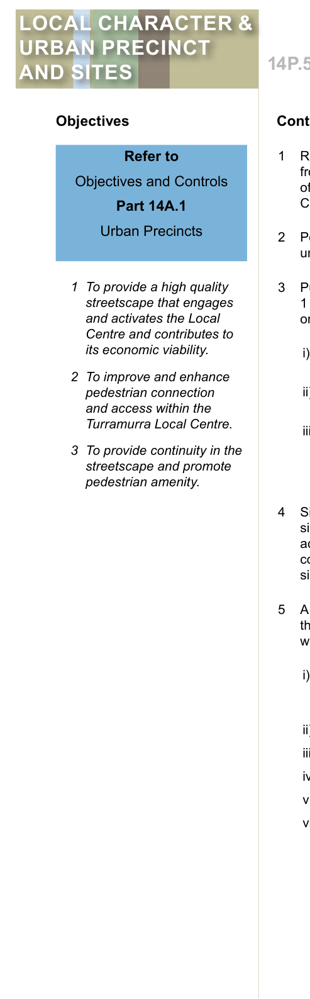

### 14P.5 PUBLIC DOMAIN

#### PACIFIC     HIGHWAY

#### STONEX      LANE

#### KISSING  POINT  RD

#### STONEX      STREET

#### Legend

Kissing Point Road Footpath upgrade (approx.255m2) Pacific Highway Footpath upgrade (approx.265m2) Land dedication SP2 Zone (approx.141m2)

#### Figure 14P.5-1:

#### Public Domain: Turramurra Plaza

#### Legend

New Park (approx. 708sqm) - land dedication Extended Stonex Street (approx.1,434sqm) - land dedication Kissing Point Road footpath upgrade (approx.255sqm) - land dedication

Pacific Highway footpath upgrade (approx.265sqm) - land dedication Pacific Highway future road widening (approx.141sqm) - land dedication to SP2 Zone

Existing trees

### 14P.5 PUBLIC DOMAIN (continued)

> [Picture on page 11: a picture, saved as a picture (images/part-14p-turramurra-plaza-1364-1396-pacific-highway-1-1a-3-page-11-2.gif, 150 dpi).]
> Words printed on the picture (title and legend, copied from the PDF):
> Objectives and Controls
> Urban Precincts
> streetscape that engages
> and activates the Local
> Centre and contributes to
> its economic viability.
> pedestrian connection
> and access within the
> Turramurra Local Centre.
> streetscape and promote
> pedestrian amenity.

#### Objectives

#### Controls

Refer to

1 Retain, enhance and provide street trees on all street and lane

frontages. Landscaping within the public domain is to consist

of endemic plants consistent with the Blue Gum High Forest

Critically Endangered Ecological Community.

#### Part 14A.1

2 Powerlines directly adjoining the site frontages are to be

undergrounded.

3 Public domain works are to be in accordance with Figure 14P.5-

1 and delivered through a Voluntary Planning Agreement (VPA)

or other delivery mechanism and include the following:

1	 To provide a high quality

i) A new 708sqm publicly accessible park west of the new

Stonex Street.

ii)	 Provision of a new public street “Stonex Street” connecting

Duff Street and Kissing Point Road.

2	 To improve and enhance

iii)	 Land dedication along Kissing Point Road and Pacific

Highway upgrading of footpath to facilitate a future

intersection upgrade by TfNSW to improve outcomes for

vehicles, cyclists and pedestrians

3	 To provide continuity in the

4 Siting and design of buildings adjoining the open to sky through

site pedestrian link are to ensure that a suitable level of solar

access to the public domain plaza areas are achieved, including

consideration of building orientation and factoring in the

significant falls across the site.

5 A minimum 400sqm community space is to be provided within

the site and be dedicated to Council. This space is to comply

with the following:

i) is not be located on the corner of Kissing Point Road and

Pacific Highway, is not to only have a frontage to Pacific

Highway; is not to be located on the central through-site link;

ii)	 have a frontage to either Stonex Lane or Stonex Street;

iii)	 have direct access to natural light and air;

iv)	 achieve commercial floor-to-ceiling heights;

### TURRAMURRA   PLAZA

v)	 comply with accessibility requirements; and

vi)	 include bathroom and kitchen facilities.

### THIS PAGE IS INTENTIONALLY BLANK
