## 1 Introduction

### 4

### 1.1 Background

5

### 1.2 Methodology

6

### 1.3 Planning Context

7

### 1.4 Local Centre Context

9

### 1.5 Regional Context

10

### 1.6 Regional Context

11

## 2 Site Analysis

### 12

### 2.1 Local Analysis

13

### 2.2 Site Characteristics

15

### 2.3 Context Characteristics

17

### 2.4 Existing Conditions

19

### 2.5 Constraints & Opportunities

21

## 3 Urban Design Concepts

### 22

### 3.1 Urban Design Principles

21

### 3.2 Urban Design Response

23

### 3.3 Masterplan Concept

24

### 3.4 Masterplan Parameters

25

### 3.5 Visualisation

26

### 3.6 Illustrative Plan

27

### 3.7 Massing

30

### 3.8 Section

31

### 3.9 Shadow Analysis

34

## 4 Conclusion

### 35

### 4.1	 Conclusion

36

## 5 Appendix

### 37

### Introduction

Overview of the regional, urban and local context to

### provide an initial understanding of the site.

### 1

### 1

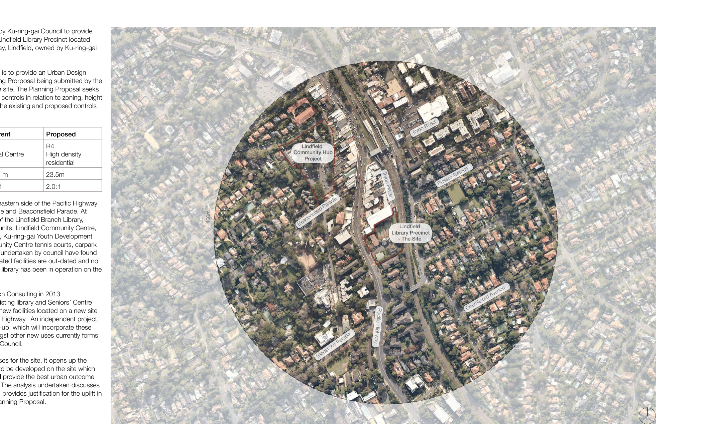

> [Picture on page 7: a map, saved as a picture (images/part-14r-references-masterplan-page-7-2.gif, 150 dpi); the street names and other small labels are on the picture.]
> Words printed on the picture (title and legend, copied from the PDF):
> - The Site

### Introduction

### 1.1	 Background

SJB has been appointed by Ku-ring-gai Council to provide a concept design for the Lindfield Library Precinct located at 259-271 Pacific Highway, Lindfield, owned by Ku-ring-gai Council.

The purpose of this report is to provide an Urban Design Study to support a Planning Prorposal being submitted by the Ku-ring-gai Council for the site. The Planning Proposal seeks to amend the current LEP controls in relation to zoning, height and FSR.  A summary of the existing and proposed controls is listed below:

| Controls | Current |  | Proposed |
|---|---|---|---|
| Land zoning | B2 Local | Centre | R4 High density residential |
| Height of buildings | 17.5 | m | 23.5m |
| FSR | 1.3:1 |  | 2.0:1 |

The site is located to the eastern side of the Pacific Highway between Strickland Avenue and Beaconsfield Parade. At present, it is the location of the Lindfield Branch Library, self-contained residential units, Lindfield Community Centre, Lindfield Resource Centre, Ku-ring-gai Youth Development Services, Lindfield Community Centre tennis courts, carpark and access road. Studies undertaken by council have found that the library and associated facilities are out-dated and no longer fit for purpose. The library has been in operation on the site since 1954.

A study completed by Elton Consulting in 2013 recommended that the existing library and Seniors’ Centre facilities be replaced with new facilities located on a new site on the western side of the highway.  An independent project, the Lindfield Community Hub, which will incorporate these community facilities amongst other new uses currently forms a separate project for the Council.

In relocating the current uses for the site, it opens up the opportunity for new uses to be developed on the site which respond appropriately and provide the best urban outcome for Lindfield Local Centre. The analysis undertaken discusses the context of the site and provides justification for the uplift in controls to support the Planning Proposal.

Figure 01.	 Site Aerial (source NearMaps)

### Introduction

### 1.2	 Methodology

Comprehensive analysis has been undertaken through site

visits and desktop analysis, which led to a series of urban

design principles, concept masterplan and three concept

options.

As part of this analysis, the team has explored potential

options for different uses including residential apartments,

affordable housing, commercial uses and co-working spaces and childcare facilities.

These use options have been explored by JLL who have

provided specialist advice in relation to the feasibility of such uses.

Council’s adopted option is illustrated within this report and

which responds most apppropriately to the site context.

### 1

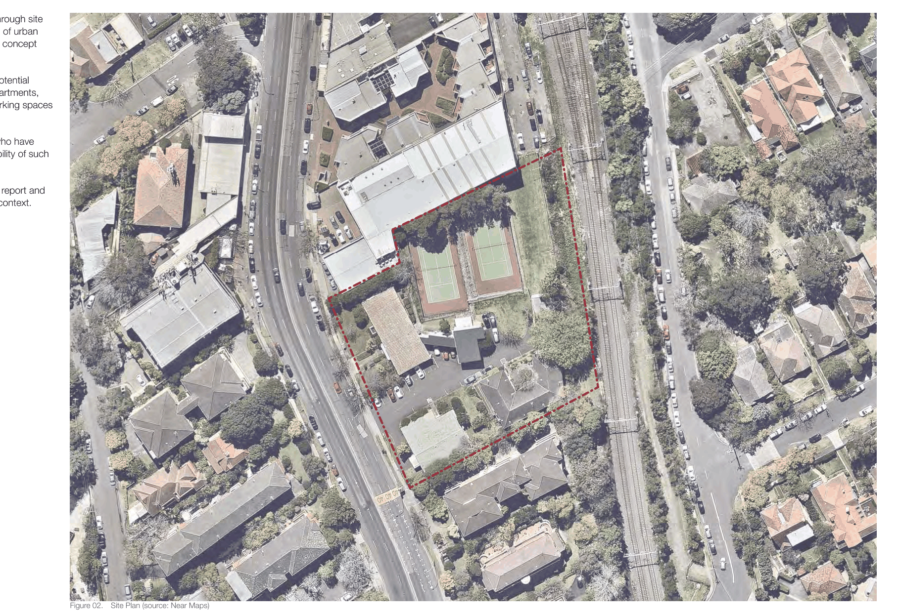

> [Picture on page 8: a picture, saved as a picture (images/part-14r-references-masterplan-page-8-17.gif, 150 dpi).]
> Words printed on the picture (title and legend, copied from the PDF):
> 400m
> Tryon Road
> Russell Avenue
> Tryon Place
> Beaconsfield Parade
> Lindfield
> Library Precinct
> - The Site
> Chemlsford Avenue
> Pacific Highway
> Gladstone Parade

Figure 02.	 Site Plan (source: Near Maps)

D      0.5

KENILWO

KENILWO

KENILWO ST

ST

ST

ST

ST

ST

AVE

AVE

AVE

12A

10A

12A

10A

12A

10A

RD

RD

RD

WHARF

WHARF

A2

J 2

PACIFIC

PACIFIC

PACIFIC

32A

32A

32A

J       0.8

469-475

469-475

469-475

NELSON

NELSON

NELSON

A2

J

A2

J

SMITH

SMITH

SMITH

L

2A

2A

2A

K      0.85

GRASSMERE

GRASSMERE

J

R2

7 8B

8B

TREATTS

TREATTS

8B

TREATTS

A2

8A

8A

8A

WOLSELEY

WOLSELEY

WOLSELEY

AVE

AVE

N      1.0

RD

ELEHAM

RD

ELEHAM

RD

ELEHAM

1A SLADE

1A S LA DE

ST REID

ST REID

ST REID

ELLSMORE

ELLSMORE

RE1

10 RD

RD

HIGHGATE

HIGHGATE

HIGHGATE

19-21

19-21

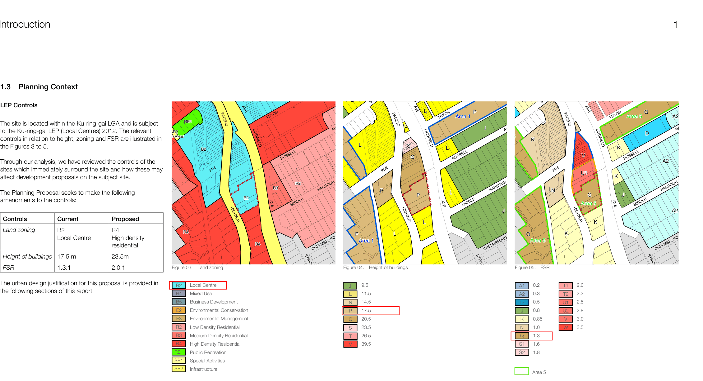

> [Picture on page 9: a map, saved as a picture (images/part-14r-references-masterplan-page-9-95.gif, 150 dpi); the street names and other small labels are on the picture.]
> Words printed on the picture (title and legend, copied from the PDF):
> Q      1.3 1
> 5-9 52 52A
> 23 (Howar d)
> 328 326 324
> 328 326 324
> 328 326 324 L
> 313 315 317
> 313 315 317
> 313 315 317
> This information is a representation of Ku-ring-gai Local
> Environmental Plan (Local Centres) 2012 as published
> in the NSW government Gazette on 25 January 2013 -
> No reliance is to be placed upon this Plan. For precise
> information reference should be made to the original
> Cadastre                      © Land & Property Management Authority
> 5 - 7
> 5 - 7
> 5 - 7
> 8 B4 Mixed Use
> B5 Business Development
> E3 Environmental Management
> 0 50 100 150 200 Metres 14
> R2 Low Density Residential
> Scale:                 @ A3
> R3 Medium Density Residential
> Projection: GDA 1994
> MGA Zone 56
> (210 - 214)
> (210 - 214)
> (210 - 214)
> High Density Residential
> Map identification number:
> SP1 Special Activities

Figure 03.	 Land zoning

Figure 04.	 Height of buildings

Figure 05.	 FSR

26.5

LIGHTCLIFF

LIGHTCLIFF

### Introduction

### 1

39.5

8

15

9

5A

7

11

17

ea 1

2

4

6

12

10

14

TRYON

40

36

38

34

ea 2

41

37

39

5

1A

3

35

29A

RD

8

21

23

25 27

34

29 31 33 35

### 1.3	 Planning Context

PROVINCIAL

38 40

4

2

28 30 32

36

42

RD

44

VALLE

3A

3

4

2

6

1A

1

#### LEP Controls

re                      © Land & Property Management Authority

30/01/2013

40

47A

6

8

1B

5

3

4

2

1

3

1

The site is located within the Ku-ring-gai LGA and is subject to the Ku-ring-gai LEP (Local Centres) 2012. The relevant controls in relation to height, zoning and FSR are illustrated in the Figures 3 to 5.

47C

55 32

3

30A

RD

59

ation is a representation of Ku-ring-gai Local

tal Plan (Local Centres) 2012 as published

government Gazette on 25 January 2013 -

is to be placed upon this Plan. For precise

reference should be made to the original

ion.

63

61

57

55

53

51

49

44

46

48

58

Through our analysis, we have reviewed the controls of the sites which immediately surround the site and how these may affect development proposals on the subject site.

62

60

50 52 54 56

33

35

31

5

44

46

The Planning Proposal seeks to make the following amendments to the controls:

| RD Controls 7 2 56 | Current 18 16 11 9 RD 2 7 | Proposed 29 27 |
|---|---|---|
| 4 Land BENT zoning 60 58 79 62 64 IVES 81 Height 66 of buildings 76 78A 68 85 FSR 78 87 80 | 14 5 6 B2 12 10 ST 6 3 1 Local Centre 8 6 8 4 2 10 IGNATIUS 12 32 17.5 m 37 22 38 1.3:1 43A 43 44 41 42 16 40 14 20 18 NORWOOD 16 43 41 26 | R4 35 33 BEACONSFIELD 31 24 22 20A High 28 density 1 27 residential 30 29 2 14 23.5m 37 35 POLDING 33 28A 31 18 5 16 4 39 20 2.0:1 22 23 24 |

42

MIDDL

18

15

9 11

17

19

9

11

21

6

8 23

27

31

29

AVE

ST

12

14

16

10

TURRAMURRA

25

27

18

RD

POLDING

1A

23

1B

PL

PYMBLE

9

1

2

KEL 14

16

4

6

BURRAGA 7

3

5

The urban design justification for this proposal is provided in the following sections of this report.

8 9

10

21

32

34 30 51

17

49 47 45

8

10

0 50 100 150 200 Metres

RD

WAIMEA

12

26

18

24

14

16

20

22

6

19

11

9

15

4

Scale:                 @ A3

1:5,500

94

RAW 2

3

5

number:

HOB_

LINDFIELD 7

7A

A2 1

9

11

#### 1.2.1   Zoning

#### 1.2.2    Height of Buildings

#### 1.2.3    FSR

The FSR control applicable to the site is 1.3, with a special clause for Area 5. It should be noted that this clause does not apply to the site as it is exceeds 2,400 m2.

Land zoning is identified as B2 Local Centre. This zoning applies to the land immediately to the north of the site. To the south of the site and to the west (on the opposite side of the Pacific Highway, R4 High Density Residential use is identified.

The permissible height of the subject site is 17.5 metres (5 storeys). Immediately to the north of the site a height control of 20.5 metres (6 metres) is permissible. To the south and the east, a height control of 11.5 metres is permissible (3 storeys).

To the north of the site, an FSR of 2.5 is applicable. To the south and the west, an FSR of 0.85 is applicable.

### Introduction

### 1.3   Planning Context

#### DCP Controls

The site is located within Lindfield Local Centre under Ku-ring-gai DCP 2012, identified on the adjacent figure. Within Volume B of the DCP, six urban precincts have been identified within the centre.  The site is located directly adjacent to

L3 -Tryon Place Mixed Use area, identified in Figure 06 to the right.  The future character of Tryon Place Mixed Use is described:

#### Precinct L3: Tryon Place Mixed Use Area

This precinct is located between the Pacific Highway and the railway corridor directly adjoining the entry forecourt of the Lindfield train station at Tryon Place. Currently the precinct is somewhat isolated from other parts of the centre by the highway and rail line.

v) The area is planned to become a mixed use precinct with retail and commercial uses on the lower floors and residential apartments on the upper floors. A high quality landmark building will define the corner of Tryon Place and the Pacific Highway. The area has a high visual prominence from the rail and road and is in an important location adjoining the rail station.

vi) A new network of lanes will be created through the redevelopment process. The lanes will provide improved vehicle and service access to the area. Tryon Place will be closed to traffic (upon the completion of the new lane system) and will become a vibrant and highly visible pedestrian square for community activities such as markets.

Key aspects of proposed upgrades include:

1\. Improvements to Tryon Lane with new footpaths and carparking;

2\. A new town square at Tryon Place to co-incide with its location to the station.

In addition to this, the Lindfield Transport Network Study 2014 proposes an extension of Tryon Lane through the subject site to connect with the Pacific Highway. This will enable enhanced circulation within the centre as a location for kiss-and-ride associated with the rail station.

The subject site, being located directly to the south of this precinct and located between R4 residential uses forms a key transition point along the Pacific Highway corridor and in relation to the station and has an important role within the centre.

#### Lindfield Local Centre Precincts

The precincts, as identified in the Ku-ring-gai DCP include:

1\. Balfour Street Retail Area

2\. Pacific Highway Retail Area

3\. Tryon Place Mixed Use Area

4\. Tryon Road and Lindfield Avenue

5\. Lindfield Community Hub

6\. Buildings in R4 Zones

#### Legend

Site

Lindfield Local Centre

Precincts (from Lindfield DCP)

Mixed Use Zone

Residential Zone

Walking catchment

Figure 06.	 Lindfield Local Centre

### 1

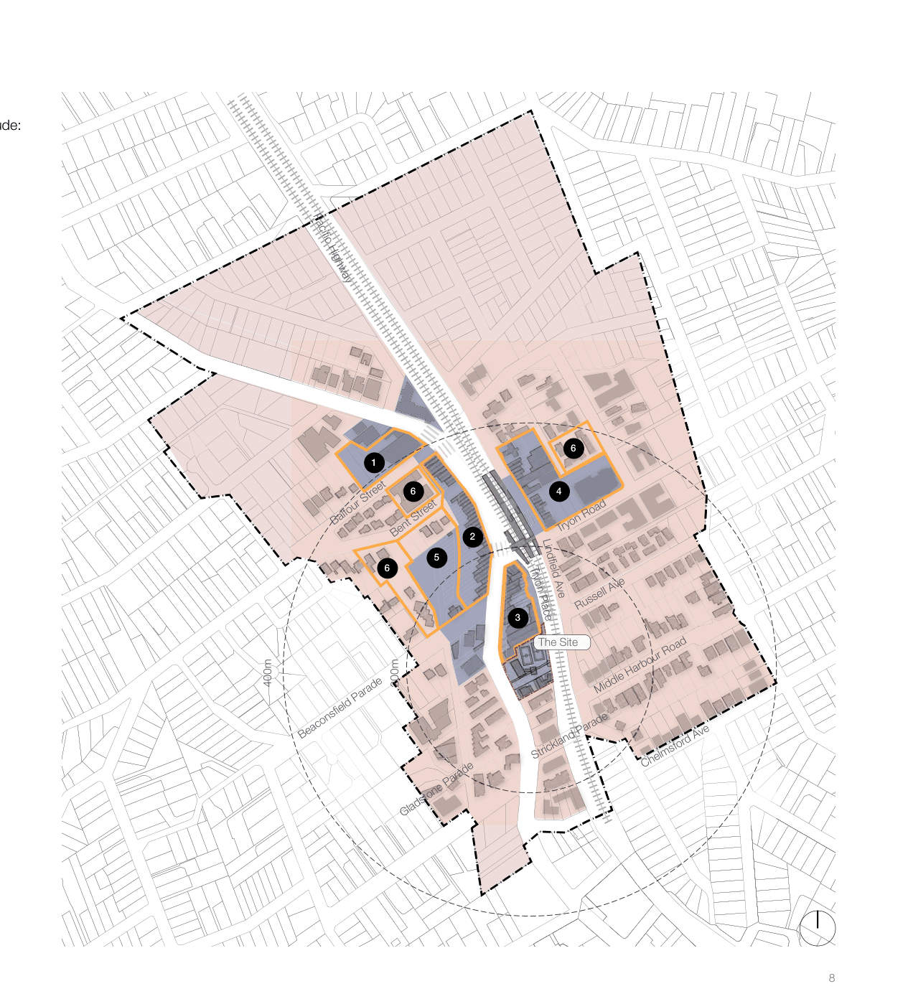

> [Picture on page 10: a map, saved as a picture (images/part-14r-references-masterplan-page-10-62.gif, 150 dpi); the street names and other small labels are on the picture.]
> Words printed on the picture (title and legend, copied from the PDF):
> Bent Street 2
> Middle Harbour Road

### Site Analysis

### 1.4	 Local Centre Context

The site is located within the Lindfield Local Centre at the block situated between the Pacific Highway and the railway line.

The site is highly accessible, situtated directly to the south of the mixed use commercial strip of the eastern side of the Pacific Highway and within 200 metres of the Lindfield Station.

Within the context of the local centre and surrounding uses, the site forms a key transition site with established community uses sitting between existing commercial and residential uses.

The proposed Lindfield Community Hub and the Village Green also form an integral part of this Local Centre.

Legend

Site

Commercial Frontage

Residential Frontage

Proposed Commercial Frontage

Proposed Residential Frontage\

Proposed Site Link

Arterial Road

Primary Road

Lindfield Local Centre

Rail Line

Pedestrian Link

Future Development

Possible Pedestrian Link

Train Station

#### T

Figure 07.	 Lindfield Local Centre

### 2

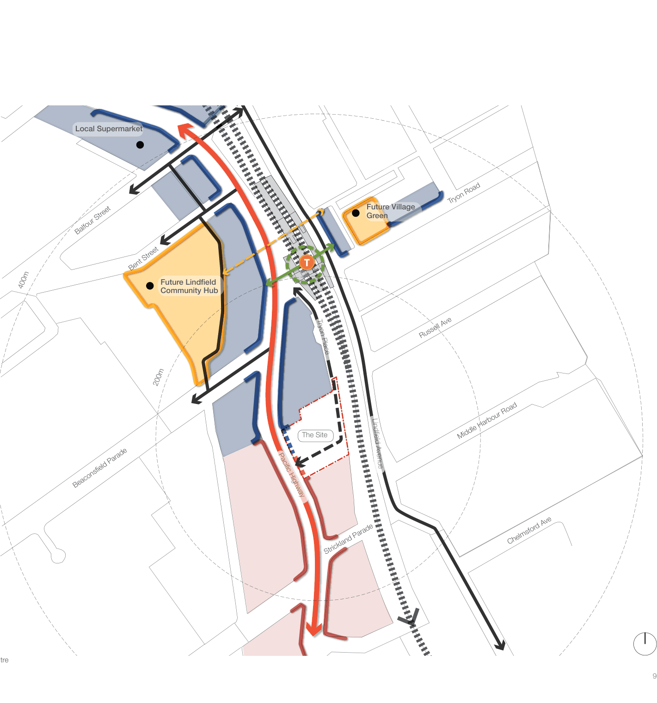

> [Picture on page 11: a map, saved as a picture (images/part-14r-references-masterplan-page-11-33.gif, 150 dpi); the street names and other small labels are on the picture.]
> Words printed on the picture (title and legend, copied from the PDF):
> Middle Harbour Road

#### T

### Site Analysis

### 1.5	 Regional Context

#### Hierarchy of Local Centres within Ku-ring-gai

Lindfield is one of eight suburbs which are located within Ku-ring-gai LGA and located along the main Pacfiic Highway and Railway corridor.

A clear hiearchy exists amongst each of the suburbs and its local centre, evident through growth over the decades. The centres as established can be grouped into broad categories based on the size and amenity offered by their local centre. Alongside this is a broad review of the permissible controls within the centres of each and how this does not always align with the size of the centre. This is analysed very broadly:

## 1. Largest Centres

Gordon:

FSR: 3.0:1, 2.5:1 and 2:0:1

Height: 23.5m, 26.5m and 39.5m

## 2. Mid size Centres

Turramurra:

FSR: 2.5:1

Height: 17.5m

Lindfield:

FSR: 3.0:1, 2.5:1and 1.3:1

Height: 26.5m, 23.5m and 20.5m

## 3. Small Centres

Pymble:

FSR:2.3:1 and 1.3:1

Height: 23.5m and 17.5m

Roseville:

FSR: up to 2:1

Height:up to 20.5m

Wahroonga:

FSR: 1:0:1

Height: 14.5m

## 4. Smallest suburbs

Killara: no local centre

FSR: 1:0:1

Height: 14.5m

Warrawee: no local centre

#### Legend

### 1

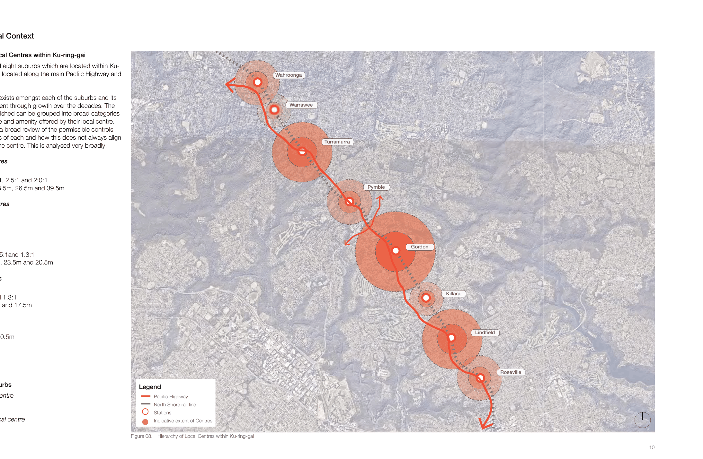

> [Picture on page 12: a map, saved as a picture (images/part-14r-references-masterplan-page-12-42.gif, 150 dpi); the street names and other small labels are on the picture.]
> Words printed on the picture (title and legend, copied from the PDF):
> North Shore rail line
> Indicative extent of Centres

Figure 08.	 Hierarchy of Local Centres within Ku-ring-gai

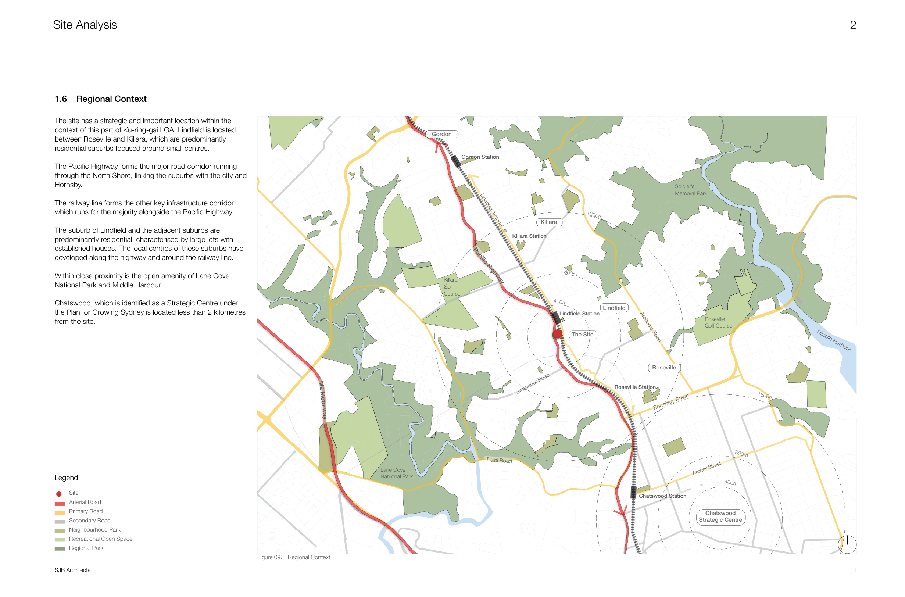

> [Picture on page 13: a map, saved as a picture (images/part-14r-references-masterplan-page-13-1.gif, 150 dpi); the street names and other small labels are on the picture.]
> Words printed on the picture (title and legend, copied from the PDF):
> Recreational Open Space

Figure 09.	 Regional Context

### Site Analysis

### 1.6	 Regional Context

The site has a strategic and important location within the context of this part of Ku-ring-gai LGA. Lindfield is located between Roseville and Killara, which are predominantly residential suburbs focused around small centres.

The Pacific Highway forms the major road corridor running through the North Shore, linking the suburbs with the city and Hornsby.

The railway line forms the other key infrastructure corridor which runs for the majority alongside the Pacific Highway.

The suburb of Lindfield and the adjacent suburbs are predominantly residential, characterised by large lots with established houses. The local centres of these suburbs have developed along the highway and around the railway line.

Within close proximity is the open amenity of Lane Cove National Park and Middle Harbour.

Chatswood, which is identified as a Strategic Centre under the Plan for Growing Sydney is located less than 2 kilometres from the site.

### 2

### Site Analysis

Exploring the existing urban conditions and

### contexts, to assist in developing an appropriate urban response.

### 2

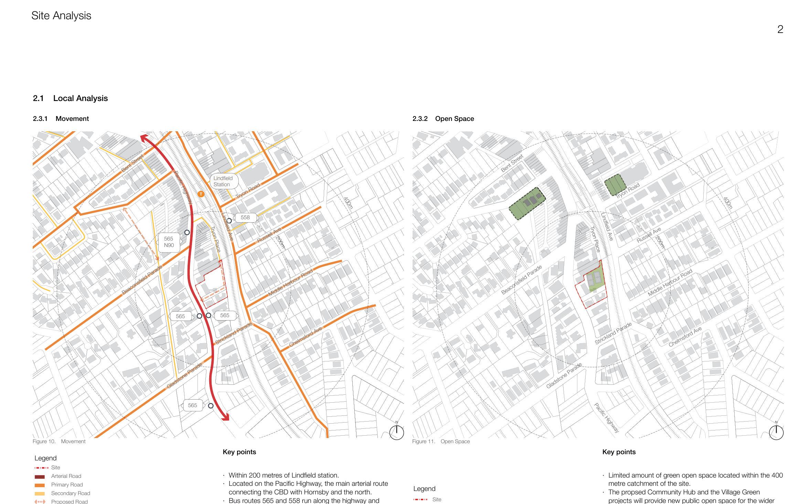

> [Picture on page 15: a map, saved as a picture (images/part-14r-references-masterplan-page-15-1.gif, 150 dpi); the street names and other small labels are on the picture.]
> Words printed on the picture (title and legend, copied from the PDF):
> Middle Harbour Road
> Middle Harbour Road

Figure 10.	 Movement

Figure 11.	 Open Space

### Site Analysis

### 2.1	 Local Analysis

#### 2.3.1    Movement

Bus stop

#### T

Train station

#### Key points

·· Within 200 metres of Lindfield station. ·· Located on the Pacific Highway, the main arterial route connecting the CBD with Hornsby and the north. ·· Bus routes 565 and 558 run along the highway and Lindfield Avenue connecting Lindfield with Chatswood, UTS Lindfield, Macquarie Centre and Macquarie University.

#### 2.3.2    Open Space

Recreational Space Future Recreational Space

### 2

#### Key points

·· Limited amount of green open space located within the 400 metre catchment of the site. ·· The propsed Community Hub and the Village Green projects will provide new public open space for the wider Lindfield community.

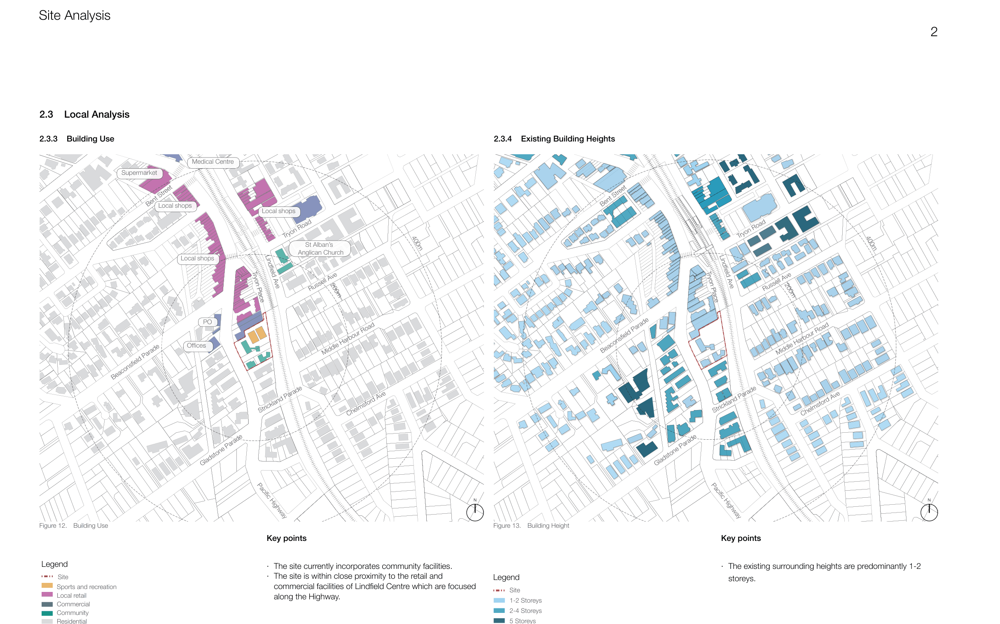

> [Picture on page 16: a map, saved as a picture (images/part-14r-references-masterplan-page-16-1.gif, 150 dpi); the street names and other small labels are on the picture.]
> Words printed on the picture (title and legend, copied from the PDF):
> Sports and recreation
> Middle Harbour Road
> Middle Harbour Road

Figure 12.	 Building Use

Figure 13.	 Building Height

### 2.3    Local Analysis

#### 2.3.3    Building Use

#### Key points

·· The site currently incorporates community facilities. ·· The site is within close proximity to the retail and commercial facilities of Lindfield Centre which are focused along the Highway.

#### 2.3.4    Existing Building Heights

### 2

#### Key points

·· The existing surrounding heights are predominantly 1-2

### Site Analysis

### 2.2	 Site Characteristics

The site has a total area of 5,848.6m2. and is bounded by an existing car showroom to the north (289-293 Pacific Highway), the North Shore rail line to the east, a residential flat buildng to the south at 257 and the Pacific Highway to the west.

The key site characteristics are identified on the following page.

Site

Legend

Figure 14.	 Regional Context

Pacific Highway

### 2

Lindfield Avenue

N

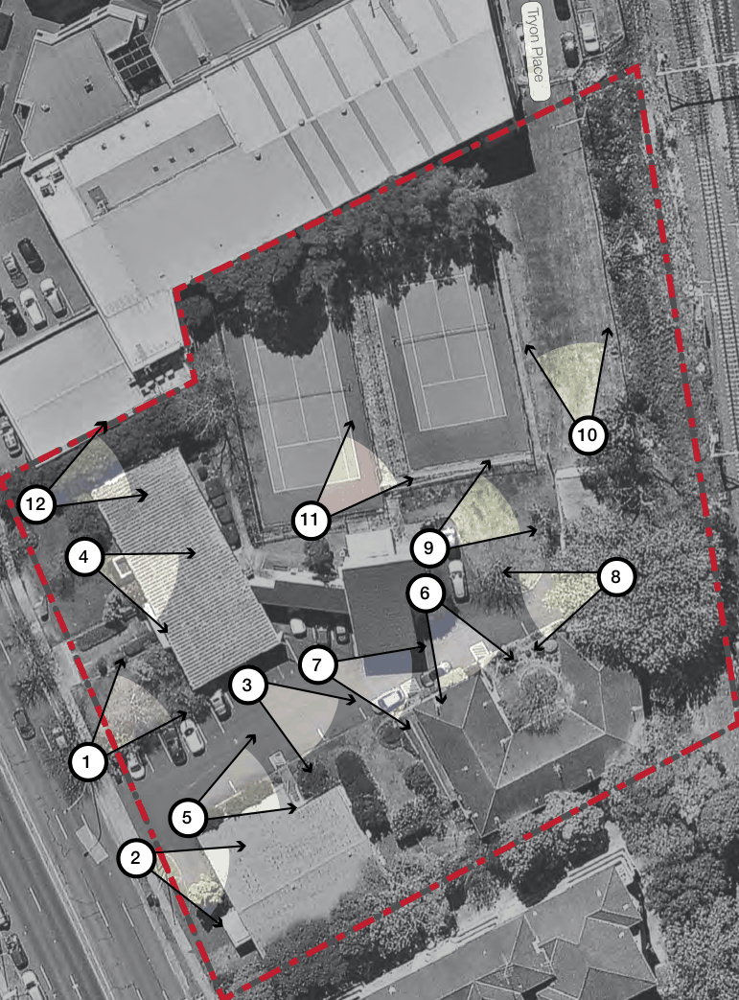

> [Picture on page 17: a map, saved as a picture (images/part-14r-references-masterplan-page-17-17.gif, 150 dpi); the street names and other small labels are on the picture.]

### Site Analysis

### 2.4    Site Characteristics

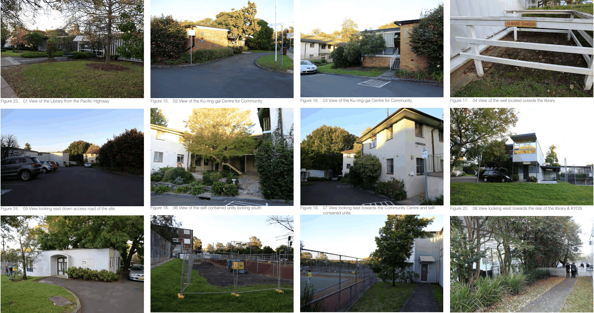

> [Picture on page 18: a picture, saved as a picture (images/part-14r-references-masterplan-page-18-3.gif, 150 dpi).]

Figure 23.	 01 View of the Library from the Pacific Highway

Figure 24.	 05 View looking east down access road of the site

Figure 25.	 09 View of the Community Centre looking east

Figure 15.	 02 View of the Ku-ring-gai Centre for Community

Figure 18.	 06 View of the self-contained units looking south

Figure 21.	 10 View looking north towards Tryon Place

Figure 16.	 03 View of the Ku-ring-gai Centre for Community

Figure 19.	 07 View looking east towards the Community Centre and self-contained units

Figure 26.	 11 Looking east towards tennis courts

### 2

Figure 17.	 04 View of the well located outside the library

Figure 20.	 08 View looking west towards the rear of the library & KYOS

Figure 22.	 12 View along northern boundary

### Site Analysis

### 2.3	 Context Characteristics

The following page provides an indication of the character

of the surrounding area of Lindfield Local centre and the

adjacent sites.

Legend

Site

### 2

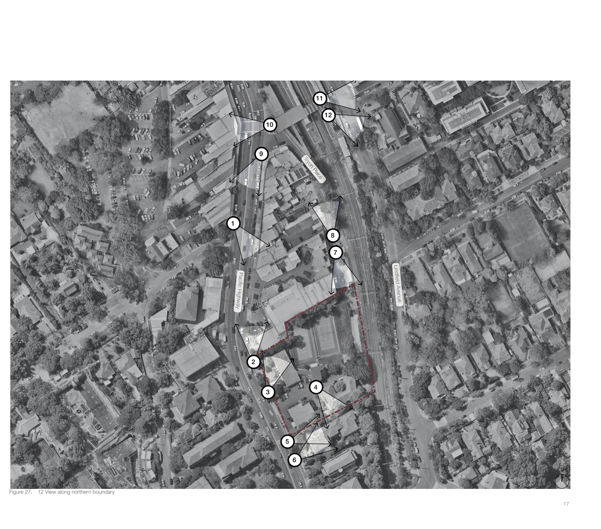

> [Picture on page 19: a map, saved as a picture (images/part-14r-references-masterplan-page-19-9.gif, 150 dpi); the street names and other small labels are on the picture.]

Figure 27.	 12 View along northern boundary

### Site Analysis

### 2.5    Surrounding Context

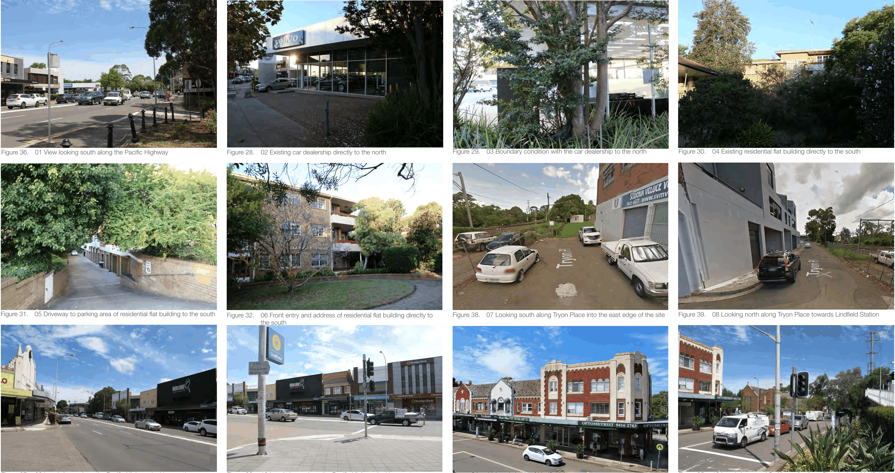

> [Picture on page 20: a picture, saved as a picture (images/part-14r-references-masterplan-page-20-3.gif, 150 dpi).]
> Words printed on the picture (title and legend, copied from the PDF):
> Text

Figure 36.	 01 View looking south along the Pacific Highway

Figure 31.	 05 Driveway to parking area of residential flat building to the south

Figure 37.	 09 Local shops along the Pacific Highway looking south

Figure 28.	 02 Existing car dealership directly to the north

Figure 32.	 06 Front entry and address of residential flat building directly to the south

Figure 33.	 10 Local shops along the Pacific Highway looking west

Figure 29.	 03 Boundary condition with the car dealership to the north

Figure 38.	 07 Looking south along Tryon Place into the east edge of the site

Figure 34.	 11 Local shops of Lindfield Avenue

### 2

Figure 30.	 04 Existing residential flat building directly to the south

Figure 39.	 08 Looking north along Tryon Place towards Lindfield Station

Figure 35.	 12 Local shops and St Albans Anglican Church along Lindfield Avenue

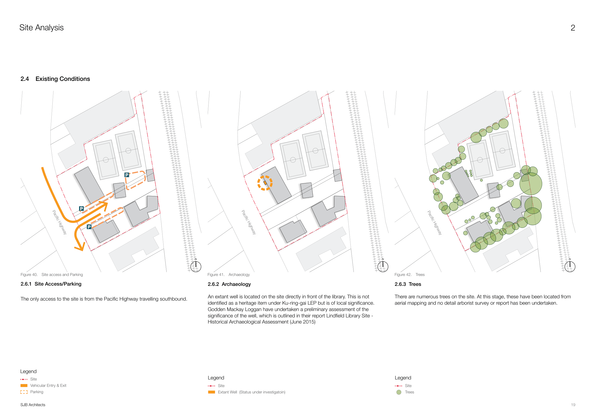

> [Picture on page 21: a map, saved as a picture (images/part-14r-references-masterplan-page-21-1.gif, 150 dpi); the street names and other small labels are on the picture.]
> Words printed on the picture (title and legend, copied from the PDF):
> Vehicular Entry & Exit
> Extant Well  (Status under investigatoin)

Figure 40.	 Site access and Parking

Figure 41.	 Archaeology

Figure 42.	 Trees

### Site Analysis

### 2.4	 Existing Conditions

#### 2.6.1  Site Access/Parking

The only access to the site is from the Pacific Highway travelling southbound.

#### 2.6.2  Archaeology

An extant well is located on the site directly in front of the library. This is not identified as a heritage item under Ku-ring-gai LEP but is of local significance. Godden Mackay Loggan have undertaken a preliminary assessment of the significance of the well, which is outlined in their report Lindfield Library Site - Historical Archaeological Assessment (June 2015)

### 2

#### 2.6.3  Trees

There are numerous trees on the site. At this stage, these have been located from aerial mapping and no detail arborist survey or report has been undertaken.

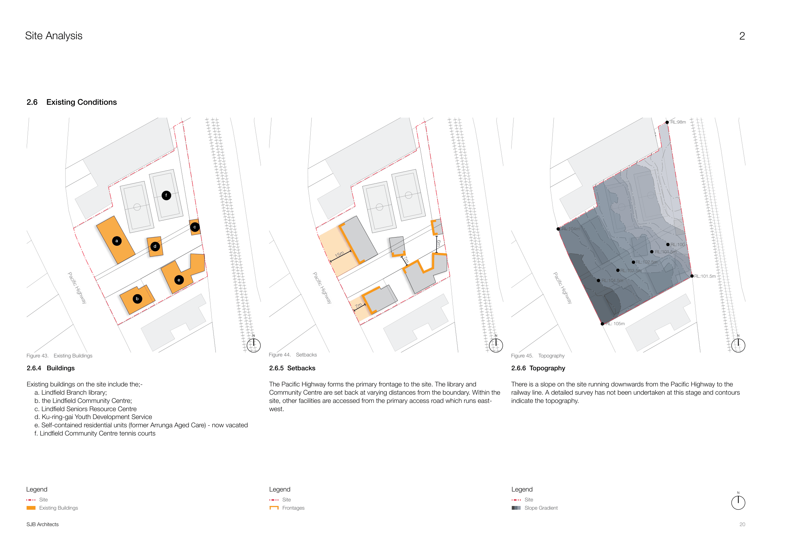

> [Picture on page 22: a map, saved as a picture (images/part-14r-references-masterplan-page-22-1.gif, 150 dpi); the street names and other small labels are on the picture.]

Figure 43.	 Existing Buildings

Figure 44.	 Setbacks

Figure 45.	 Topography

### Site Analysis

### 2.6    Existing Conditions

#### 2.6.4   Buildings

Existing buildings on the site include the;-

a. Lindfield Branch library;

b. the Lindfield Community Centre;

c. Lindfield Seniors Resource Centre

d. Ku-ring-gai Youth Development Service

e. Self-contained residential units (former Arrunga Aged Care) - now vacated

f. Lindfield Community Centre tennis courts

#### 2.6.5  Setbacks

The Pacific Highway forms the primary frontage to the site. The library and Community Centre are set back at varying distances from the boundary. Within the site, other facilities are accessed from the primary access road which runs east-west.

#### 2.6.6  Topography

### 2

There is a slope on the site running downwards from the Pacific Highway to the railway line. A detailed survey has not been undertaken at this stage and contours indicate the topography.

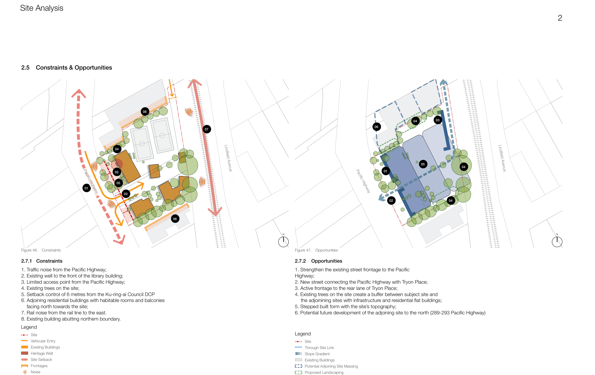

> [Picture on page 23: a map, saved as a picture (images/part-14r-references-masterplan-page-23-1.gif, 150 dpi); the street names and other small labels are on the picture.]
> Words printed on the picture (title and legend, copied from the PDF):
> Through Site Link
> Potential Adjoining Site Massing

Figure 46.	 Constraints

Figure 47.	 Opportunities

### 2.5	 Constraints & Opportunities

#### 2.7.1   Constraints

1\. Traffic noise from the Pacific Highway;

2\. Existing well to the front of the library building;

3\. Limited access point from the Pacific Highway;

4\. Existing trees on the site;

5\. Setback control of 6 metres from the Ku-ring-ai Council DCP

6\. Adjoining residential buildings with habitable rooms and balconies facing north towards the site;

7\. Rail noise from the rail line to the east.

8\. Existing building abutting northern boundary.

Legend

### 2

#### 2.7.2    Opportunities

1\. Strengthen the existing street frontage to the Pacific

Highway;

2\. New street connecting the Pacific Highway with Tryon Place;

3\. Active frontage to the rear lane of Tryon Place;

4\. Existing trees on the site create a buffer between subject site and

the adjoinining sites with infrastructure and residential flat buildings;

5\. Stepped built form with the site’s topography;

6\. Potential future development of the adjoining site to the north (289-293 Pacific Highway)

Frontage

### Urban Design

### Concepts

### Design principles, response and a concept master- plan for the site.

### 3

### Urban Design Concepts

### 3.1	 Urban Design Principles

The following design principles provide the basis for the concept design and the evolution of the masterplan options. We will revisit these principles throughout the design process to ensure thery are reflected in the outcomes.

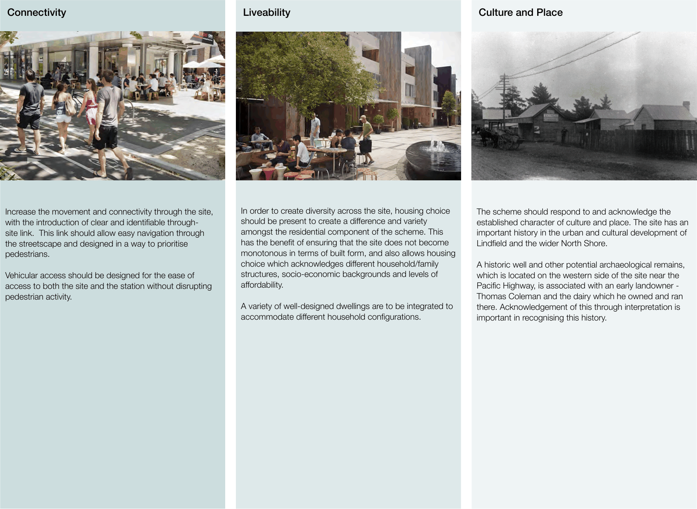

> [Picture on page 25: a picture, saved as a picture (images/part-14r-references-masterplan-page-25-7.gif, 150 dpi).]

#### Connectivity

Increase the movement and connectivity through the site, with the introduction of clear and identifiable through-site link.  This link should allow easy navigation through the streetscape and designed in a way to prioritise pedestrians.

Vehicular access should be designed for the ease of access to both the site and the station without disrupting pedestrian activity.

#### Liveability

In order to create diversity across the site, housing choice should be present to create a difference and variety amongst the residential component of the scheme. This has the benefit of ensuring that the site does not become monotonous in terms of built form, and also allows housing choice which acknowledges different household/family structures, socio-economic backgrounds and levels of affordability.

A variety of well-designed dwellings are to be integrated to accommodate different household configurations.

### 3

#### Culture and Place

The scheme should respond to and acknowledge the established character of culture and place. The site has an important history in the urban and cultural development of Lindfield and the wider North Shore.

A historic well and other potential archaeological remains, which is located on the western side of the site near the Pacific Highway, is associated with an early landowner - Thomas Coleman and the dairy which he owned and ran there. Acknowledgement of this through interpretation is important in recognising this history.

### Urban Design Concepts

### 3.1	 Urban Design Principles

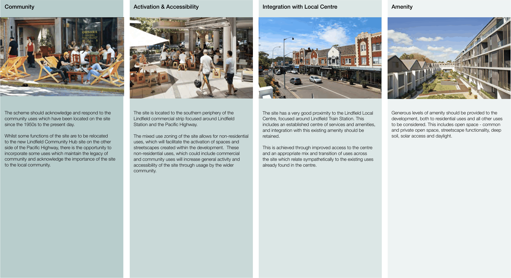

> [Picture on page 26: a picture, saved as a picture (images/part-14r-references-masterplan-page-26-3.gif, 150 dpi).]

#### Community

The scheme should acknowledge and respond to the community uses which have been located on the site since the 1950s to the present day.

Whilst some functions of the site are to be relocated to the new Lindfield Community Hub site on the other side of the Pacific Highway, there is the opportunity to incorporate some uses which maintain the legacy of community and acknowledge the importance of the site to the local community.

#### Activation & Accessibility

The site is located to the southern periphery of the Lindfield commercial strip focused around Lindfield Station and the Pacific Highway.

The mixed use zoning of the site allows for non-residential uses, which will facilitate the activation of spaces and streetscapes created within the development.  These non-residential uses, which could include commercial and community uses will increase general activity and accessibility of the site through usage by the wider community.

#### Integration with Local Centre

The site has a very good proximity to the Lindfield Local Centre, focused around Lindfield Train Station. This includes an established centre of services and amenities, and integration with this existing amenity should be retained.

This is achieved through improved access to the centre and an appropriate mix and transition of uses across the site which relate sympathetically to the existing uses already found in the centre.

### 3

#### Amenity

Generous levels of amenity should be provided to the development, both to residential uses and all other uses to be considered. This includes open space - common and private open space, streetscape functionality, deep soil, solar access and daylight.

### Urban Design Concepts

### 3.2	 Urban Design Response

#### Building Uses

Figure 48.	 Building Uses

Mixed uses are located to the north of the site responding to the Local Centre function, which include commercial and retail uses. Purely residential uses are located to the south of the site.

Legend

Site

Commercial

Mixed Use

Residential

#### Urban Grain

Figure 49.	 Urban grain

The existing urban grain of the site and its surrounding context reflects the range of land uses.

The site’s response is to provide a transition in grain between the two -incorporating larger footprints which are articulated through their architecture to provide a transition between the traditional fine grain of the centre and the existing residential to the south.

Legend

Site

Existing Building Footprint

Proposed Building Footprint

### 3

#### Building Height

Figure 50.	 Height

Building heights to the north of the site have traditionally been low rise shop-fronts. The aspiration to increase height with a maximum height of 23.5 metres (7 storeys) reflects the importance of the Local Centre, the proximity to the station, and the benefit of increasing density within transport and local centre catchments. Variation in building height is desireable throughout this precinct and may be pursued by a DCP control for the 6 storeys (20.5 metres) along the Pacific Highway

To the south, the heights are predominantly to be retained at a maximum of 11.5 metres (3 storeys).

The design response is to provide heights which sit between these proposed maximum and minimum of the block.

Legend

Site

6-7 Storey

3 Storey

### Urban Design Concepts

### 3

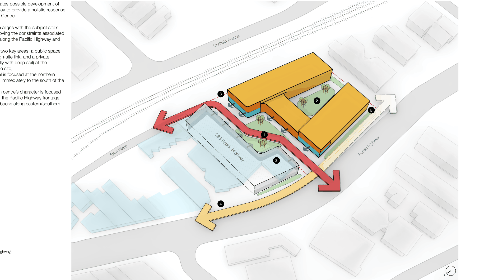

> [Picture on page 28: a picture, saved as a picture (images/part-14r-references-masterplan-page-28-3.gif, 150 dpi).]
> Words printed on the picture (title and legend, copied from the PDF):
> Lindfield Avenue
> 3
> 2
> 5
> 1
> Pacific Highway
> Tryon Place
> 283 Pacific Highway
> 3
> 4
> N

### 3.3	 Masterplan Concept

The following concept integrates possible development of the site at 283 Pacific Highway to provide a holistic response to this part of Lindfield Local Centre.

1\.	 Through-site connection aligns with the subject site’s northern boundary, removing the constraints associated with building interfaces along the Pacific Highway and Tryon Place frontages;

2\.	 Open space is split into two key areas; a public space that straddles the through-site link, and a private amenity space (potentially with deep soil) at the southern boundary of the site;

3\.	 Ground floor commercial is focused at the northern edge of the subject site, immediately to the south of the through-site link;

4\.	 Integration with the town centre’s character is focused at the northern extent of the Pacific Highway frontage;

5\.	 Deep soil landscape setbacks along eastern/southern boundaries.

Legend

Site Residential Commercial Adjoining Site (283 Pacific Highway) Frontage Open Space Through-Site Link Local Centre Frontage

Figure 51.	 Concept Diagram

### Urban Design Concepts

### 3.4	 Masterplan Parameters

#### Activity and Connection

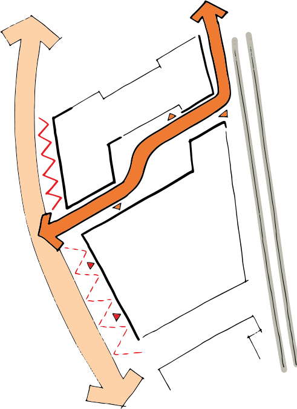

> [Picture on page 29: a picture, saved as a picture (images/part-14r-references-masterplan-page-29-4.gif, 150 dpi).]

Figure 52.	 Connections and Activation

The through-site link aligns with the site’s northern boundary, weaving through a public open space towards Tryon Place. Activation of the Pacific Highway frontage can be limited to the adjoining property (no. 283). Pedestrian access to the buildings is taken from the Pacific Highway frontage and from the through-site link.

#### Open Space

Figure 53.	 Open Spaces

The realignment of the through-site link removes the potential conflicts of the building interfaces between the subject site and neighbouring 283 Pacific Highway.

The setback to the Pacific Highway frontage is a minimum of 6 metres adjacent to the town centre  and increasing to 10 metres at the southern boundary in response to the surrounding residential grain. A minimum of 6 metres along the southern boundary allows for deep soil landscaping.

Building separation distances align with the requirement of the Council’s DCP.

### 3

#### Built Form

Figure 54.	 Built Form

A range of building lengths and depths are proposed in order to achieve the desired   urban, amenity and development outcomes. The 22 metre blocks allows for double-loaded corridors and apartments that orientate to all frontages. The 18 metre deep blocks assume a single aspect apartment layout, typically oriented to maximise residential amenity.

### Urban Design Concepts

### 3

### 3.5	 Visualisation

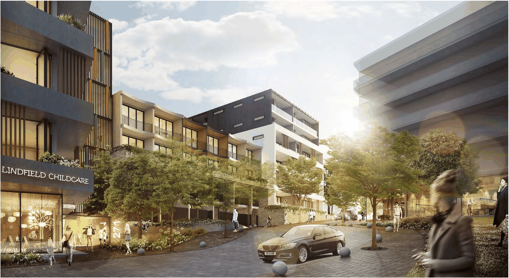

> [Picture on page 30: a picture, saved as a picture (images/part-14r-references-masterplan-page-30-4.gif, 150 dpi).]

Figure 55.	 Illustrative view of the proposed new street

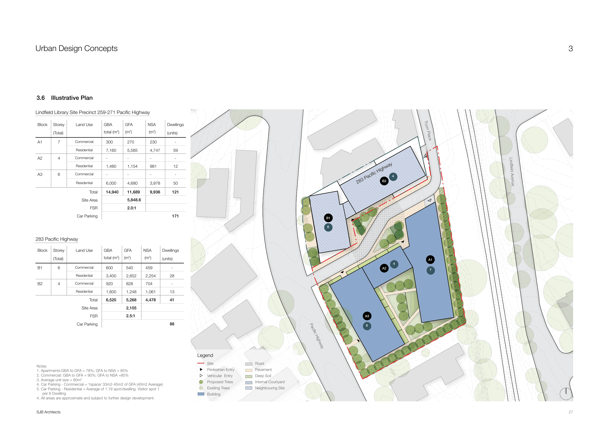

> [Picture on page 31: a map, saved as a picture (images/part-14r-references-masterplan-page-31-1.gif, 150 dpi); the street names and other small labels are on the picture.]
> Words printed on the picture (title and legend, copied from the PDF):
> 283 Pacific Highway
> GFA NSA Dwellings
> (m2) (m2) (units)
> 270 230 -
> 5,585 4,747 59
> 1,154 981 12
> 4,680 3,978 50
> 11,689 9,936 121
> GFA NSA Dwellings
> (m2) (m2) (units)
> 540 459 -
> 2,652 2,254 28
> 828 704 -
> 1,248 1,061 13
> 5,268 4,478 41
> 1\. Apartments:GBA to GFA = 78%; GFA to NSA = 85%
> 2\. Commercial: GBA to GFA = 90%; GFA to NSA =85%
> 3\. Average unit size = 80m2
> 4\. Car Parking - Commercial = 1space/ 33m2-45m2 of GFA (40m2 Average)
> 5\. Car Parking - Residential = Average of 1.19 spot/dwelling. Visitor spot 1
> per 6 Dwelling
> 4\. All areas are approximate and subject to further design development.
> 283 Pacific Highway

### Urban Design Concepts

### 3.6	 Illustrative Plan

Lindfield Library Site Precinct 259-271 Pacific Highway

### 3

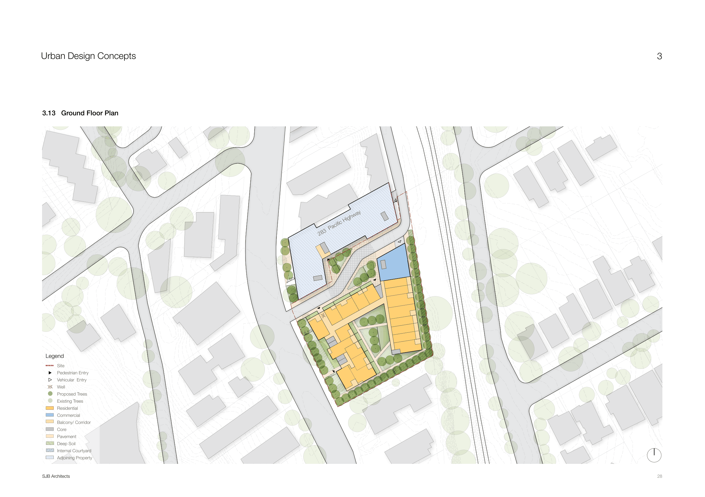

> [Picture on page 32: a map, saved as a picture (images/part-14r-references-masterplan-page-32-1.gif, 150 dpi); the street names and other small labels are on the picture.]
> Words printed on the picture (title and legend, copied from the PDF):
> 283  Pacific Highway
> Middle Harbour Road

### Urban Design Concepts

### 3.13   Ground Floor Plan

### 3

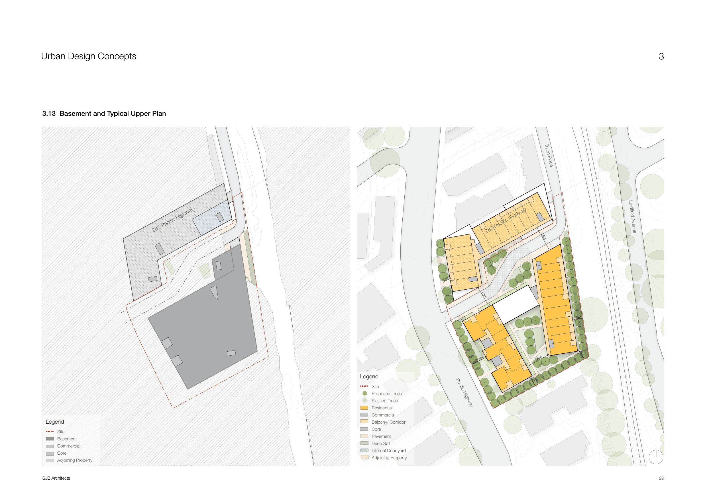

> [Picture on page 33: a map, saved as a picture (images/part-14r-references-masterplan-page-33-1.gif, 150 dpi); the street names and other small labels are on the picture.]
> Words printed on the picture (title and legend, copied from the PDF):
> 283 Pacific Highway
> 283 Pacific Highway

### Urban Design Concepts

### 3.13  Basement and Typical Upper Plan

### 3

### Urban Design Concepts

### 3.7	 Massing

### 3

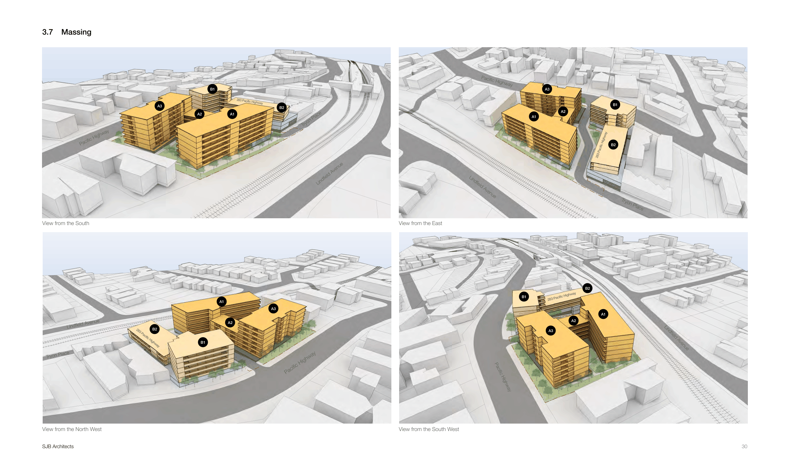

> [Picture on page 34: a map, saved as a picture (images/part-14r-references-masterplan-page-34-4.gif, 150 dpi); the street names and other small labels are on the picture.]
> Words printed on the picture (title and legend, copied from the PDF):
> View from the South
> View from the North West
> 283 Pacific Highway
> 283 Pacific Highway
> View from the East
> View from the South West
> 283 Pacific Highway
> 283 Pacific Highway

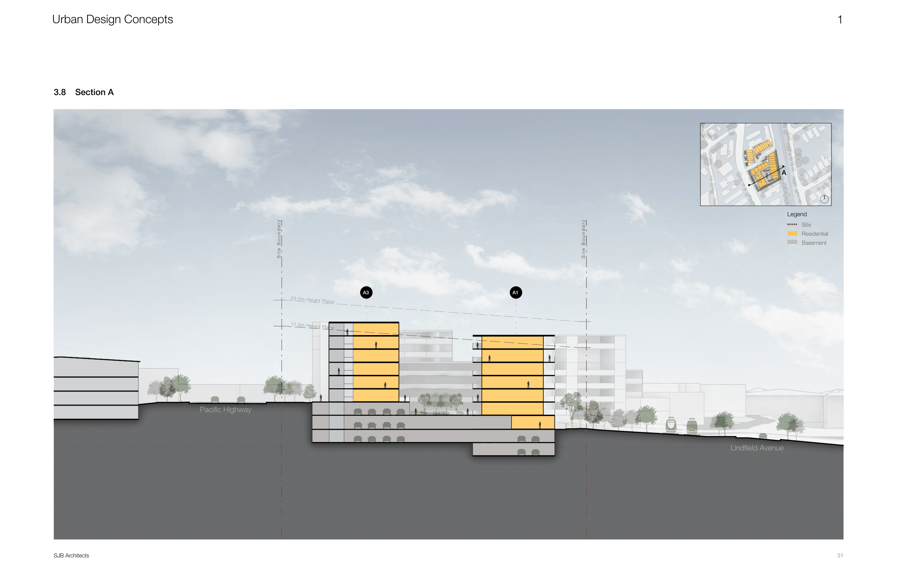

> [Picture on page 35: a map, saved as a picture (images/part-14r-references-masterplan-page-35-1.gif, 150 dpi); the street names and other small labels are on the picture.]
> Words printed on the picture (title and legend, copied from the PDF):
> S i t e B o u n d a r y
> 23.5m Height Plane
> 17.5m Height Plane
> S i t e B o u n d a r y

### Urban Design Concepts

### 3.8	 Section A

### 1

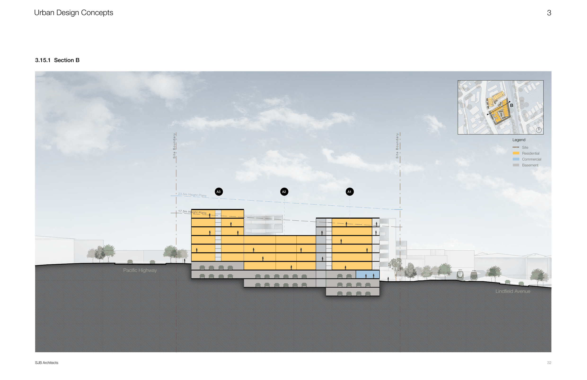

> [Picture on page 36: a map, saved as a picture (images/part-14r-references-masterplan-page-36-1.gif, 150 dpi); the street names and other small labels are on the picture.]
> Words printed on the picture (title and legend, copied from the PDF):
> S i t e B o u n d a r y
> 23.5m Height Plane
> 17.5m Height Plane
> S i t e B o u n d a r y

### Urban Design Concepts

#### 3.15.1  Section B

### 3

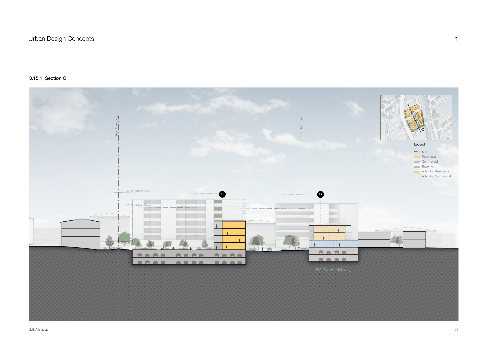

> [Picture on page 37: a map, saved as a picture (images/part-14r-references-masterplan-page-37-1.gif, 150 dpi); the street names and other small labels are on the picture.]
> Words printed on the picture (title and legend, copied from the PDF):
> S i t e B o u n d a r y
> 23.5m Height Plane
> 17.5m Height Plane
> S i t e B o u n d a r y
> 283 Pacific Highway

### Urban Design Concepts

#### 3.15.1  Section C

### 1

### Urban Design Concepts

### 3.9	 Shadow Analysis

21 June - 9 am

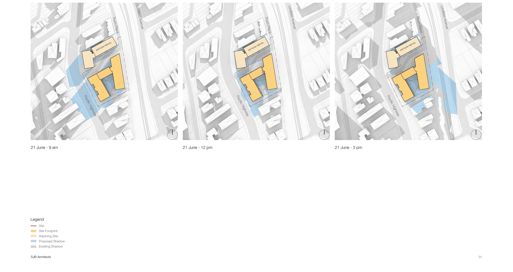

> [Picture on page 38: a picture, saved as a picture (images/part-14r-references-masterplan-page-38-4.gif, 150 dpi).]
> Words printed on the picture (title and legend, copied from the PDF):
> Legend
> Site
> Site Footprint
> 283 Pacific Highway
> Adjoining Site
> Proposed Shadow
> Exisiting Shadow

21 June - 12 pm

21 June - 3 pm

### 3

> Words printed on the picture (title and legend, copied from the PDF):
> 283 Pacific Highway
> 283 Pacific Highway
> 283 Pacific Highway

### Conclusion

A conclusion and recommendation in response to

### the site.

### 4

### Conclusion

### 4.1	 Conclusion

Based on the urban analysis undertaken, this Urban Design report presents a concept masterplan for the site based on the following key parameters:

·· Predominantly residential uses and the inclusion of a childcare centre which contributes commercial and community uses to the site; ·· A range of heights with a maximum height of 23.5 metres; ·· A maximum FSR of 2:1.

In addition, a new one-way street is proposed which is to extend from Tryon Place to the east to the Pacific Highway to the west.

The proposed changes to the LEP as outlined in the report and detailed in the Planning Proposal are considered appropriate and are outlined below:

#### Changes to Height and FSR

The site is located within 200 metres of Lindfield station and one of the key precincts of centre (Tryon Place Precinct). This proximity to transport and local centre amenity warrants an increase in population, which will be generated from the increase height to support higher densities living near these facilities. The inclusion of a new street to form part of improved connections to the stations, also further supports this argument.

The site is located on a block that incorporates a range of heights which respond to the Local Centre location and character. At the northern end of the block, closest to the station, the proposed maximum height is 23.5 metres (7 storeys), which forms a key gateway site. This height is proposed to the extend through to the subject site. To the south of the site, the height control is 11.5 metres (3 storeys). Therefore the site has a role to play in providing transition from the local centre to the residential areas to the south. . The proposed heights on the site have been organised in a way to take advantage of the topography and ensure impacts to the residential dwellings to the south are mitigated.

#### Changes to Land Use

The site is located within a transition zone. Mixed uses, including retail and commercial uses are located to the north of the site within the Tryon Place precinct, which fall under the B2 Local centre zoning. To the south of the site, full residential uses are incorporated under R4 high density residential use.  The site has had community uses on it since the early 1960s, which has supported the has a transitioning role between land uses to the north and south.

The current zoning of the site is B2 Local Centre, which suggests an alignment with the patterns of development occurring directly to the north. However, the site is located on the edge of an exisitng mixed centre and is located just outside of the identified Tryon Place precinct.

### 4

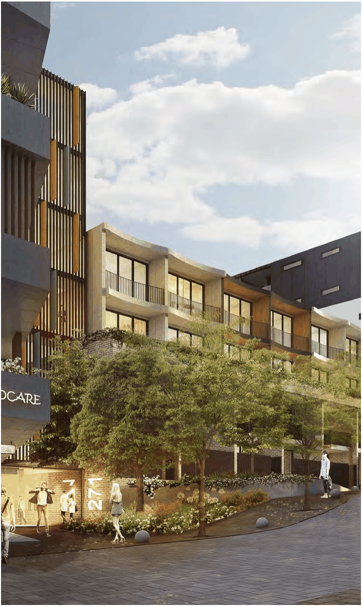

> [Picture on page 40: a picture, saved as a picture (images/part-14r-references-masterplan-page-40-41.gif, 150 dpi).]

The B2 zoning permits commercial, community and retail uses along with shop-

top housing, and whilst the aspiration to incorporate these uses is intended and

supported, the economic reality of providing a large amount of non-residential uses

to the ground floor of development at this edge of centre location is questioned.

The existing community use of the library is to be relocated to the other side of

the Pacific Highway within the new Lindfield Community Hub project.  Along with

community uses, this project incorporates retail, commercial residential uses.

Detailed analysis of the market for Lindfield reveavls that the subject site will not be

able to support commercial uses which will be able to function independenlty of

those new uses proposed on the Lindfield Community Hub project.

With this in mind, the project team has limited the amount of the non-residential

uses on the site to respond to this advice. There is a high demand for childcare

facilities in the area, on both sides of Lindfield Local Centre, and for this reason, a

childcare facility has been proposed to be located within the scheme. It is located

on the new street near Tryon Place and is considered to be an appropriate location

close to the proposed kiss n’ride route for the station.

#### Recommendation

In conclusion, based on the analysis and argument presented, this Urban Design

Study supports the Planning Proposal with the following changes to Ku-ring-gai

LEP 2012.

| Controls | Current | Proposed |
|---|---|---|
| Land zoning | B2 Local Centre | R4 High density residential |
| Height of buildings | 17.5 m | 23.5m |
| FSR | 1.3:1 | 2.0:1 |

### Appendix

### Study of projects that feature similar characteristics to those outlined in the masterplan options

### A

### Appendix
