#### 14R  References

#### 14R.2 Turramurra Community Hub Masterplan

### REFERENCES - TURRAMURRA COMMUNITY  HUB MASTERPLAN

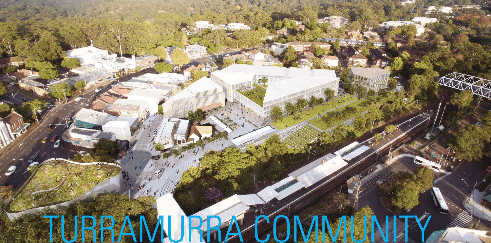

> [Picture on page 47: a picture, saved as a picture (images/part-14r-references-masterplan-page-47-1.gif, 150 dpi).]

### TURRAMURRA COMMUNITY

### HUB MASTERPLAN

NOVEMBER 2016

### DESIGN  STATEMENT

### CONTENTS

PAGE SECTION

5 1.0 DESIGN STATEMENT

6 2.0 THE SITE AND ITS SURROUNDS

8 3.0 DESIGN PRINCIPLES

10 4.0 ARTIST'S IMPRESSION

12 5.0 DESIGN CONCEPTS

15 6.0 LANDSCAPE MASTERPLAN

16 7.0 KEY SPACES

20 8.0 SITE SECTIONS

26 9.0 ARTIST'S IMPRESSIONS

APPENDIX A - ARCHITECTURAL DRAWINGS

The 12,300sqm Ray Street Precinct makes up roughly one fourth of the combined Turramurra Local Centre. The triangular site is the result of an orthogonally organised village centre that was at one point divided on a 45 degree angle by the North Shore rail line corridor. The site, however, abounds in assets. A train station, bus interchange, parking, library and supermarket have already resulted in an active village centre despite lack of quality public domain. The brief consists of a new library and community centre building, European scale public piazza, full-line supermarket, parklands, commuter parking and connections to existing rail network. The purpose of the feasibility study has been to determine how to self-fund the development by the provision of mixed use housing and retail tenancies.

Turramurra has experienced a mixed history with multi-residential projects, most failing to truly retain the area’s well-known leafy, village character. The project is an opportunity to create an exemplary village centre without compromising on intimacy of scale in the buildings and public spaces.

The strategy was to utilise the natural valley running across the site in order to partially bury the supermarket whilst still allowing outlook and viability. Parking also goes underground. This creates an accessible platform above with access to district views, tree canopy and sunlight throughout the day. The platform is the site for low scale housing and retail as well as a wide variety of crafted and specific public open spaces. The public spaces are designed to be differing in character including narrow laneways, streets, a european scale Piazza, heritage botanical gardens, linear park. These spaces collectively build a ‘place’ that will attract a lively community,

Building design focused on place-making through the creation of activated ground floor public space, human-scale residential units, a mixed use building and a landmark in a position of prominence on the Highway. The urban design focused on separating large buildings into more singular building blocks to each be designed with a highly individual character.

### THE SITE AND ITS

### SURROUNDS

### UME B

### UME B

### UME B

#### 1B.1 LOCAL CENTRE URBAN PRECINCTS

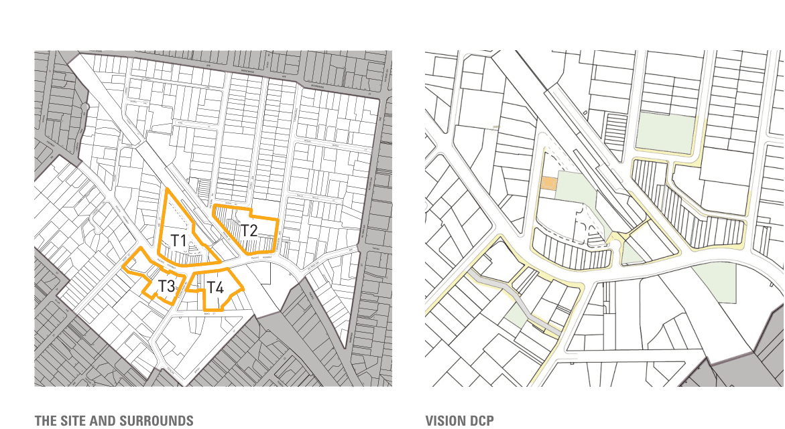

> [Picture on page 52: a map, saved as a picture (images/part-14r-references-masterplan-page-52-7.gif, 150 dpi); the street names and other small labels are on the picture.]
> Words printed on the picture (title and legend, copied from the PDF):
> 5 9 15
> 35 37 38
> 57 55 53 49 45 43
> ALIGNMENT AND SETBACKS
> 33 31 29
> 11 9 5 1
> 49-51 47 45 70
> 33 22 20
> 43 41 37 35 35A
> 18 14 8
> - 10m setback
> - 6m setback
> - 3m setback
> - Nil setback
> - Land dedication
> - Alternate deep soil requirement
> 65 63 65
> - Primary active frontage
> - Secondary active frontage
> - 3 storey street wall
> - 2m upper level setback above street
> - 4m upper level setback above street
> PUBLIC DOMAIN AND PEDESTRIAN
> - Through site link
> - Entry plaza/forecourt
> - Continuous awnings
> - Continuous awnings where possible
> - Continuous colonnade
> 9 7 5 3 1
> BUILDING ENTRIES AND CARPAT
> 8 6 4
> - Vehicular access to site
> - Pedestrian access to site
> KISSING POINT RD
> PATHWAY 24 24A
> 22 20 18

8

6

4

EULBERTIE

17

NLAY

#### T1

#### T2

#### T3 T4

34

#### THE SITE AND SURROUNDS

#### VISION DCP

1

d

AN STRUCTURE

ban Precinct (B2 and B4 zones)

ban Precinct (R4 zone)

The focus of the Turramurra Community Hub Masterplan is only part of the larger ‘town centre’ of Turramurra. We will firstly consider the site in its larger context and the scope as the latest stage in a longer project to revitalise the town centre.  The Sydney Metropolitan Plan earmarks Turramurra to retain its characteristics as a “group of retail, business or office premises reinforcing appropriately scaled and integrated urban fabric. For this reason the Masterplan will opt to retain the zoning controls set out in the LEP for height and FSR.

Ku-Ring-Gai Council's centre hierarchy defines Turramurra as a ‘Local

Centre’ characterised by ‘a group of retail, office or business premises

reinforcing appropriately scaled and integrated urban fabric’. The zoning

controls within the LEP are consistent with this definition and hence the

current controls have become the planning context for the Turramurra

Community Hub Master Plan. The Local Centres DCP map depicts

Turrumurra Local Centre as 4 precincts. While the master plan study

has considered this broader context, the physical proposal is confined

to precinct T1.

Local Centres Development Control Plan

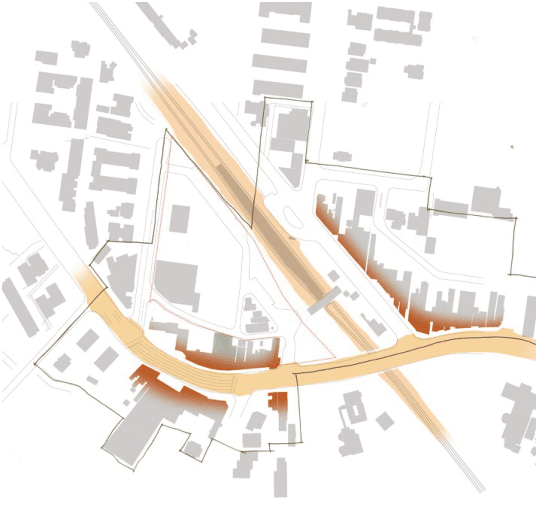

> [Picture on page 52: a picture, saved as a picture (images/part-14r-references-masterplan-page-52-43.gif, 150 dpi).]

#### BARRIERS

The town centre is split into three parts by the Pacific Highway and the rail line. With limited opportunities to cross these barriers, the parts do not benefit from the whole.

These barriers are reinforced by inactive retail frontages. It is evident that the retail frontages facing the Pacific Highway are suffering from a lack of pedestrian amenity along this corridor.

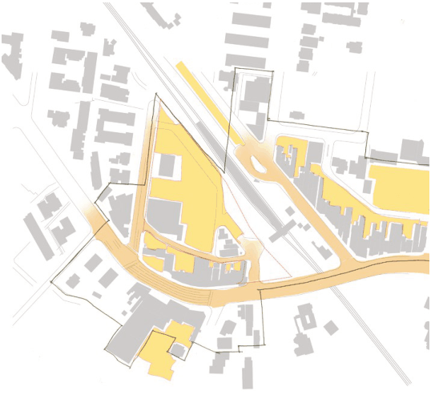

> [Picture on page 52: a picture, saved as a picture (images/part-14r-references-masterplan-page-52-51.gif, 150 dpi).]

#### PARKING AND TRAFFIC

This diagram is evidence of the space given over to the automobile. The vast majority of the town centre is dedicated to parking or road, which has resulted in an unattractive environment despite the services on offer. Although it is difficult to curb the vehicular activity on the Pacific Highway, understanding its effect and creating spaces removed from this will be important.

### THE SITE AND ITS

### SURROUNDS

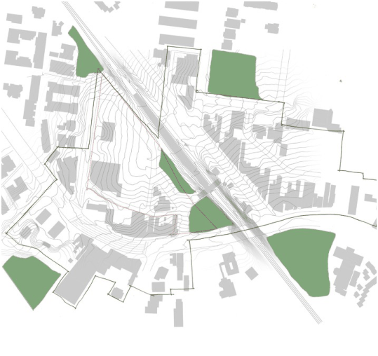

> [Picture on page 53: a picture, saved as a picture (images/part-14r-references-masterplan-page-53-3.gif, 150 dpi).]

#### OPEN SPACE CONTEXT

The green, leafy character of Turramurra is renowned. The site is surrounded by important green spaces including the Look Out Community Gardens, the railway curtilage corridor and Cameron Park. Generally Turramurra enjoys an abundance of biodiversity and significant mature trees that are interspersed in the built environment and contribute greatly to the amenity of the place.

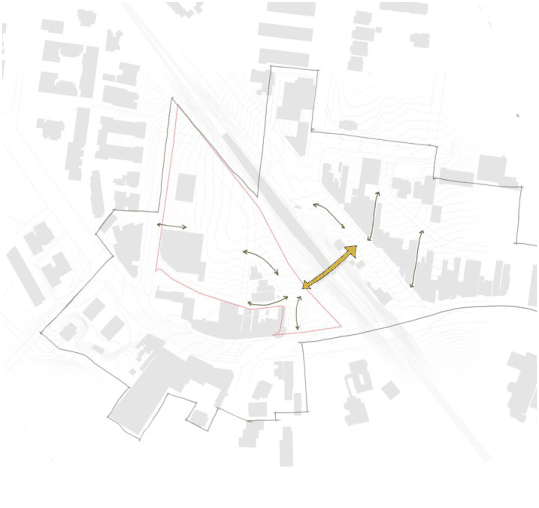

> [Picture on page 53: a picture, saved as a picture (images/part-14r-references-masterplan-page-53-11.gif, 150 dpi).]

#### CONNECTIONS

Two issues effect the free flow of pedestrians in the town centre -infrastructure and topography. Firstly the rail line and highway block the path of travel, secondly the approximate 5m drop across the site makes it inaccessible to some users. If the town centre is to function as a whole this needs to be addressed.

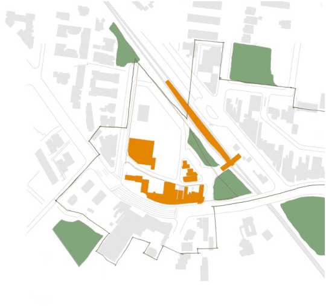

> [Picture on page 53: a picture, saved as a picture (images/part-14r-references-masterplan-page-53-18.gif, 150 dpi).]

#### ASSETS

The Ray Street Precinct has potential to be the centrepiece of the town centre spatially as well as functionally. The site boasts a number of assets that an ideal town centre needs.

- Mass transport in the heritage railway station allows thousands of commuters to use the site every day

- The supermarket is one of the few in the upper north shore and has capacity to expand

- The Forbes Lane shop-top buildings hold potential for a fine grain retail spine. Replay Cafe is already taking advantage of this

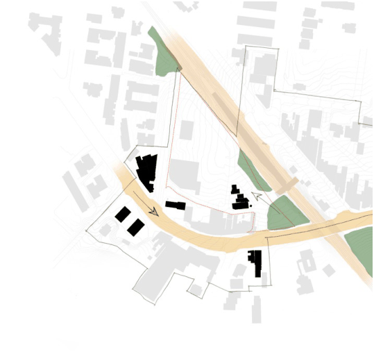

> [Picture on page 53: a picture, saved as a picture (images/part-14r-references-masterplan-page-53-29.gif, 150 dpi).]

#### LANDMARKS

The experience of Turrumurra is currently defined by the road and rail infrastructure with a lack of any signature landmarks buildings. There is a great opportunity to capitalise upon the centre’s location on the ridge line and the high number of people passing though the centre each day creating a landmark development as signature for a revitalised Local Centre.

### DESIGN PRINCIPLES

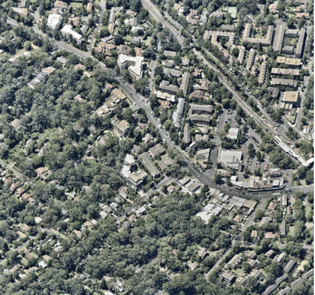

> [Picture on page 54: a picture, saved as a picture (images/part-14r-references-masterplan-page-54-2.gif, 150 dpi).]

#### PLACE MAKING

Turrumurra Centre is largely characterised by its low scale pattern of development and the convergence of the Pacific Highway and Northern Rail Line.

The site has been isolated by both the road and the rail. It is primed to become a revitalised centre that capitalises upon its proximity to the rail station.

The following Design Principles would contribute to making Turramurra a recognisable, loved and sustainable place into the future.

> [Picture on page 54: a picture, saved as a picture (images/part-14r-references-masterplan-page-54-12.gif, 150 dpi).]

#### RETAINING THE VILLAGE CHARACTER

Reinforcing the delightful village character of Turramurra will require design principles to be adhered to. Most of the masterplan will be new so this implies a sophisticated design with the constant ambition to respect human scale and the intimacy of spaces.

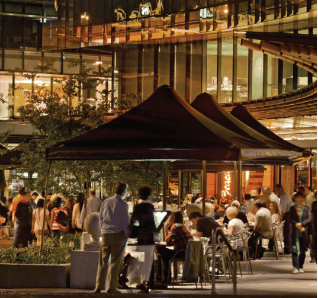

> [Picture on page 54: a picture, saved as a picture (images/part-14r-references-masterplan-page-54-18.gif, 150 dpi).]

#### VIBRANT RETAIL MIX

A lively and healthy suite of ground floor retail spaces is a key part of place making. It is a great way to activate spaces, attract people, make a memorable and destinational user experience for the local community and visitor. The Turramurra Community Hub Masterplan already has the infrastructure to deliver enough people to meet retail demand in the area, however, the type and quality of these tenants will be influenced by a number of factors including building design, location and orientation.

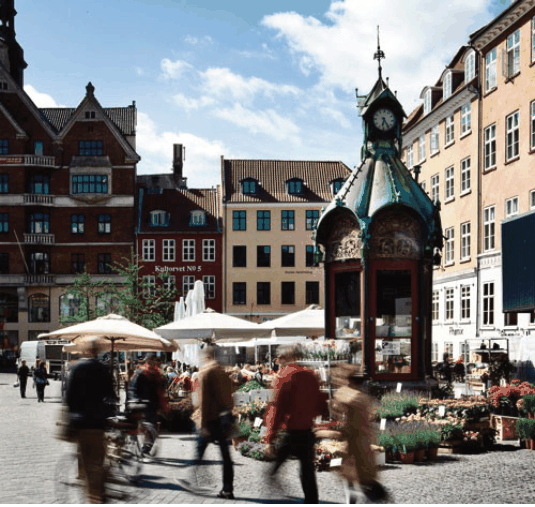

> [Picture on page 54: a picture, saved as a picture (images/part-14r-references-masterplan-page-54-28.gif, 150 dpi).]

#### A VARIETY OF PUBLIC URBAN SPACES

The brief requires generous public urban spaces to compliment the community and retail uses. It is vital however to consider a range of individual spatial types, scales and experiences. Larger open spaces are essential for events and more intimate public spaces are critical to people feeling a sense of ownership and comfort. A variety of spaces also attract a variety of tenants into ground floor retail spaces bringing a vibrancy to the place.

### DESIGN PRINCIPLES

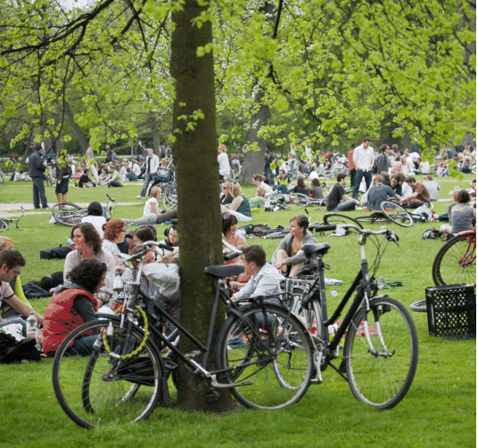

> [Picture on page 55: a picture, saved as a picture (images/part-14r-references-masterplan-page-55-2.gif, 150 dpi).]

#### ACTIVE GREEN SPACE

Trees and green space are integral to the sense of place in Turramurra. The key will be to introduce a complementary green open space to the suite of already impressive gardens and parks on offer. The space also has the potential to connect the pre-existing green spaces surrounding the site to increase for biodiversity and assist with WSUD and acoustic effects of the train line.

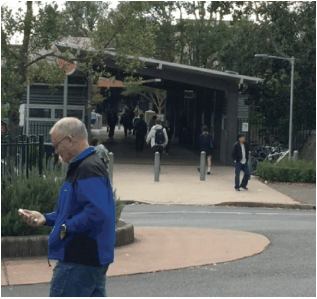

> [Picture on page 55: a picture, saved as a picture (images/part-14r-references-masterplan-page-55-10.gif, 150 dpi).]

#### CONNECTING THE TOWN CENTRE

Accessibility is important for the ease of use for locals and visitors. The masterplan implements a decisive strategy that creates a level platform to traverse the site. The plan also considers a bridge proposal connection Ray Street and Rohini Street to make it easier for the northern catchment of Turramurra and Warrawee to access the site without having to pass through the Pacific Highway.

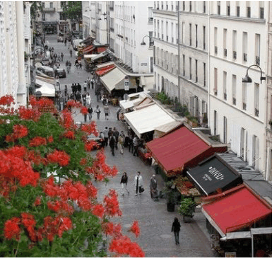

> [Picture on page 55: a picture, saved as a picture (images/part-14r-references-masterplan-page-55-18.gif, 150 dpi).]

#### DENSITY DONE RIGHT

Some additional density will prime the public spaces and help provide surveillance while making the project financially sustainable. The site has the potential to support many families using the amenity of the railway station, supermarket, retail, community hub building and public open spaces. Considerations will be made for scale, overlooking and overshadowing.

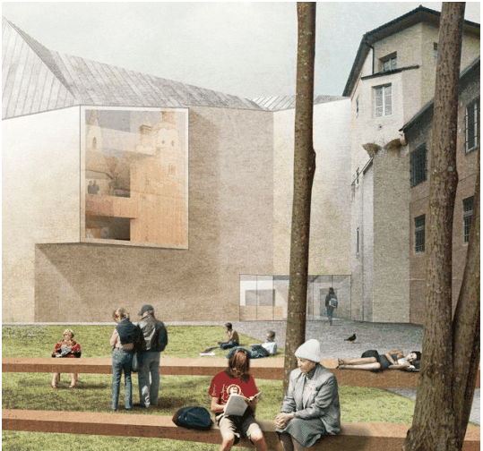

> [Picture on page 55: a picture, saved as a picture (images/part-14r-references-masterplan-page-55-26.gif, 150 dpi).]

#### A GREAT COMMUNITY BUILDING

The ‘Ku-ring-gai Community Facilities Strategy’ and the 'Turramurra Community Facilities Study' outline the requirement for a new library and community facility for Turramurra. The combination of these facilities into a building will undoubtedly become a beacon for the community on the site and act as a welcoming building.

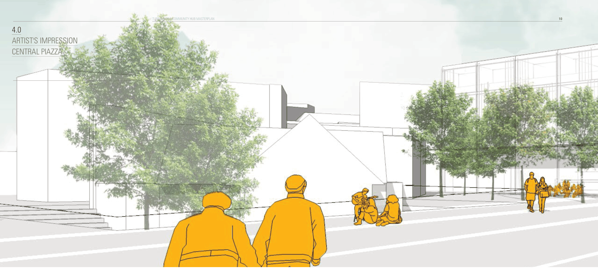

> [Picture on page 56: a picture, saved as a picture (images/part-14r-references-masterplan-page-56-1.gif, 150 dpi).]

### ARTIST'S IMPRESSION CENTRAL PIAZZA

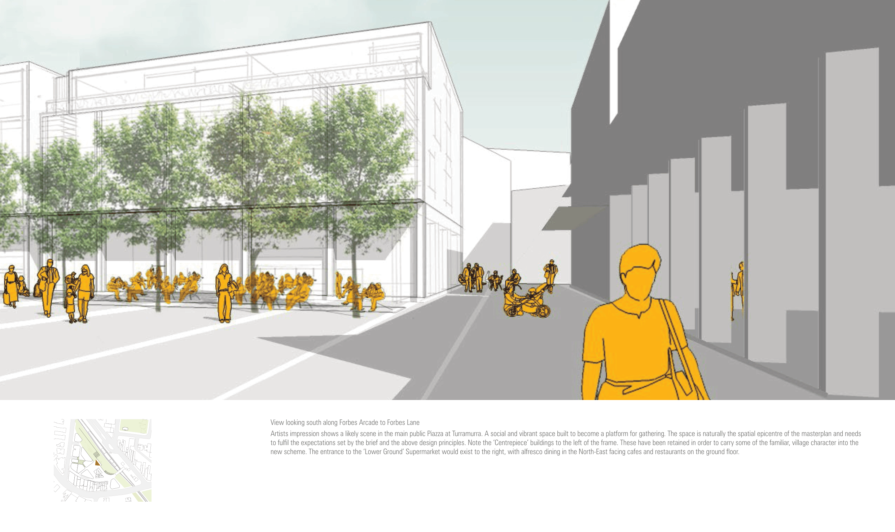

> [Picture on page 57: a picture, saved as a picture (images/part-14r-references-masterplan-page-57-1.gif, 150 dpi).]
> Words printed on the picture (title and legend, copied from the PDF):
> View looking south along Forbes Arcade to Forbes Lane
> Artists impression shows a likely scene in the main public Piazza at Turramurra. A social and vibrant space built to become a platform for gathering. The space is naturally the spatial epicentre of the masterplan and needs
> to fulfil the expectations set by the brief and the above design principles. Note the ‘Centrepiece’ buildings to the left of the frame. These have been retained in order to carry some of the familiar, village character into the
> new scheme. The entrance to the ‘Lower Ground’ Supermarket would exist to the right, with alfresco dining in the North-East facing cafes and restaurants on the ground floor.
> 08.10.2014
> TURRAMURRA COMMUNITY HUB
> DATE

### DESIGN CONCEPTS

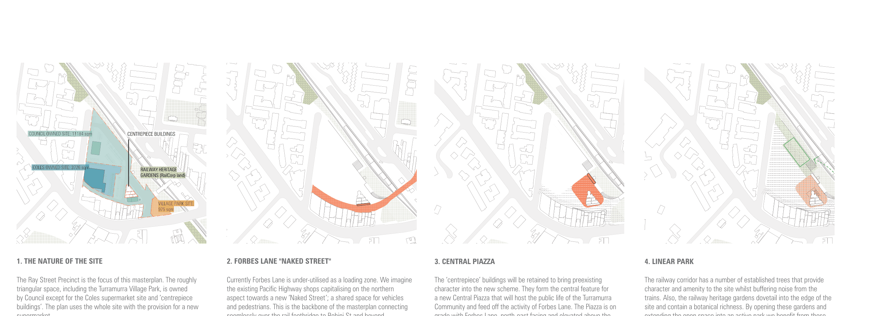

> [Picture on page 58: a picture, saved as a picture (images/part-14r-references-masterplan-page-58-2.gif, 150 dpi).]
> Words printed on the picture (title and legend, copied from the PDF):
> COUNCIL OWNED SITE: 11184 sqm
> COLES OWNED SITE: 3726 sqm
> CENTREPIECE BUILDINGS
> RAILWAY HERITAGE
> GARDENS (RailCorp land)
> VILLAGE PARK SITE:
> 975 sqm
> The Ray Street Precinct is the focus of this masterplan. The roughly
> TURRAMURRA COMMUNITY HUB
> triangular space, including the Turramurra Village Park, is owned
> CHROFI
> by Council except for the Coles supermarket site and ‘centrepiece
> buildings’. The plan uses the whole site with the provision for a new
> 08.10.2014
> DATE
> TURRAMURRA COMMUNITY HUB
> CHROFI
> Currently Forbes Lane is under-utilised as a loading zone. We imagine
> the existing Pacific Highway shops capitalising on the northern
> aspect towards a new ‘Naked Street’; a shared space for vehicles
> and pedestrians. This is the backbone of the masterplan connecting
> 08.10.2014
> DATE
> TURRAMURRA COMMUNITY HUB
> The ‘centrepiece’ buildings will be retained to bring preexisting
> character into the new scheme. They form the central feature for
> a new Central Piazza that will host the public life of the Turramurra
> Community and feed off the activity of Forbes Lane. The Piazza is on
> 08.10.2014
> DATE
> TURRAMURRA COMMUNITY HUB
> CHROFI
> The railway corridor has a number of established trees that provide
> character and amenity to the site whilst buffering noise from the
> trains. Also, the railway heritage gardens dovetail into the edge of the
> site and contain a botanical richness. By opening these gardens and

## 1. THE NATURE OF THE SITE

supermarket.
