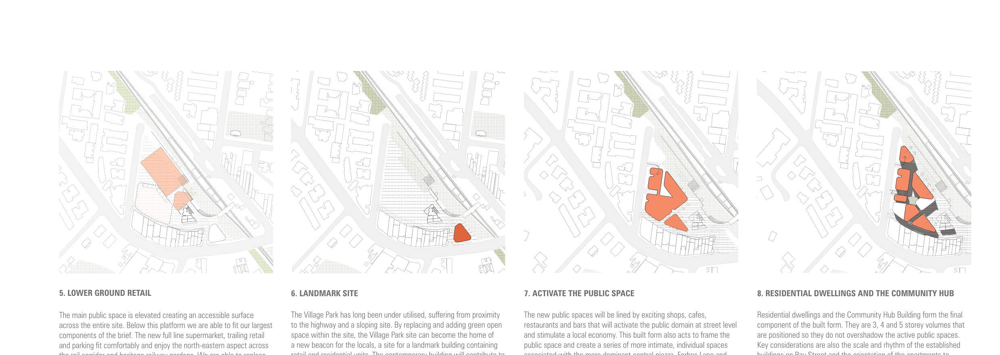

## 4. LINEAR PARK

extending the open space into an active park we benefit from these latent conditions and provide another great space for the community.

> [Picture on page 59: a picture, saved as a picture (images/part-14r-references-masterplan-page-59-1.gif, 150 dpi).]
> Words printed on the picture (title and legend, copied from the PDF):
> CHROFI
> TURRAMURRA COMMUNITY HUB
> The main public space is elevated creating an accessible surface
> across the entire site. Below this platform we are able to fit our largest
> components of the brief. The new full line supermarket, trailing retail
> and parking fit comfortably and enjoy the north-eastern aspect across
> TURRAMURRA COMMUNITY HUB
> CHROFI
> 08.10.2014
> DATE
> The Village Park has long been under utilised, suffering from proximity
> to the highway and a sloping site. By replacing and adding green open
> space within the site, the Village Park site can become the home of
> a new beacon for the locals, a site for a landmark building containing
> RESI
> 08.10.2014
> DATE
> TURRAMURRA COMMUNITY HUB CHROFI
> The new public spaces will be lined by exciting shops, cafes,
> restaurants and bars that will activate the public domain at street level
> and stimulate a local economy. This built form also acts to frame the
> public space and create a series of more intimate, individual spaces
> RESI
> RESI
> 08.10.2014
> DATE
> TURRAMURRA COMMUNITY HUB
> Residential dwellings and the Community Hub Building form the final
> component of the built form. They are 3, 4 and 5 storey volumes that
> are positioned so they do not overshadow the active public spaces.
> Key considerations are also the scale and rhythm of the established
