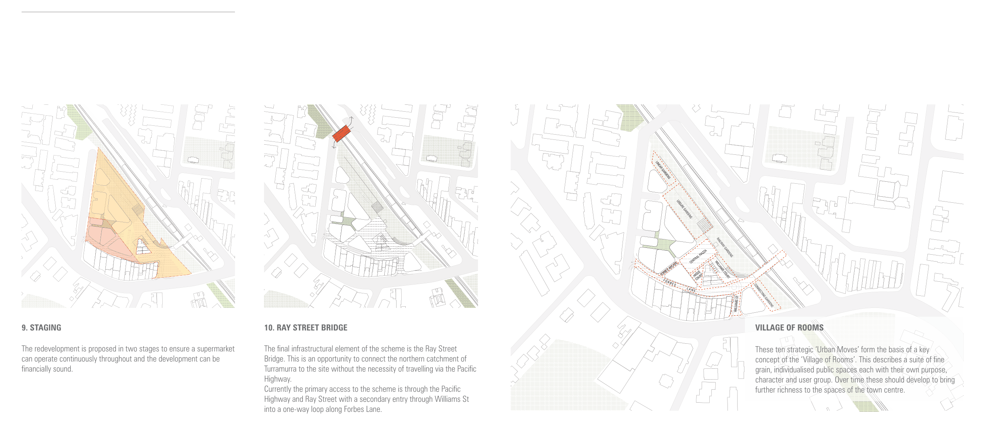

## 8. RESIDENTIAL DWELLINGS AND THE COMMUNITY HUB

buildings on Ray Street and the orientation of the apartments to achieve amenity and views.

> [Picture on page 60: a picture, saved as a picture (images/part-14r-references-masterplan-page-60-1.gif, 150 dpi).]
> Words printed on the picture (title and legend, copied from the PDF):
> RESI
> RESI
> TURRAMURRA COMMUNITY HUB
> CHROFI
> The redevelopment is proposed in two stages to ensure a supermarket
> can operate continuously throughout and the development can be
> financially sound.
> RESI
> RESI
> 08.10.2014
> DATE
> 08.10.2014
> TURRAMURRA COMMUNITY HUB
> DATE
> The final infrastructural element of the scheme is the Ray Street
> Bridge. This is an opportunity to connect the northern catchment of
> Turramurra to the site without the necessity of travelling via the Pacific
> Highway.
> Currently the primary access to the scheme is through the Pacific
> Highway and Ray Street with a secondary entry through Williams St
> into a one-way loop along Forbes Lane.
> CHROFI
> LINEAR GARDENS
> RESI
> LEISURE GARDENS
> RAILWAY GARDENS
> CENTRAL PIAZZA
> RESI
> FORBES ARCADE HIGGS WILLIAMS COURT
> COURT
> FORBES
> LANE
> WILLIAMS ST
> TURRAMURRA COMMUNITY HUB
> CONNECTING GARDENS
> These ten strategic ‘Urban Moves’ form the basis of a key
> concept of the ‘Village of Rooms’. This describes a suite of fine
> grain, individualised public spaces each with their own purpose,
> character and user group. Over time these should develop to bring
> further richness to the spaces of the town centre.
> 08.10.2014
> DATE
