## 9. STAGING

## 10. RAY STREET BRIDGE

#### VILLAGE OF ROOMS

### LANDSCAPE

### MASTERPLAN

01  LINEAR GARDENS

02  LEISURE GARDENS

03  GRAND STEPS

04  CENTRAL PIAZZA

05  FORBES ARCADE

06  HIGGS COURT

07  LOWER CAFE COURT

08  ALFRESCO DINING CURTILAGE

09  WILLIAMS COURT

10  CONNECTING GARDENS

11  MIXED USE BUILDING

12  COMMUNITY HUB BUILDING

13  CENTREPIECE BUILDINGS

14  SUPERMARKET ENTRY

15  RESIDENTIAL COURTYARD

16  BASEMENT PARKING ENTRY

17  LOADING ENTRY

18  RESIDENTIAL BUILDING

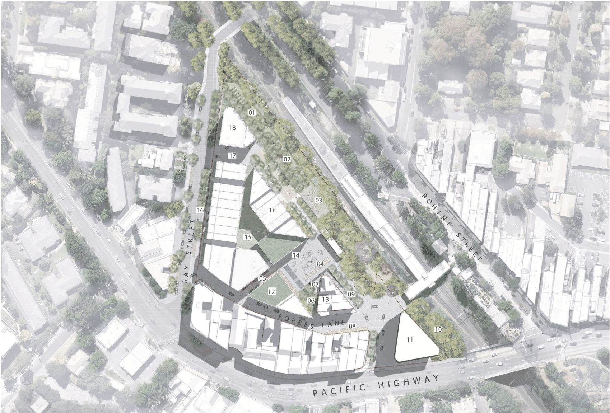

> [Picture on page 61: a map, saved as a picture (images/part-14r-references-masterplan-page-61-21.gif, 150 dpi); the street names and other small labels are on the picture.]

#### PACIFICHIGHWAY

### KEY SPACES AXONOMETRIC DIAGRAM & AREA SCHEDULE

01  LINEAR GARDENS 02  LEISURE GARDENS 03  GRAND STEPS 04  CENTRAL PIAZZA 05  FORBES ARCADE 06  HIGGS COURT 07  LOWER CAFE COURT 08  ALFRESCO DINING CURTILAGE 09  WILLIAMS COURT 10  CONNECTING GARDENS 11  MIXED USE BUILDING 12  COMMUNITY HUB BUILDING 13  CENTREPIECE BUILDINGS 14  SUPERMARKET ENTRY 15  RESIDENTIAL COURTYARD 16  BASEMENT PARKING ENTRY 17  PARKING 18  LOADING ENTRY 19 SUPERMARKET 20 LOWER GROUND RETAIL

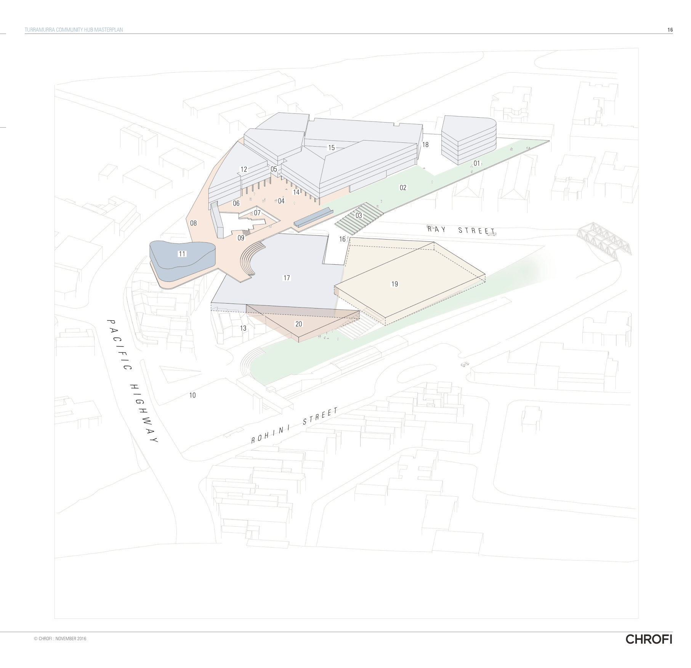

> [Picture on page 62: a map, saved as a picture (images/part-14r-references-masterplan-page-62-24.gif, 150 dpi); the street names and other small labels are on the picture.]

#### PACIFICHIGHWAY

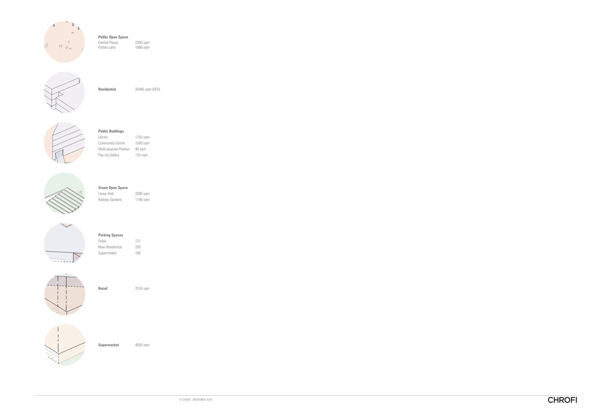

> [Picture on page 63: a map, saved as a picture (images/part-14r-references-masterplan-page-63-1.gif, 150 dpi); the street names and other small labels are on the picture.]
> Words printed on the picture (title and legend, copied from the PDF):
> Public Open Space
> Central Piazza 2300 sqm
> Forbes Lane 1690 sqm
> Residential 20485 sqm (GFA)
> Community Centre 1500 sqm
> Multi-purpose Pavilion 90 sqm
> Pop-Up Gallery 133 sqm
> Green Open Space
> Linear Park 2090 sqm
> Railway Gardens 1190 sqm
> New Residential 200
> Supermarket 4000 sqm

### KEY SPACES DETAILED DESCRIPTIONS

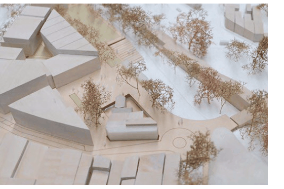

> [Picture on page 64: a picture, saved as a picture (images/part-14r-references-masterplan-page-64-3.gif, 150 dpi).]

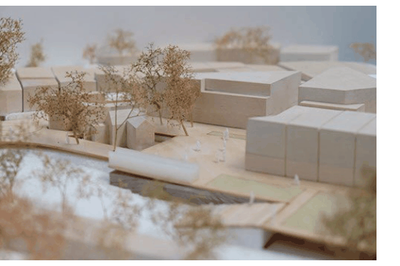

> [Picture on page 64: a picture, saved as a picture (images/part-14r-references-masterplan-page-64-4.gif, 150 dpi).]

#### CENTRAL PIAZZA

Central Piazza is a platform for community exchange and large events. At 41m x 25m the space is large enough to hold around 700 people standing comfortably. The space will be an active and safe place throughout the day with passive surveillance of apartment residents, supermarket shoppers, restaurant goers, and commuters.

The space has four active edges, each with a different purpose. To the North-West is the entrance to the Lower Ground supermarket, retail and car parking activated a fresh food retailer. To the South-West is the alfresco dining zone with cafes and restaurants enjoying the morning to afternoon sun and district vistas. To the South-East are the Centrepiece buildings, including a stunning pitched roof building that has a first floor that will address the Piazza whilst its Ground Floor will address an intimate courtyard to the Lower Ground retail shops. To the North-East is public Multipurpose Pavilion, a flexible building like a permanent marquee and can be used in a variety of ways depending on the use in the square.

#### GREEN OPEN SPACES

Turramurra is blessed with great green open spaces. The suite of gardens this Masterplan delivers will expand that again. A key opportunity is to formalise a new park utilising the mature trees and landscape curtilage along the rail corridor. However, there are a number of decisions to be made by the local community as to the purpose of these spaces:

1\. Railway Gardens - This space is currently fenced-off, but will be open to the public for this Masterplan. It is a scenic and picturesque garden with a variety of species. It is a largely sedentary space that will act as an outlook for the supermarket and Lower Ground retail.

2\. Connecting Gardens - This space will be closely associated with the mixed use building facility. The space will need to be designed to minimise traffic noise from the pacific highway, however it should a great way to connect to the station and be a pleasant place to enjoy a book or newspaper whilst enjoying vista over the railway gardens.

3\. Linear Gardens - This space crucially connects the Leisure Gardens to the Ray St bridge and has the potential to link to linear green spaces and bicycle paths as far as Warrawee Station.

4\. Leisure Gardens - This space 26m x 55m space is big enough to host three basketball courts.

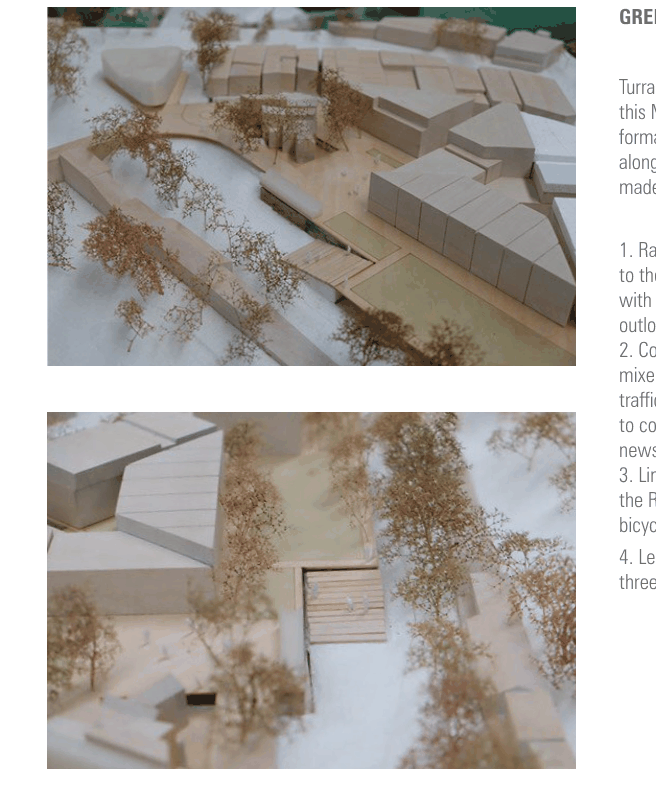

> [Picture on page 64: a picture, saved as a picture (images/part-14r-references-masterplan-page-64-42.gif, 150 dpi).]

> [Picture on page 65: a picture, saved as a picture (images/part-14r-references-masterplan-page-65-1.gif, 150 dpi).]

### SITE SECTIONS

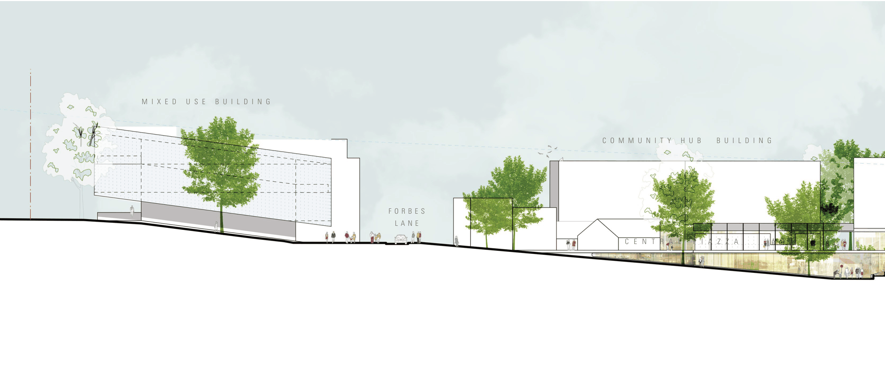

> [Picture on page 66: a picture, saved as a picture (images/part-14r-references-masterplan-page-66-2.gif, 150 dpi).]
> Words printed on the picture (title and legend, copied from the PDF):
> MIXEDUSEBUILDING
> FORBES
> LANE
> COMMUNITYHUBBUILDING
> CENTRALPIAZZA

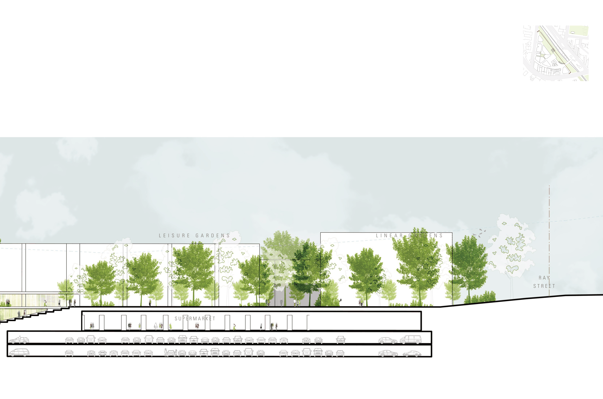

> [Picture on page 67: a picture, saved as a picture (images/part-14r-references-masterplan-page-67-1.gif, 150 dpi).]
> Words printed on the picture (title and legend, copied from the PDF):
> LEISUREGARDENS
> SUPERMARKET
> RESI
> RESI
> TURRAMURRA COMMUNITY HUB
> CHROFI
> LINEARGARDENS
> RAY
> STREET

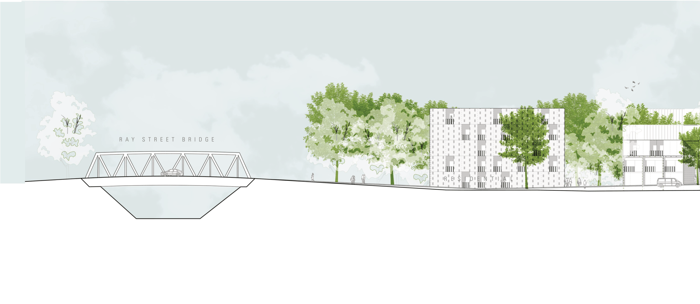

> [Picture on page 68: a picture, saved as a picture (images/part-14r-references-masterplan-page-68-1.gif, 150 dpi).]
> Words printed on the picture (title and legend, copied from the PDF):
> RAYSTREETBRIDGE
> RESIDENTIAL

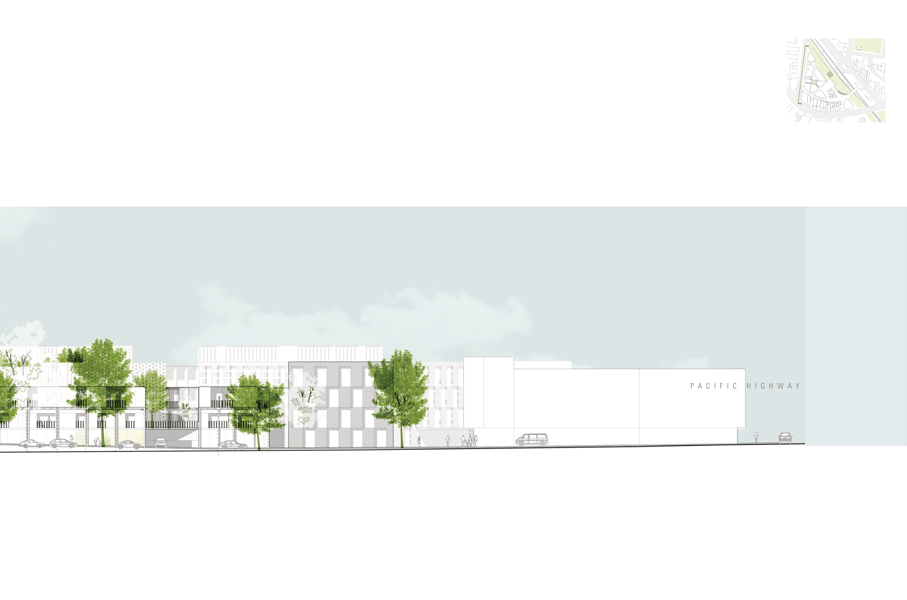

> [Picture on page 69: a picture, saved as a picture (images/part-14r-references-masterplan-page-69-1.gif, 150 dpi).]
> Words printed on the picture (title and legend, copied from the PDF):
> TURRAMURRA COMMUNITY HUB
> CHROFI
> PACIFICHIGHWAY

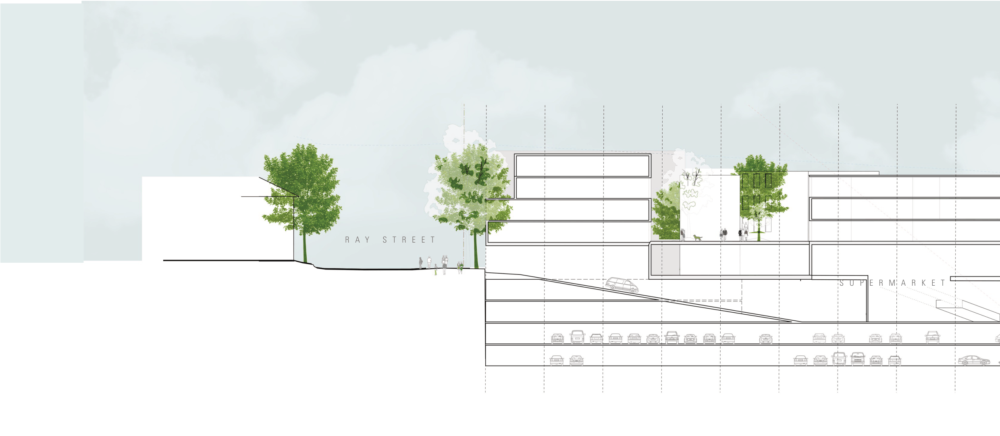

> [Picture on page 70: a picture, saved as a picture (images/part-14r-references-masterplan-page-70-1.gif, 150 dpi).]
> Words printed on the picture (title and legend, copied from the PDF):
> RAYSTREET
> SUPERMARKET

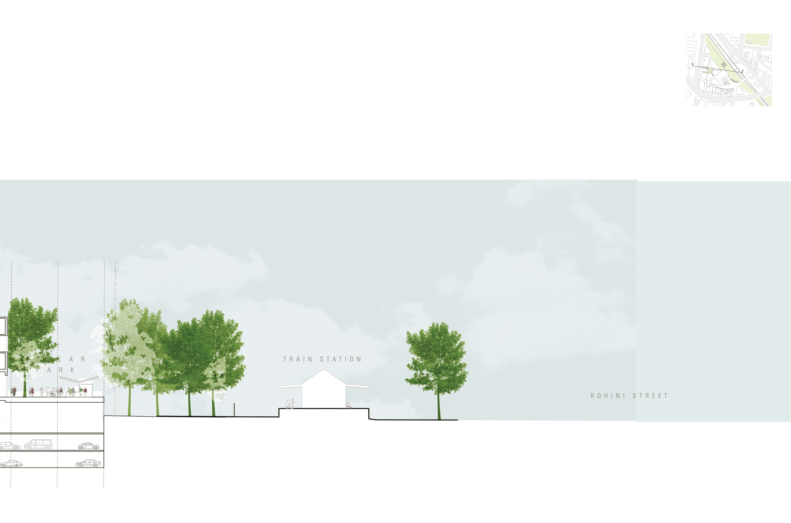

> [Picture on page 71: a picture, saved as a picture (images/part-14r-references-masterplan-page-71-1.gif, 150 dpi).]
> Words printed on the picture (title and legend, copied from the PDF):
> TRAINSTATION
> LINEAR
> PARK
> TURRAMURRA COMMUNITY HUB
> CHROFI
> ROHINISTREET

### ARTIST'S IMPRESSIONS MASTERPLAN

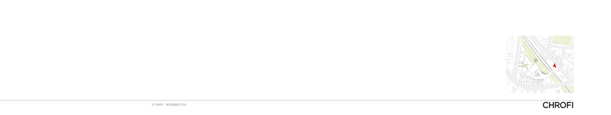

> [Picture on page 72: a picture, saved as a picture (images/part-14r-references-masterplan-page-72-3.gif, 150 dpi).]
> Words printed on the picture (title and legend, copied from the PDF):
> 08.10.2014
> TURRAMURRA COMMUNITY HUB
> CHROFI
> DATE

An aerial perspective showing the scheme in its entirety. The generous open spaces and greenery sit above a conveniently located full line supermarket and parking.

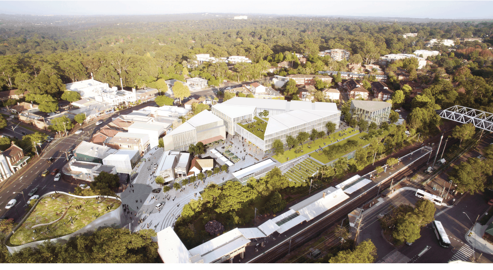

> [Picture on page 73: a picture, saved as a picture (images/part-14r-references-masterplan-page-73-4.gif, 150 dpi).]

### FORBES LANE SHARED WAY

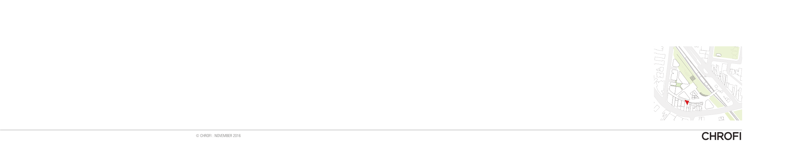

> [Picture on page 74: a picture, saved as a picture (images/part-14r-references-masterplan-page-74-2.gif, 150 dpi).]
> Words printed on the picture (title and legend, copied from the PDF):
> 08.10.2014
> TURRAMURRA COMMUNITY HUB
> CHROFI
> DATE

Forbes Lane

This perspective looking north-east towards the station entrance imagines a weekend flower market in which the lane is closed to traffic and open to a public event. Note the new public buildings in the two storey pop-up community gallery and mixed use building.

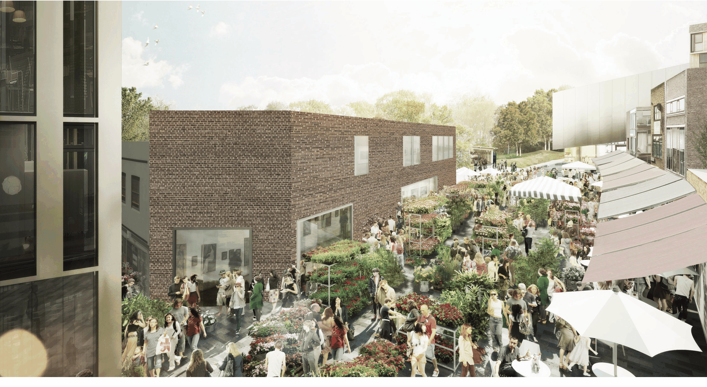

> [Picture on page 75: a picture, saved as a picture (images/part-14r-references-masterplan-page-75-6.gif, 150 dpi).]

### LEISURE GARDENS & GRAND STEPS

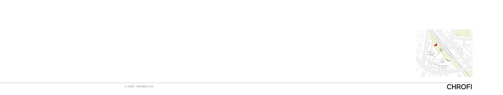

> [Picture on page 76: a picture, saved as a picture (images/part-14r-references-masterplan-page-76-2.gif, 150 dpi).]
> Words printed on the picture (title and legend, copied from the PDF):
> 08.10.2014
> TURRAMURRA COMMUNITY HUB
> CHROFI
> DATE

Leisure Gardens & Grand Steps

A perspective image showing the Leisure Park looking towards the mixed use, landmark building. The tree lined park is pictured as an open flexible space but has further potential for a variety of uses in the future.

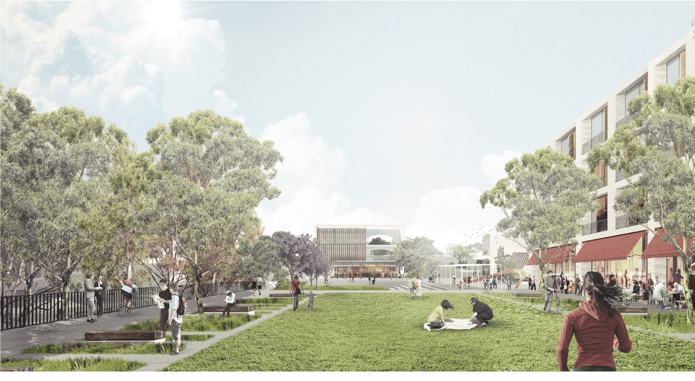

> [Picture on page 77: a picture, saved as a picture (images/part-14r-references-masterplan-page-77-5.gif, 150 dpi).]

### RAY STREET

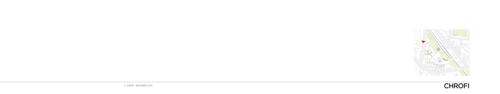

> [Picture on page 78: a picture, saved as a picture (images/part-14r-references-masterplan-page-78-2.gif, 150 dpi).]
> Words printed on the picture (title and legend, copied from the PDF):
> 08.10.2014
> TURRAMURRA COMMUNITY HUB
> CHROFI
> DATE

Ray Street

A revitalised Ray Street is characterised by low scale, residential building with a village scale, materiality and articulation. The street will facilitate the entry and egress of vehicles to the loading bay and underground carpark.

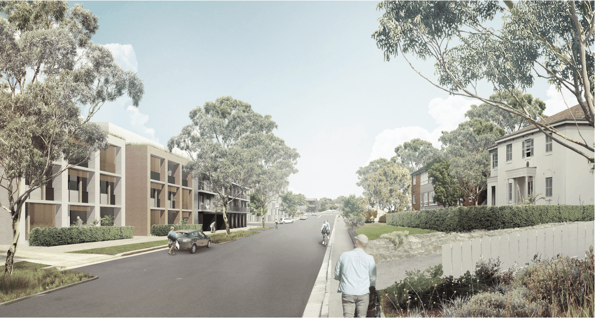

> [Picture on page 79: a picture, saved as a picture (images/part-14r-references-masterplan-page-79-6.gif, 150 dpi).]

#### An aerial perspective showing the scheme in its entirety. The

generous open spaces and greenery sit above a conveniently located full line supermarket and parking station.

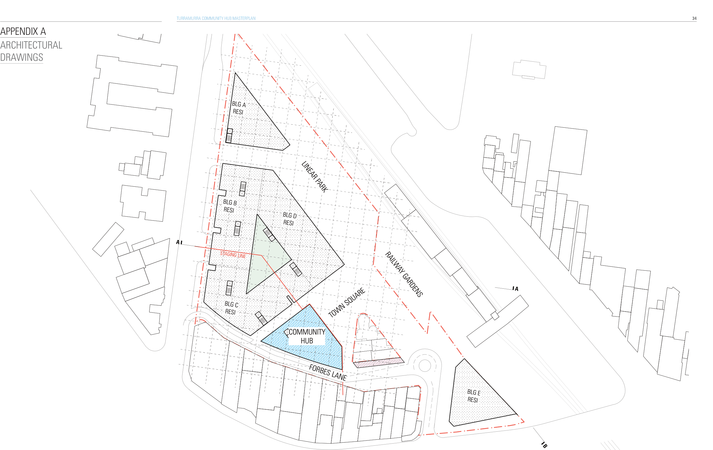

> [Picture on page 80: a map, saved as a picture (images/part-14r-references-masterplan-page-80-1.gif, 150 dpi); the street names and other small labels are on the picture.]

### APPENDIX A ARCHITECTURAL

### DRAWINGS

#### HROFI

#### RAILWAY GARDENS

#### LINEAR PARK

#### TOWN SQUARE

#### COMMUNITY

#### HUB

#### FORBES LANE

#### FIRST FLOOR PLAN

0 1

SCALE 1:1000

#### ISSUE

#### DATE 09.11.2016

#### F

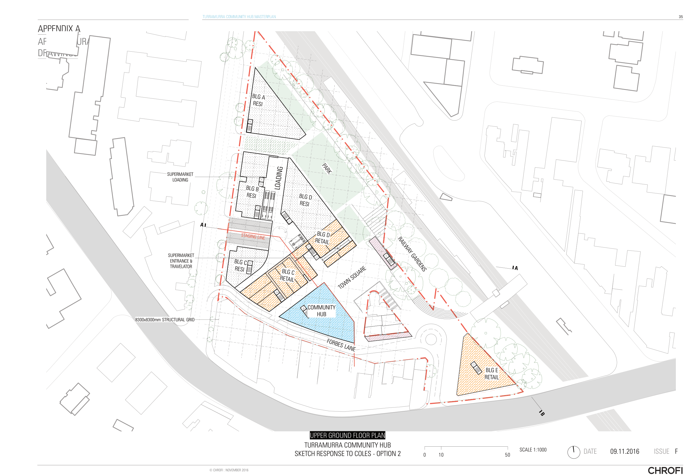

> [Picture on page 81: a map, saved as a picture (images/part-14r-references-masterplan-page-81-1.gif, 150 dpi); the street names and other small labels are on the picture.]
> Words printed on the picture (title and legend, copied from the PDF):
> 8300x8300mm STRUCTURAL GRID

### DRAWINGS

#### LOADING

#### UPPER GROUND FLOOR PLAN

#### SKETCH RESPONSE TO COLES - OPTION 2

### DRAWINGS

#### HROFI

EXPRESS RESIDENTIAL RAMP TO B2

RETAIL RAMP TO LG

EXISTING SUPERMARKET TO BE DEMOLISHED DURING STAGE 2

8300x8300mm STRUCTURAL GRID

#### B

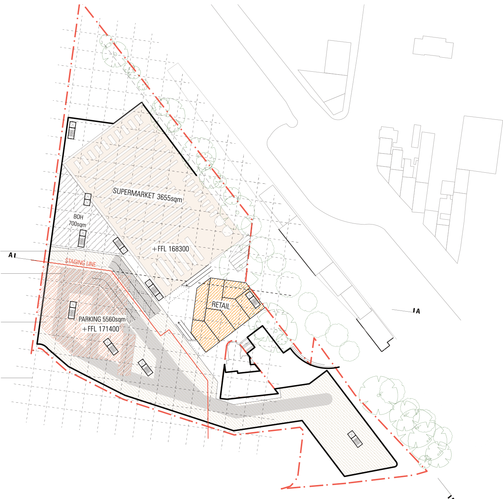

> [Picture on page 82: a map, saved as a picture (images/part-14r-references-masterplan-page-82-10.gif, 150 dpi); the street names and other small labels are on the picture.]

0 1

#### LOWER GROUND FLOOR PLAN

#### B

SCALE 1:1000

### DRAWINGS

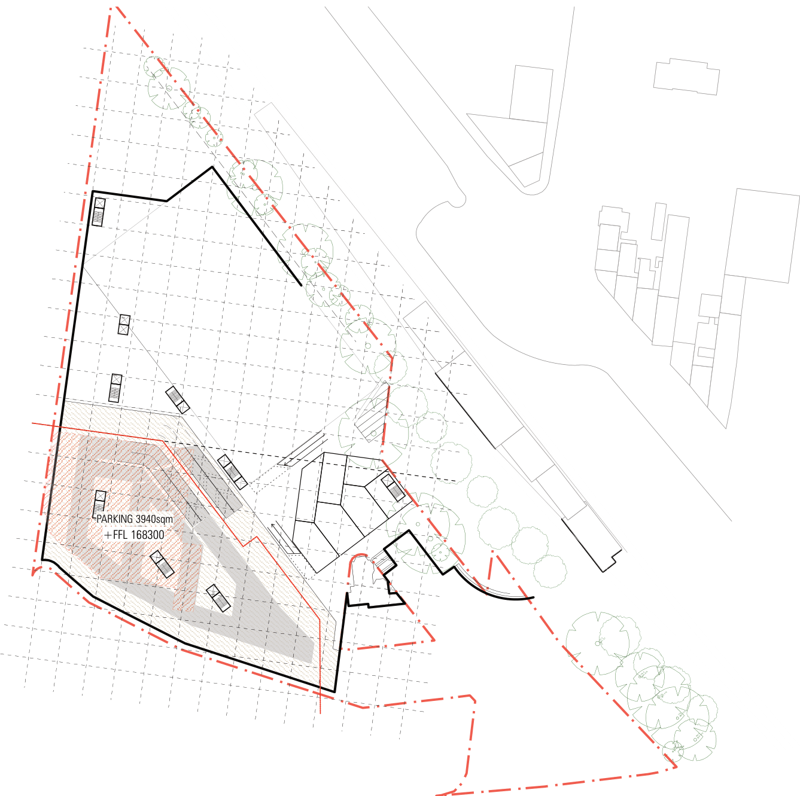

> [Picture on page 83: a map, saved as a picture (images/part-14r-references-masterplan-page-83-2.gif, 150 dpi); the street names and other small labels are on the picture.]

0 1

#### BASEMENT ONE FLOOR PLAN

SCALE 1:1000

### DRAWINGS

#### B

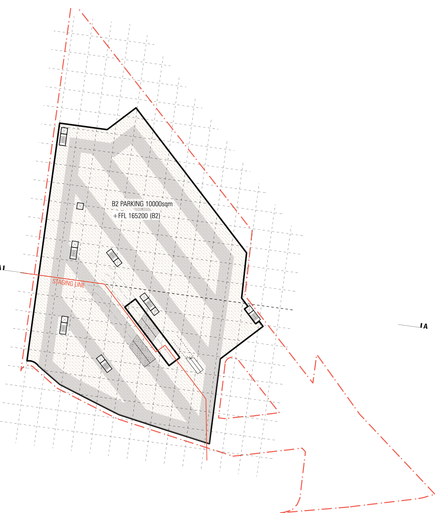

> [Picture on page 84: a picture, saved as a picture (images/part-14r-references-masterplan-page-84-3.gif, 150 dpi).]
> Words printed on the picture (title and legend, copied from the PDF):
> STAGING LINE
> B2 PARKING 10000sqm
> \+FFL 165200 (B2)
> A

#### A

#### BASEMENT TWO FLOOR PLAN

0 1

#### B

SCALE 1:1000

### DRAWINGS

#### B

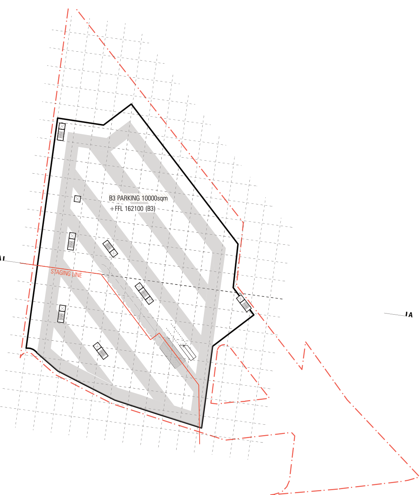

> [Picture on page 85: a picture, saved as a picture (images/part-14r-references-masterplan-page-85-3.gif, 150 dpi).]
> Words printed on the picture (title and legend, copied from the PDF):
> STAGING LINE
> B3 PARKING 10000sqm
> \+FFL 162100 (B3)
> A

#### A

#### BASEMENT THREE FLOOR PLAN

0 1

#### B

SCALE 1:1000

### DRAWINGS

B3 FLOOR PLAN

B3 FLOOR PLAN

B3 FLOOR PLAN

A - 760sqm

B - 1280sqm

A - 760sqm

A - 760sqm

B - 1280sqm

B - 1280sqm

C - 1440sqm

C - 1440sqm

COMMUNITY HUB - 830sqm

C - 1440sqm

COMMUNITY HUB - 830sqm COMMUNITY HUB - 830sqm

FIRST FLOOR PLAN FIRST FLOOR PLAN

B2 PARKING 10000sqm

B2 PARKING 10000sqm

B2 PARKING 10000sqm

RESIDENTIAL TOTAL 5585sqm

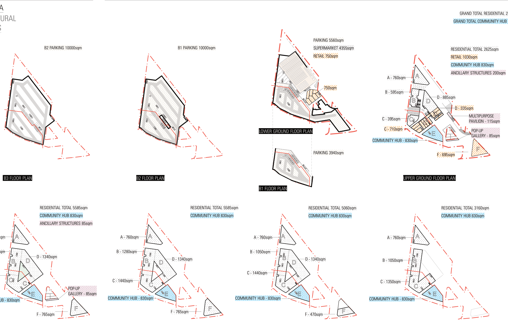

> [Picture on page 86: a map, saved as a picture (images/part-14r-references-masterplan-page-86-23.gif, 150 dpi); the street names and other small labels are on the picture.]
> Words printed on the picture (title and legend, copied from the PDF):
> FIRST FLOOR PLAN
> COMMUNITY HUB 830sqm
> ANCILLARY STRUCTURES 85sqm
> RESIDENTIAL TOTAL 5585sqm
> RESIDENTIAL TOTAL 5585sqm
> COMMUNITY HUB 830sqm
> COMMUNITY HUB 830sqm
> ANCILLARY STRUCTURES 85sqm
> ANCILLARY STRUCTURES 85sqm
> D - 1340sqm
> D - 1340sqm
> D - 1340sqm
> F - 765sqm
> F - 765sqm
> F - 765sqm
> GALLERY - 85sqm
> GALLERY - 85sqm
> GALLERY - 85sqm

SECOND FLOOR PLAN

THIRD FLOOR PLAN

SECOND FLOOR PLAN

THIRD FLOOR PLAN

#### GBA TOTALS

#### GBA TOTALS

#### GBA TOTALS

GRAND TOTAL RESIDENTIAL 22025sqm GRAND TOTAL COMMUNITY HUB 4150sqm

> Words printed on the picture (title and legend, copied from the PDF):
> B1 PARKING 10000sqm
> B1 PARKING 10000sqm
> B1 PARKING 10000sqm
> LOWER GROUND FLOOR PLAN
> LOWER GROUND FLOOR PLAN
> LOWER GROUND FLOOR PLAN
> B2 FLOOR PLAN
> B1 FLOOR PLAN
> B2 FLOOR PLAN
> B2 FLOOR PLAN
> B1 FLOOR PLAN
> RESIDENTIAL TOTAL 5060sqm
> RESIDENTIAL TOTAL 5585sqm
> B1 FLOOR PLAN
> COMMUNITY HUB 830sqm
> COMMUNITY HUB 830sqm
> RESIDENTIAL TOTAL 5585sqm
> RESIDENTIAL TOTAL 5060sqm
> RESIDENTIAL TOTAL 5060sqm
> RESIDENTIAL TOTAL 5585sqm
> COMMUNITY HUB 830sqm
> COMMUNITY HUB 830sqm
> A - 760sqm
> A - 760sqm
> COMMUNITY HUB 830sqm
> COMMUNITY HUB 830sqm
> B - 1050sqm
> B - 1280sqm
> A - 760sqm
> A - 760sqm
> D - 1340sqm
> D - 1340sqm
> A - 760sqm
> A - 760sqm
> C - 1440sqm
> B - 1280sqm
> B - 1050sqm
> B - 1050sqm
> B - 1280sqm
> D - 1340sqm
> D - 1340sqm
> C - 1440sqm
> D - 1340sqm
> D - 1340sqm
> C - 1440sqm
> COMMUNITY HUB - 830sqm
> COMMUNITY HUB - 830sqm
> C - 1440sqm
> C - 1440sqm
> C - 1440sqm
> F - 470sqm
> F - 765sqm
> COMMUNITY HUB - 830sqm
> COMMUNITY HUB - 830sqm
> COMMUNITY HUB - 830sqm
> COMMUNITY HUB - 830sqm
> F - 765sqm
> F - 470sqm
> SECOND FLOOR PLAN
> THIRD FLOOR PLAN
> F - 470sqm
> F - 765sqm
> GRAND TOTAL RESIDENTIAL 22025sqm
> GRAND TOTAL RESIDENTIAL 22025sqm
> GRAND TOTAL COMMUNITY HUB 4150sqm
> RESIDENTIAL TOTAL 2625sqm
> GRAND TOTAL COMMUNITY HUB 4150sqm
> COMMUNITY HUB 830sqm
> RESIDENTIAL TOTAL 2625sqm
> ANCILLARY STRUCTURES 200sqm
> RESIDENTIAL TOTAL 2625sqm
> A - 760sqm
> COMMUNITY HUB 830sqm
> B - 595sqm
> COMMUNITY HUB 830sqm
> ANCILLARY STRUCTURES 200sqm
> D - 885sqm
> A - 760sqm
> ANCILLARY STRUCTURES 200sqm
> A - 760sqm
> C - 150sqm
> D - 335sqm
> B - 595sqm
> D - 885sqm
> C - 395sqm
> B - 595sqm
> PAVILION - 115sqm
> D - 885sqm
> C - 710sqm
> C - 150sqm
> D - 335sqm
> GALLERY - 85sqm
> C - 150sqm
> D - 335sqm
> C - 395sqm
> COMMUNITY HUB - 830sqm
> PAVILION - 115sqm
> C - 395sqm
> PAVILION - 115sqm
> C - 710sqm
> F - 695sqm
> GALLERY - 85sqm
> C - 710sqm
> COMMUNITY HUB - 830sqm
> GALLERY - 85sqm
> COMMUNITY HUB - 830sqm
> F - 695sqm
> UPPER GROUND FLOOR PLAN
> F - 695sqm
> UPPER GROUND FLOOR PLAN
> UPPER GROUND FLOOR PLAN
> RESIDENTIAL TOTAL 3160sqm
> COMMUNITY HUB 830sqm
> RESIDENTIAL TOTAL 3160sqm
> RESIDENTIAL TOTAL 3160sqm
> COMMUNITY HUB 830sqm
> A - 760sqm
> COMMUNITY HUB 830sqm
> A - 760sqm
> B - 1050sqm
> A - 760sqm
> C - 1350sqm
> B - 1050sqm
> B - 1050sqm
> COMMUNITY HUB - 830sqm
> C - 1350sqm
> C - 1350sqm
> COMMUNITY HUB - 830sqm
> COMMUNITY HUB - 830sqm
> FOURTH FLOOR PLAN

FOURTH FLOOR PLAN

FOURTH FLOOR PLAN

SCALE 1:3000

SCALE 1:3000

SCALE 1:3000

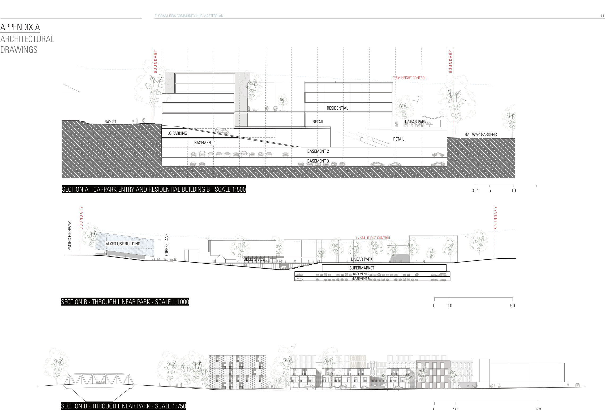

> [Picture on page 87: a map, saved as a picture (images/part-14r-references-masterplan-page-87-1.gif, 150 dpi); the street names and other small labels are on the picture.]
> Words printed on the picture (title and legend, copied from the PDF):
> 17.5M HEIGHT CONTROL

### DRAWINGS

> Words printed on the picture (title and legend, copied from the PDF):
> 17.5M HEIGHT CONTROL
> MIXED USE BUILDING

#### SECTION A - CARPARK ENTRY AND RESIDENTIAL BUILDING B - SCALE 1:500

#### SECTION B - THROUGH LINEAR PARK - SCALE 1:1000

0

0

0 1

5

#### SECTION B - THROUGH LINEAR PARK - SCALE 1:750

0

0

0 1

5

#### SECTION
