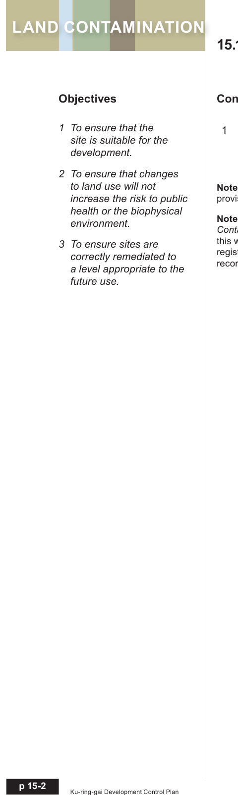

### 15.1 Land Contamination

### LAND CONTAMINATION

p 16-1

Ku-ring-gai Development Control Plan

> [Picture on page 2: a picture, saved as a picture (images/part-15-land-contamination-page-2-1.gif, 150 dpi).]
> Words printed on the picture (title and legend, copied from the PDF):
> development.
> health or the biophysical
> environment.
> record.
> correctly remediated to
> future use.
> p 15-2
> Ku-ring-gai Development Control Plan

### LAND CONTAMINATION
