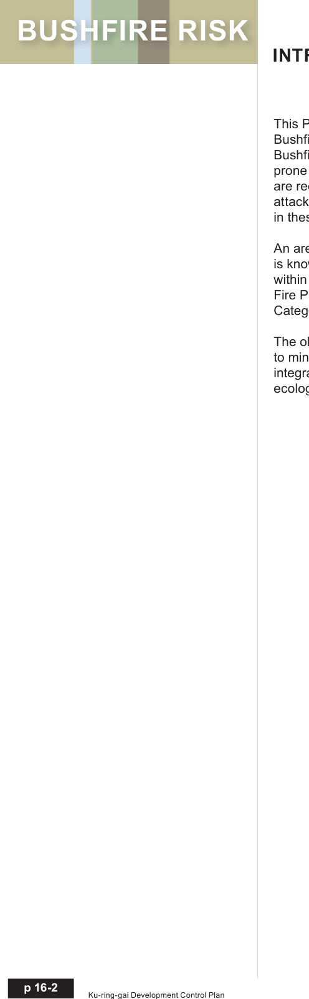

### 16.1	 Bushfire Risk Management

### PART

### BUSHFIRE RISK

### INTRODUCTION

This Part guides development on land identified on the Ku-ring-gai

Bushfire Prone Land Map and/or to land identified on the Ku-ring-gai

Bushfire Risk Evacuation Map. For other areas not identified as bush fire

prone land but within 700m proximity of the aforementioned, the controls

are recommended to reduce house loss primarily as a result from ember

attack and house-to-house ignition. It provides guidance for development

in these areas to meet the objectives in the KLEP.

An area that is likely to support a bushfire or be subject to bushfire attack

is known as a bush fire prone area. Land that falls within or partially

within a bushfire prone area is identified on Ku-ring-gai Council’s Bush

Fire Prone Land Map which consists of Bush Fire Prone Vegetation

Category 1 or Category 2 and a vegetation buffer.

The objectives and controls in this Part, use a risk based approach

to minimise direct and indirect risk to life and property, and seek the

integration of risk management, urban development, heritage and

ecological protection.

> [Picture on page 2: a picture, saved as a picture (images/part-16-bushfire-risk-page-2-18.gif, 150 dpi).]
