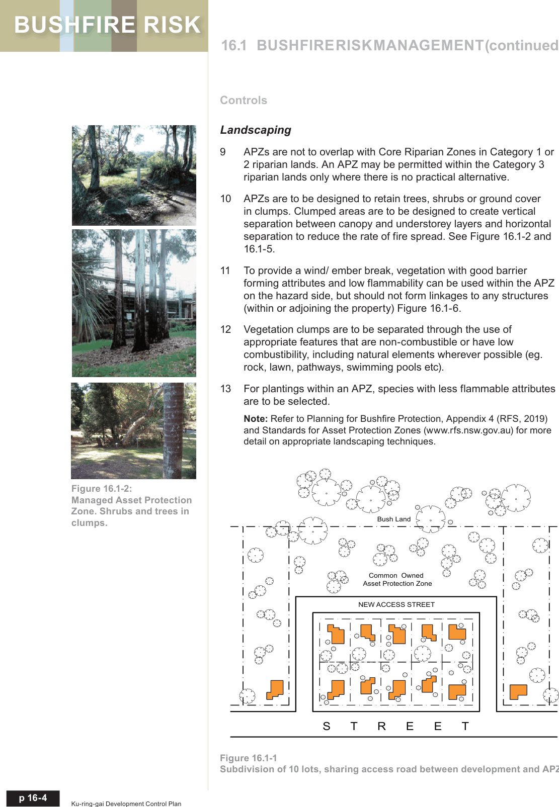

### 16.1	 BUSHFIRE RISK MANAGEMENT

#### Further controls that may apply SECTION A

PART 3: Land Consolidation

and Subdivision

#### SECTION B

PART 17: Riparian Lands

PART 18: Biodiversity

#### Controls

#### Objectives

#### Access, location and design

1 Any proposed development is to consider safe access for emergency

services, and safe evacuation for users of the development.

1	 To minimise risk to life,

property, heritage and

natural values during a

bushfire.

2 Where possible, site access must be designed to enable fire trails,

perimeter and access roads to be located between the urban

development and the bushfire prone vegetation. These areas

provide a defendable space, passive recreation and bushland views.

Managed Asset Protection Zones (APZs) are to be located to the

bushfire prone vegetation side of these access ways. See Figure

16.1-1.

2	 To avoid unsustainable

social and economic costs

to the community as a

consequence of managing

bushfire risk, now or under

changes projected as a

result of climate change.

3 Asset Protection Zones (APZs), access and perimeter roads are

to be designed to minimise impact on habitat and / or significant

vegetation.

3	 To ensure bushfire

protection is included early

in the design process.

4 Development is not to be located so as to require measures to

manage bushfire risk by other landowners/managers.

4	 To ensure safe evacuation

and emergency access in

the event of bushfire.

5 Development is to be located and designed to minimise the need for

bushfire hazard reduction, while protecting life and property.

5	 To encourage good design

and management of

development on bushfire

prone land.

6 Asset protection is to incorporate an inner protection area and an

outer protection area determined by a bush fire risk assessment.

See Figure 16.1-2 and 16.1-3. 7 Consideration is to be made to the impact of any bushfire

management measures on ecological, riparian and heritage values

of the site, and outline conditions proposed to mitigate these.

6	 To ensure development

adjacent to urban

bushland is sympathetic

and safe.

### BUSHFIRE RISK

8 Measures such as increased construction standards, building shape

and layout, siting in the landscape and improved access and water

supplies are to be considered where this would reduce the need for

removal of native vegetation or habitat. See Figure 16.1-4.

7	 To ensure that bushfire

management measures

are integrated with the

protection of areas

of environmental

significance.

Note: Development on Bushfire Prone Land is to comply with the

requirements of Planning for Bushfire Protection 2019. Protection of life

and property from bushfire is to be considered in the early design phase,

to allow appropriate construction and design techniques to be incorporated

with biodiversity and heritage management on the site. Note: The Ku-ring-gai Bushfire Prone Land Map and Bushfire Evacuation

Risk Map are available on council’s website: www.krg.nsw.gov.au.

> [Picture on page 4: a picture, saved as a picture (images/part-16-bushfire-risk-page-4-1.gif, 150 dpi).]
> Words printed on the picture (title and legend, copied from the PDF):
> 16.1-5.
> are to be selected.
> Note: Refer to Planning for Bushfire Protection, Appendix 4 (RFS, 2019)
> and Standards for Asset Protection Zones (www.rfs.nsw.gov.au) for more
> detail on appropriate landscaping techniques.
> Bush Land
> Managed Asset Protection
> Zone. Shrubs and trees in
> clumps.
> Common  Owned
> Asset Protection Zone
> NEW ACCESS STREET
> STREET
> Subdivision of 10 lots, sharing access road between development and APZ.

Figure 16.1-2:

Figure 16.1-1
