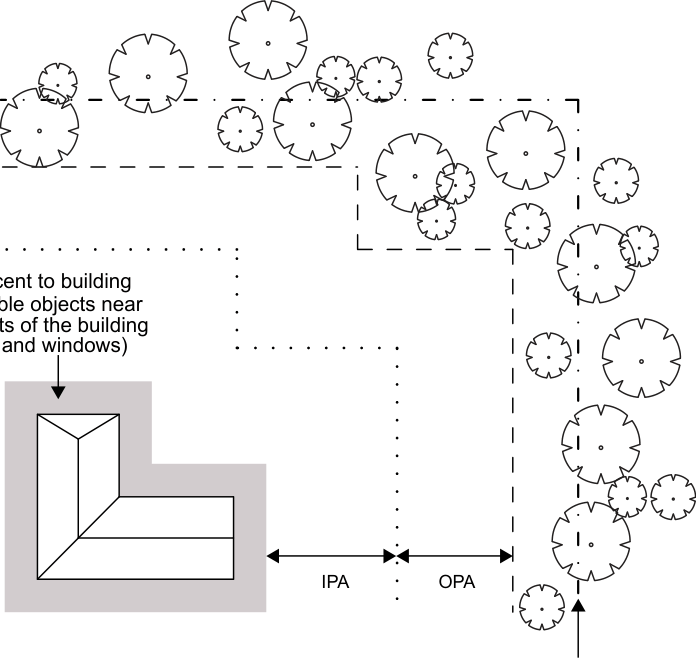
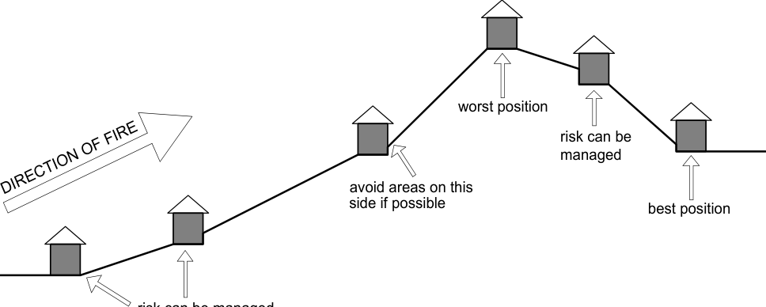

### 16.1	 BUSHFIRE RISK MANAGEMENT (continued)

> [Picture on page 5: a picture, saved as a picture (images/part-16-bushfire-risk-page-5-2.gif, 150 dpi).]
> Words printed on the picture (title and legend, copied from the PDF):
> IPA OPA

10m area adjacent to building

(avoid flammable objects near

vulnerable parts of the building

such as doors and windows)

inner protection area

IPA -

OPA -

outer protection aea

Property boundary

(on bush land side)

### BUSHFIRE RISK

Figure 16.1-3: Asset Protection Zones should incorporate an Inner Protection Area (defendable space closest

to the building) and an Outer Protection Area (reduced fuel to slow rate of spread and filter embers). The

actual APZ width is to be determined through a bushfire risk assessment prior to lodging a DA.

> [Picture on page 5: a picture, saved as a picture (images/part-16-bushfire-risk-page-5-17.gif, 150 dpi).]
> Words printed on the picture (title and legend, copied from the PDF):
> worst position
> DIRECTION OF FIRE
> avoid areas on this
> side if possible
> risk can be
> managed
> best position

risk can be managed

#### Figure 16.1-4: Example of building siting to reduce exposure risk to bushfire.

Turbulence
