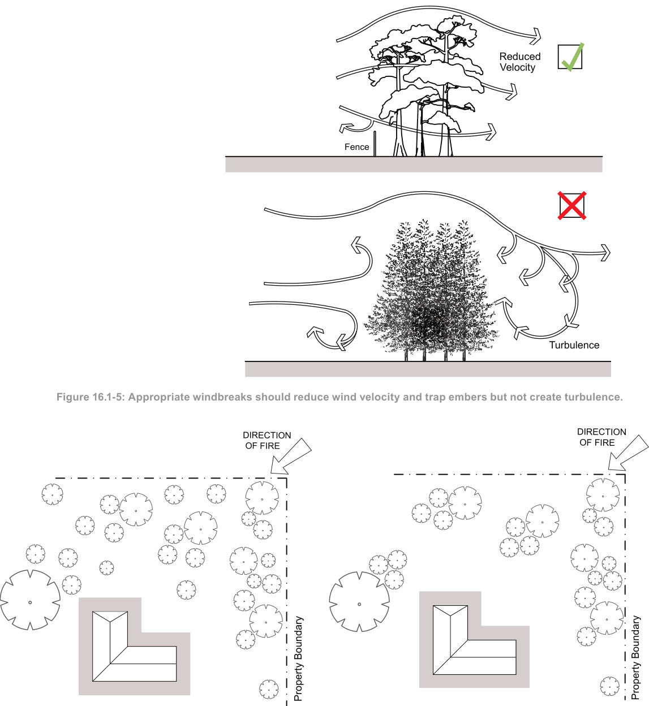

### 16.1	 BUSHFIRE RISK MANAGEMENT (continued)

> [Picture on page 6: a picture, saved as a picture (images/part-16-bushfire-risk-page-6-3.gif, 150 dpi).]
> Words printed on the picture (title and legend, copied from the PDF):
> Reduced
> Velocity
> Fence

Figure 16.1-5: Appropriate windbreaks should reduce wind velocity and trap embers but not create turbulence.

DIRECTION

OF FIRE

Property Boundary

BEFORE - vegetation continuity aids

fire spread towards building

- selective removal of shrubs to form

#### AFTER

clumps breaks vegetation continuity

#### Figure 16.1-6: Managed APZ showing spacing of trees and shrubs in clumps.

and reduces fire spread
