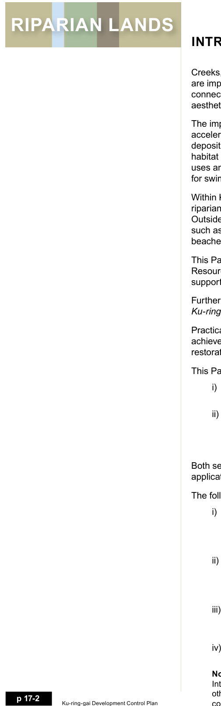

### 17.1 	 General

### 17.2 	 Category 1 Environmental Corridor

### 17.3 	 Category 2 Terrestrial and Aquatic Habitat

### 17.4 	 Category 3 Bank Stability and Water Quality

### 17.5 	 Category 3A Watercourse Restoration

### RIPARIAN LANDS

### INTRODUCTION

Creeks, aquatic habitats and the associated riparian environments

are important systems which support water quality; maintain habitat,

connectivity and biodiversity; and contribute to the character, amenity and

aesthetics of the local area. The impact of urban stormwater management systems has led to

accelerated erosion, increased localised flooding, significant sediment

deposition, increased pollution and weed proliferation as well as loss of

habitat and biodiversity. This in turn has altered the way the community

uses and values the waterways. For example, many creeks are now unfit

for swimming or other forms of recreation. Within Ku-ring-gai these changes are apparent within the streams and

riparian systems that still exist within the local government area (LGA).

Outside the LGA the impacts can be seen in the receiving water bodies

such as Sydney Harbour, the Hawkesbury River and local coastal

> [Picture on page 2: a picture, saved as a picture (images/part-17-riparian-lands-page-2-16.gif, 150 dpi).]

beaches. This Part guides development on land identified within the Natural

Resource – Riparian Lands Map in the KLEP (see clause 6.4) and

supports the achievement of the aims and objectives within the LEP. Further background on the riparian lands mapping is contained within the

Ku-ring-gai Biodiversity and Riparian Lands Study Version 5. Practical measures are provided to ensure multiple objectives are

achieved without compromising planning, development, conservation and

restoration needs. This Part is set out as follows:

i) 17.1 of this Part provides general controls for development within

all riparian land.

ii)	 17.2 - 17.5 of this Part provide additional provisions for

development within specific categories of riparian land as

identified on the Natural Resource– Riparian Lands Map in the

KLEP.

Both sections are to be addressed when preparing development

applications. The following specific riparian categories are applicable:

i) Category 1 Riparian Land includes a 40m setback from the top

of each bank which, together with the waterway, forms the core

riparian zone (CRZ); and a buffer zone of a further 10m from the

core riparian zone. Refer Figure 17.2-1.

ii)	 Category 2 Riparian Land includes a 20m setback from the top

of each bank which, together with the waterway, forms the CRZ;

and a buffer zone of a further 10m from the core riparian zone.

Refer Figure 17.3-1.

iii)	 Category 3 Riparian Land includes a 10m setback from the top

of each bank which, together with the waterway, forms the CRZ.

Refer to Figure 17.4-1.

iv)	 Category 3a Riparian Land includes the area 10m on each side

of a discontinuous or piped watercourse. Refer to Figure 17.5-1. Note: Development within ‘waterfront land’ may be Integrated Development.

Integrated Development requires consent from at least one public body

other than Council. See www.water.nsw.gov.au for links to guidelines for

controlled activities on waterfront land from NSW DPI Office of Water.
