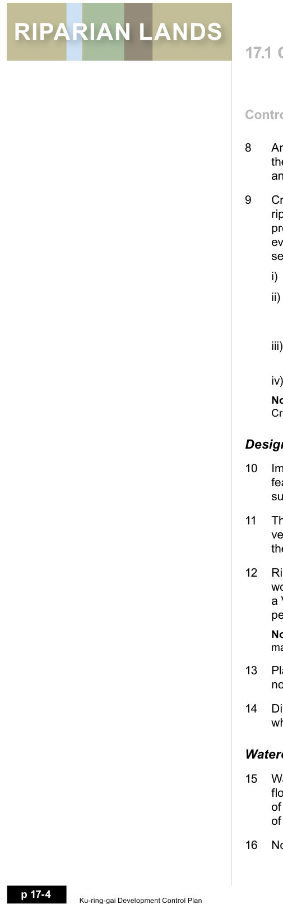

### 17.1 GENERAL (continued)

> [Picture on page 4: a picture, saved as a picture (images/part-17-riparian-lands-page-4-2.gif, 150 dpi).]

#### Controls

8 Any access to the waterway is to be located at strategic points where

the ecological integrity of the existing riparian vegetation, stream bed

and bank stability will not be compromised. 9 Crossings (ie. bridges) over natural waterbodies are to maintain

riparian connectivity; retain natural stream bed and bank profile;

prevent scour and erosion of the stream bed or banks during storm

events; not restrict bankfull or floodplain flows and not inhibit natural

sediment transport. This is to be achieved by:

i) minimising the number of crossings;

ii)	 minimising the width of the crossing to allow for pedestrian

access. Vehicle crossings will only be considered where

required;

iii)	 establishing crossings at right angles to the flow rather than at

an oblique angle; and

iv)	 minimising disturbance to existing native riparian vegetation. Note: Refer to the NSW DPI Office of Water - Guidelines for Watercourse

Crossings on Waterfront Land www.water.nsw.gov.au

#### Design

10 Impervious surfaces within the CRZ are to be minimised. Where

feasible, reduce the existing building footprint and impermeable

surfaces within riparian lands. 11 The development is to be designed to ensure connectivity of

vegetation, hydrological flows and fauna movement to, and within,

the riparian land and waterway. 12 Riparian vegetation is to be retained and enhanced, where any

works are proposed to be undertaken in the Core Riparian Zone

a Vegetation Management Plan prepared by a suitably qualified

person, is required Note: Refer to the NSW DPI Office of Water - Guidelines for vegetation

management plans on waterfront land www.water.nsw.gov.au 13 Planting of species listed in Council’s Weed Management Policy will

not be permitted within riparian lands. 14 Disturbance of soils within riparian land is to be minimised, except

where required for rehabilitation or remediation of the waterway.

#### Watercourse and flood processes

15 Watercourse and riparian land management is to be integrated with

flooding risk. Flood management studies are to consider the impacts

of rehabilitation and remediation of riparian land in the assessment

of risk and in any proposed mitigation strategies. 16 No works are to be undertaken on or near a natural waterway
