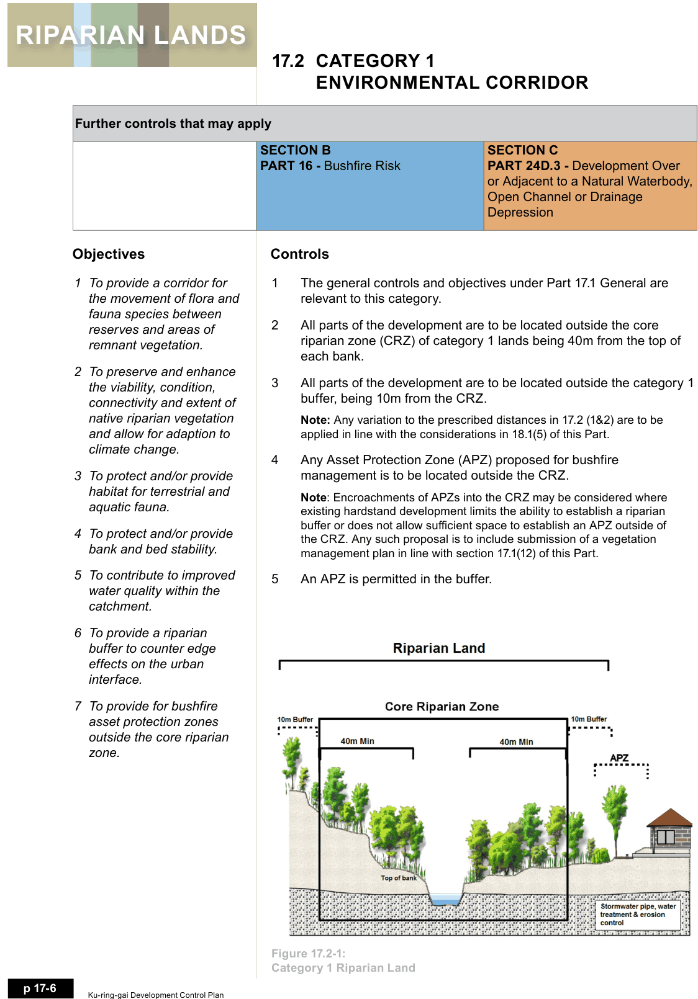
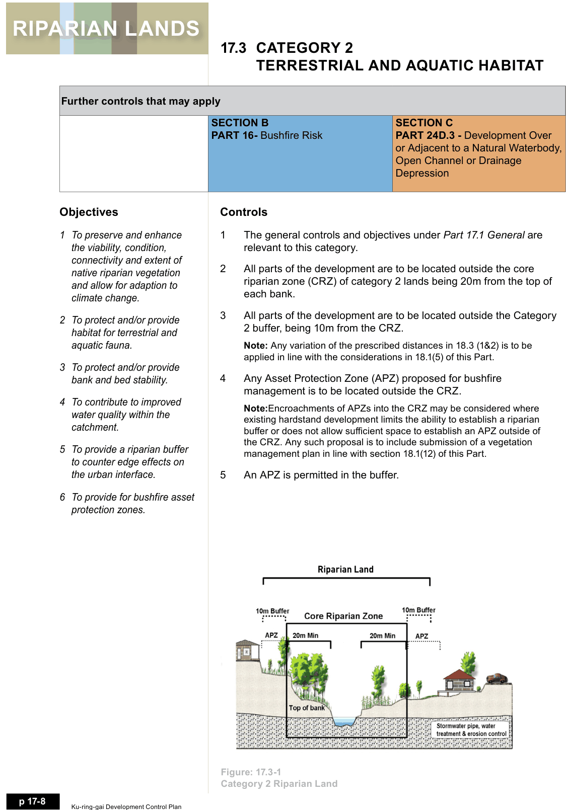
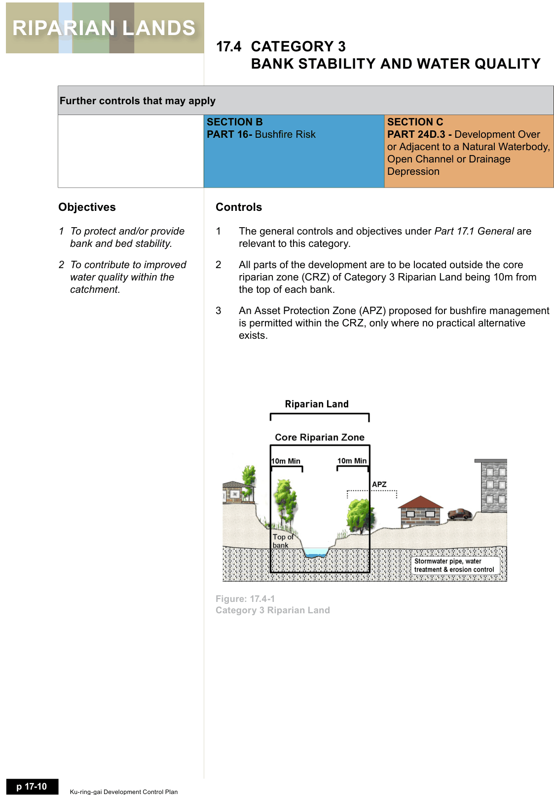
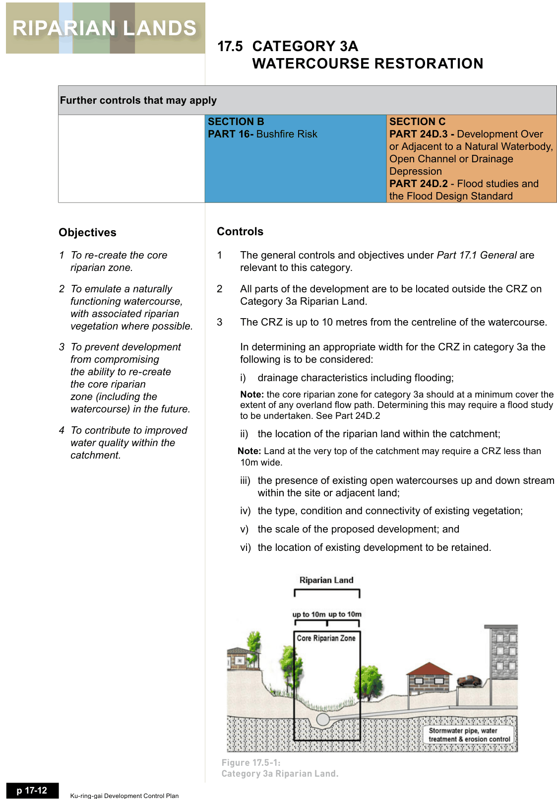

### 17.1 GENERAL (continued)

#### Controls

or section of natural waterway that would cause straightening,

significant relocation, widening, narrowing, piping or lining of the

natural waterway. 17 No works are to be undertaken on or near an artificially modified

waterway unless it involves maintenance of existing features

or naturalisation or remediation to improve the condition of the

waterway. Note: Artificially modified waterways include those that have been modified

by human activities such as relining with artificial materials and/or  those

that have been realigned (re-directed). 18 Stream bank stabilisation works should be by use of re-vegetation

methods, or if necessary, be of a ‘soft engineering’ design. 19 All stormwater discharge is to be treated before it enters the

waterway. Note: Refer to Part 24 of this DCP for post- construction water quality

standards. 20 Water quality and quantity treatments should not compromise the

biodiversity objectives of this DCP or objectives of this Part. Note: Council may require, as a condition of consent, that a restriction-on-

use be placed over the riparian land. The terms of which do not permit any

works or development including earthworks, construction, landscaping,

removal of vegetation or changes to the waterway, without the written

concurrence of Council. 21 Channel and bank stability within the CRZ is to be protected by

avoiding the removal of natural stream structure, vegetation and

woody debris, except where debris creates a flood hazard. 22 Development is to be designed to maintain or emulate a naturally

functioning watercourse wherever possible. 23 Piped services through the CRZ are to be avoided. Where

necessary use non-destructive techniques such as direct drilling,

where no part of the pipe is above ground or above the bed of the

waterway. In exceptional circumstances piered crossings may be

considered.

### RIPARIAN LANDS

> [Picture on page 6: a map, saved as a picture (images/part-17-riparian-lands-page-6-1.gif, 150 dpi); the street names and other small labels are on the picture.]
> Words printed on the picture (title and legend, copied from the PDF):
> Open Channel or Drainage
> relevant to this category.
> fauna species between
> reserves and areas of
> Note: Any variation to the prescribed distances in 17.2 (1&2) are to be
> applied in line with the considerations in 18.1(5) of this Part.
> the viability, condition,
> connectivity and extent of
> native riparian vegetation
> Note: Encroachments of APZs into the CRZ may be considered where
> habitat for terrestrial and
> bank and bed stability.
> existing hardstand development limits the ability to establish a riparian
> buffer or does not allow sufficient space to establish an APZ outside of
> the CRZ. Any such proposal is to include submission of a vegetation
> management plan in line with section 17.1(12) of this Part.
> water quality within the
> buffer to counter edge
> effects on the urban
> asset protection zones
> outside the core riparian
> Category 1 Riparian Land

Figure 17.2-1:

### ENVIRONMENTAL CORRIDOR

#### Further controls that may apply

#### SECTION B

PART 16 - Bushfire Risk

#### SECTION C

PART 24D.3 - Development Over

or Adjacent to a Natural Waterbody,

#### Controls

#### Objectives

1 The general controls and objectives under Part 17.1 General are

1	 To provide a corridor for

the movement of flora and

2 All parts of the development are to be located outside the core

riparian zone (CRZ) of category 1 lands being 40m from the top of

3 All parts of the development are to be located outside the category 1

buffer, being 10m from the CRZ.

2	 To preserve and enhance

and allow for adaption to

4 Any Asset Protection Zone (APZ) proposed for bushfire

management is to be located outside the CRZ.

3	 To protect and/or provide

4	 To protect and/or provide

5 An APZ is permitted in the buffer.

5	 To contribute to improved

6	 To provide a riparian

7	 To provide for bushfire

### ENVIRONMENTAL CORRIDOR (continued)

#### Controls Design

6 Where the riparian land within the CRZ or buffer has been disturbed

or degraded, appropriate riparian vegetation is to be revegetated

or rehabilitated. Local native vegetation assemblages, capable of

supporting the long term ecological function of the riparian land, is to

be used. 7 Where practicable, protection, regeneration and rehabilitation of

vegetation in the CRZ is to retain or achieve a density that would

occur naturally. Note: Practicability will be considered on merit. For instance, within existing

asset protection zones on bushfire prone lands, the density and design of

vegetated areas will need to meet the requirements for Asset Protection

Zones under Planning for Bushfire Protection 2019 rather than the above

controls. 8 Particular emphasis is to be given to the retention, regeneration or

revegetation of the CRZ in key locations. Including:

i) where two or more watercourses join;

ii)	 sites with significant erosion;

iii)	 stormwater outlets. 9 Plantings within the CRZ are to consist of 100% locally native

species. 10 Planting within sites that include land identified as Category 1 buffer

is to consist of:

i) not less than 70% locally native tree species and 30% locally

native understorey species;

ii)	 species that reflect the relevant vegetation communities within

the area;

iii)	 a mix of groundcover shrubs and trees and is to exclude

monocultures. Note: Council may support a variation to 8) or 9) above if suitable

justification is provided.

### RIPARIAN LANDS

> [Picture on page 8: a map, saved as a picture (images/part-17-riparian-lands-page-8-1.gif, 150 dpi); the street names and other small labels are on the picture.]
> Words printed on the picture (title and legend, copied from the PDF):
> PART 16- Bushfire Risk
> Open Channel or Drainage
> relevant to this category.
> the viability, condition,
> connectivity and extent of
> native riparian vegetation
> habitat for terrestrial and
> Note: Any variation of the prescribed distances in 18.3 (1&2) is to be
> applied in line with the considerations in 18.1(5) of this Part.
> bank and bed stability.
> Note:Encroachments of APZs into the CRZ may be considered where
> water quality within the
> existing hardstand development limits the ability to establish a riparian
> buffer or does not allow sufficient space to establish an APZ outside of
> the CRZ. Any such proposal is to include submission of a vegetation
> management plan in line with section 18.1(12) of this Part.
> the urban interface.
> Category 2 Riparian Land

### TERRESTRIAL AND AQUATIC HABITAT

#### Further controls that may apply

#### SECTION B

#### SECTION C

PART 24D.3 - Development Over

or Adjacent to a Natural Waterbody,

#### Controls

#### Objectives

1 The general controls and objectives under Part 17.1 General are

2 All parts of the development are to be located outside the core

riparian zone (CRZ) of category 2 lands being 20m from the top of

1	 To preserve and enhance

and allow for adaption to

3 All parts of the development are to be located outside the Category

2 buffer, being 10m from the CRZ.

2	 To protect and/or provide

3	 To protect and/or provide

4 Any Asset Protection Zone (APZ) proposed for bushfire

management is to be located outside the CRZ.

4	 To contribute to improved

5	 To provide a riparian buffer

to counter edge effects on

5 An APZ is permitted in the buffer.

6	 To provide for bushfire asset

### TERRESTRIAL AND AQUATIC HABITAT

### (continued)

#### Controls Design

6 Where the riparian land within the CRZ or buffer has been disturbed

or degraded, appropriate riparian vegetation is to be revegetated

or rehabilitated. Local native vegetation assemblages, capable of

supporting the long term ecological function of the riparian land, is to

be used. 7 Where practicable, protection, revegetation and remediation of

vegetation in the CRZ is to retain or achieve a density that would

occur naturally. Note: Practicability will be considered on merit. For instance, within existing

asset protection zones on bushfire prone lands, the density and design of

vegetated areas will need to meet the requirements for Asset Protection

Zones under Planning for Bushfire Protection 2019 rather than the above

controls. 8 Particular emphasis is to be given to the retention, regeneration or

revegetation of the CRZ in key locations. Including:

i) where two or more watercourses join;

ii)	 sites with significant erosion;

iii)	 stormwater outlets. 9 Plantings within the CRZ are to consist of 100% locally native

species. 10 Planting within sites that include land identified as Category 2 buffer

is to consist of:

i) not less than 70% locally native tree species and 30% locally

native understorey species;

ii)	 species that reflect the relevant vegetation communities within

the area;

iii)	 a mix of groundcover shrubs and trees and is to exclude

monocultures. Note: Council may support a variation to 8) or 9) above if suitable

justification is provided.

### RIPARIAN LANDS

> [Picture on page 10: a picture, saved as a picture (images/part-17-riparian-lands-page-10-1.gif, 150 dpi).]
> Words printed on the picture (title and legend, copied from the PDF):
> PART 16- Bushfire Risk
> Open Channel or Drainage
> Depression
> bank and bed stability.
> relevant to this category.
> water quality within the
> catchment.
> exists.
> Figure: 17.4-1
> Category 3 Riparian Land

### BANK STABILITY AND WATER QUALITY

#### Further controls that may apply

#### SECTION B

#### SECTION C

PART 24D.3 - Development Over

or Adjacent to a Natural Waterbody,

#### Objectives

#### Controls

1	 To protect and/or provide

1 The general controls and objectives under Part 17.1 General are

2	 To contribute to improved

2 All parts of the development are to be located outside the core

riparian zone (CRZ) of Category 3 Riparian Land being 10m from

the top of each bank. 3 An Asset Protection Zone (APZ) proposed for bushfire management

is permitted within the CRZ, only where no practical alternative

#### Riparian Land

### BANK STABILITY AND WATER QUALITY

### (continued)

#### Controls Design

4 Where the CRZ has been disturbed or degraded, appropriate

riparian vegetation is to be revegetated or rehabilitated. Locally

native vegetation assemblages, capable of supporting the long term

ecological function of the riparian land, are to be used. 5 Protection, revegetation and rehabilitation of vegetation in the CRZ

to is achieve a density that would occur naturally, except where the

zone is within bushfire prone land. 6 Particular emphasis is to be given to the retention, regeneration or

revegetation of the CRZ in key locations. Including:

i) where 2 or more watercourses join;

ii)	 sites with significant erosion;

iii)	 stormwater outlets. 7 Planting within the channel and within 2 metres of the top of the

bank is to consist of 100% locally native species. Species are to

reflect the relevant vegetation communities within the area. A mix of

groundcover, shrubs and trees is to be provided. 8 Planting within Category 3 lands more than 2 metres from the top of

the bank is to consist of:

i) not less than 70% locally native tree species and 30% locally

native understorey species;

ii)	 species that reflect the relevant vegetation communities within

the area;

iii)	 a mix of groundcover shrubs and trees and is to exclude

monocultures. Note: Council may support a variation to 6) or 7) above if suitable

justification is provided.

### RIPARIAN LANDS

> [Picture on page 12: a map, saved as a picture (images/part-17-riparian-lands-page-12-1.gif, 150 dpi); the street names and other small labels are on the picture.]
> Words printed on the picture (title and legend, copied from the PDF):
> PART 16- Bushfire Risk
> Open Channel or Drainage
> the Flood Design Standard
> relevant to this category.
> Category 3a Riparian Land.
> with associated riparian
> vegetation where possible.
> 3	 To prevent development
> the ability to re-create
> the core riparian
> zone (including the
> watercourse) in the future.
> Note: the core riparian zone for category 3a should at a minimum cover the
> extent of any overland flow path. Determining this may require a flood study
> to be undertaken. See Part 24D.2
> Note: Land at the very top of the catchment may require a CRZ less than
> water quality within the
> Category 3a Riparian Land.

Figure 17.5-1:
