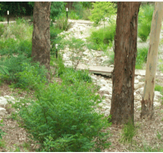
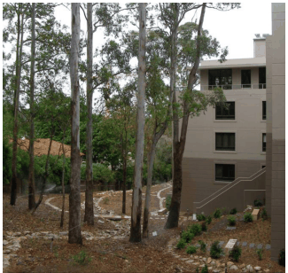
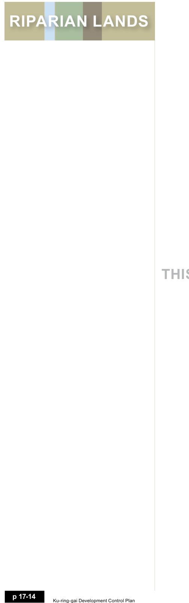

### 17.5 	CATEGORY 3A

### WATERCOURSE RESTORATION (continued)

#### Controls Access

4 Vehicular and pedestrian crossings over piped waterways are to

comply with the easement provisions in Part 24D.4. Note: Where a watercourse is re-created the general access controls apply

#### Design

5 Piped or channelised re-instatement of the watercourse to a more

natural form is only a mandatory consideration for land zoned R3

Medium Density Residential, R4 High Density Residential, or sub-

divisions into 3 or more lots, and is to be undertaken where feasible.

Feasibility of channel restoration is to be determined taking into

consideration the factors outlined in the Controls in clause 17.5(2) of

this Part. Note: watercourse re-instatement is most likely to be feasible on larger

developments where landscaping and drainage works are already

significant and re-instatement of the watercourse can help achieve

beneficial social and environmental outcomes 6 Where a watercourse is re-created the design controls for Category

3 apply.

#### Watercourse and flood processes

7 Piped waterways are to comply with the flooding and easement

provisions in Part 24D.4. Note: Where a watercourse is re-created the Watercourse and Flood

> [Picture on page 13: a picture, saved as a picture (images/part-17-riparian-lands-page-13-26.gif, 150 dpi).]

Process Controls from Part 16.1 apply.

> [Picture on page 13: a picture, saved as a picture (images/part-17-riparian-lands-page-13-28.gif, 150 dpi).]

### RIPARIAN LANDS

#### Figure 17.5-2:

Partially restored watercourse in new residential development.

#### Figure 17.5-3:

#### Same partially restored watercourse

a few months later.

### THIS PAGE IS INTENTIONALLY BLANK

> [Picture on page 14: a picture, saved as a picture (images/part-17-riparian-lands-page-14-2.gif, 150 dpi).]
