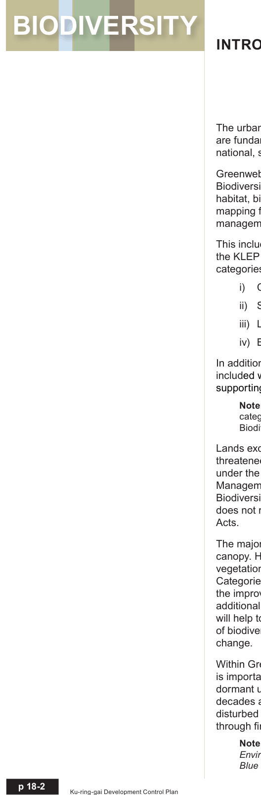
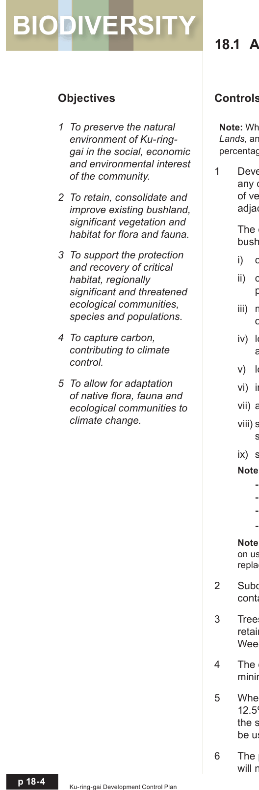

### 18.6 Category - Canopy Remnant

### 18.7 No Net Loss of Biodiversity

Explanation of Greenweb Categories and Sub Categories

18.8

#### 18R References

18R.1 	 Greenweb Maps (separate document)

### BIODIVERSITY

> [Picture on page 2: a picture, saved as a picture (images/part-18-biodiversity-page-2-1.gif, 150 dpi).]
> Words printed on the picture (title and legend, copied from the PDF):
> categories:

### INTRODUCTION

The urban forest, formal reserves and natural resources of Ku-ring-gai

are fundamental elements of its character and support biodiversity of

national, state, regional and local significance. Greenweb (as shown on the Greenweb map - Part 18R.1) is Ku-ring-gai’s

Biodiversity mapping for the management of significant vegetation and

habitat, biodiversity corridors and waterways throughout the LGA. The

mapping facilitates a consistent and strategic approach to biodiversity

management. This includes lands mapped as ‘areas of biodiversity significance’ within

the KLEP (Clause 6.3 Biodiversity Protection), broken down into four

i) Core Biodiversity Lands;

ii)	 Support for Core Biodiversity Lands;

iii)	 Landscape Remnant;

iv)	 Biodiversity Corridors and Buffer Areas. In addition to these, an additional category - ‘Canopy Remnant’ is also

included within the DCP for the role these Canopy Remnant play in

supporting ecological processes and other values. Note: Further explanation and the methodology for identifying Greenweb

categories is provided within Part 18.8 of this DCP and the Ku-ring-gai

Biodiversity and Riparian Lands Study Version 5. Lands excluded from Greenweb may still contain or provide habitat for

threatened ecological communities, species or populations as listed

under the NSW Biodiversity Conservation Act 2016, the NSW Fisheries

Management Act 1994, and / or the Environment Protection and

Biodiversity Conservation Act 1999. Absence of areas from the Greenweb

does not remove the need for consideration and protection under these

Acts. The majority of areas within the Greenweb include native vegetation

canopy. However some areas containing cleared, built or exotic

vegetation have been included (See Part 18.8 Explanation of Greenweb

Categories and Sub Categories). The inclusion of such areas facilitates

the improvement of connectivity between core habitats and may provide

additional functions such as protection of water quality. These measures

will help to maintain and restore the health, diversity and connectivity

of biodiversity within Ku-ring-gai and improve resilience under climate

change. Within Greenweb the potential for presence of a native soil seed bank

is important. This is the natural storage of seeds that remains largely

dormant until triggered by disturbance. Many plants can survive for

decades as seeds stored in soil. Areas which may look visibly weedy or

disturbed may contain a native seed bank and potential for restoration

through fire, weed removal or other disturbance mechanisms. Note: “The soil seedbank is the key to regeneration” (Department of

Environment and Climate Change NSW 2008, Protecting and Restoring

Blue Gum High Forest)

### INTRODUCTION

The Greenweb maps should not be used at a scale finer than 1:2,000.

There are considerable benefits to natural resource planning at this

scale, however investigations at a site scale for individual proposals may

identify inaccuracies or on ground changes. Variations to Greenweb mapping as proposed by either Council or

the proponent will be considered on merit, based on the methodology

outlined in the Ku-ring-gai Biodiversity and Riparian Lands Study Version

5\. The objectives and controls in this Part applies to development

activities or works that will have an impact on areas identified as

Greenweb, mapped in this DCP. Within these areas, this Part guides the

development activities or works in meeting the aims and objectives of the

KLEP (Clause 6.3 Biodiversity Protection). Where there are inconsistencies between this Part and Section C Part

1.1 (Landscaping) of this DCP, this Part prevails to the extent of any

inconsistency. This Part is set out as follows:

i) Part 18.1 includes general objectives and controls that apply to

all development on Greenweb lands;

ii)	 Parts 18.2 – 18.6 provide objectives and controls for each of the

five categories of Greenweb based on the main functions and

objectives of each area;

iii)	 Part 18.7 provides for no net loss of biodiversity and outlines

mechanisms to achieve this;

iv)	 Part 18.8 provides the explanation of Greenweb categories.

### BIODIVERSITY

> [Picture on page 4: a map, saved as a picture (images/part-18-biodiversity-page-4-1.gif, 150 dpi); the street names and other small labels are on the picture.]
> Words printed on the picture (title and legend, copied from the PDF):
> environment of Ku-ring-
> and environmental interest
> of the community.
> improve existing bushland,
> significant vegetation and
> and recovery of critical
> significant and threatened
> species and populations.
> 4	 To capture carbon,
> contributing to climate
> ecological communities to

#### Objectives

1	 To preserve the natural

gai in the social, economic

2	 To retain, consolidate and

habitat for flora and fauna. 3	 To support the protection

5	 To allow for adaptation

of native flora, fauna and
