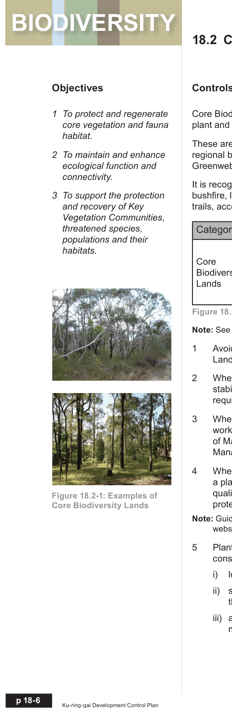

### 18.1	 ALL GREENWEB CATEGORIES (continued)

#### Controls

7 Species used for planting in or directly adjacent to Greenweb areas

should be of local provenance. 8 A flora and fauna assessment will be required where development

within Greenweb lands impacts on connectivity, existing indigenous

vegetation, fauna or habitat. Note: This may be waived where  an assessment has already been

undertaken as part of a Biodiversity Development Assessment Report

(BDAR) in accordance with Part 7 of the NSW Biodiversity Conservation

Act 2016. Note: Flora and fauna assessments must be undertaken by an

appropriately qualified and experienced person. Council assessment

provisions are available on Council’s website (www.krg.nsw.gov.au). Survey and assessments should be undertaken in accordance with

guidelines from the NSW Environment, Energy and Science Group. 9 The introduction of imported soils and disturbance of local seed banks are

to be avoided wherever possible. 10 Vegetation retention is to consider mature trees and hollow-bearing trees

within biodiversity areas as a priority for retention.

### BIODIVERSITY

> [Picture on page 6: a picture, saved as a picture (images/part-18-biodiversity-page-6-1.gif, 150 dpi).]
> Words printed on the picture (title and legend, copied from the PDF):
> core vegetation and fauna
> habitat.
> ecological function and
> connectivity.
> and recovery of Key
> Vegetation Communities,
> threatened species,
> populations and their
> habitats.
> Core Biodiversity Lands

Figure 18.2-1: Examples of

#### Objectives

1	 To protect and regenerate

2	 To maintain and enhance

3	 To support the protection
