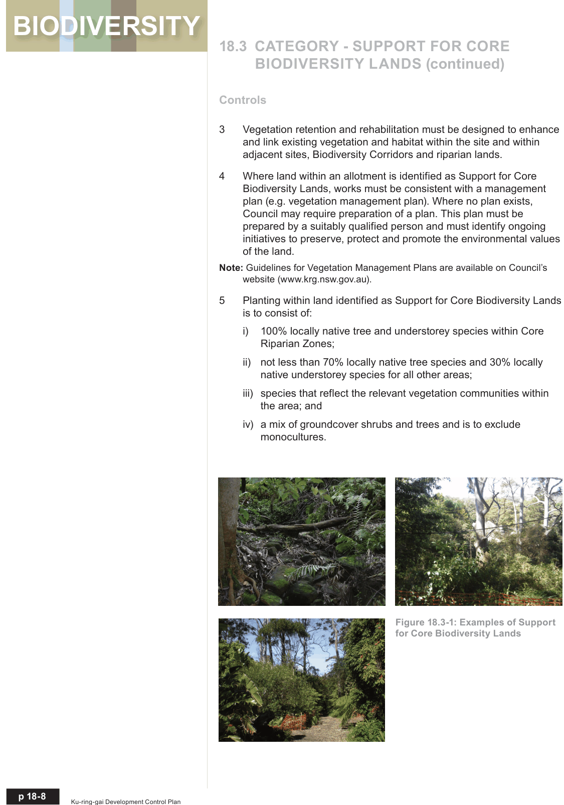

### 18.3	 CATEGORY - SUPPORT FOR CORE

### BIODIVERSITY LANDS

#### Controls

Land identified as Support for Core Biodiversity Lands provide a range of

support values, including increased remnant size, reduced edge effects

and connectivity between Core Biodiversity Lands (see Figure 18.3-1). They also include patches of Local Fauna Habitat and/or of Key

Vegetation Communities and support the health of waterways. This

category includes vegetation where protection, restoration, rehabilitation

or regeneration works are required to enhance overall biodiversity values. Biodiversity Corridors have been located in positions of strategic

importance, providing linkages between natural habitat areas such as

formal reserves or remnant patches. Whilst these corridors typically

contain barriers, including buildings, roads and infrastructure or

discontinuous vegetation, they are important stepping stones or refuge

sites for movement and dispersal of mobile species between more

extensive habitat areas.

Note: Biodiversity Corridor area lacking vegetation are addressed in Category

Biodiversity Corridor and Buffer Areas (Part 18.5).

Biodiversity Corridors play a vital role in improving the viability of

otherwise isolated areas.

Linking core areas through an urbanised landscape by means of

corridors:

- assists fauna movement by improving vegetation cover,

decreasing predation risk and promoting food resources within

a species foraging range;

- supports pollination, seed and gene dispersal, which may

assist in the protection of high biodiversity values including

endangered ecological communities and threatened flora and

fauna.

| Category | Sub Category |
|---|---|
| Support for Core Biodiversity Lands | Key Vegetation Communities (KVC), adjoining Core Biodiversity Lands Local Fauna Habitat Vegetation within Core Riparian Zones and KVC’s adjoining All vegetation within Biodiversity Corridors |

### BIODIVERSITY

#### Figure 18.3-1 Areas identified as Support for Core Biodiversity Lands

Note: See Part 18.8 for explanation of Greenweb categories. 1 Avoid locating development on areas identified as Support for Core

Biodiversity Lands on the Greenweb map. (Refer to maps in 18R.1 of

this Part).

2 Where work impacts on land within Support for Core Biodiversity

Lands, stabilisation and or rehabilitation with indigenous vegetation

will be required to mitigate impacts.

> [Picture on page 8: a picture, saved as a picture (images/part-18-biodiversity-page-8-1.gif, 150 dpi).]
> Words printed on the picture (title and legend, copied from the PDF):
> of the land.
> website (www.krg.nsw.gov.au).
> Riparian Zones;
> the area; and
> monocultures.
