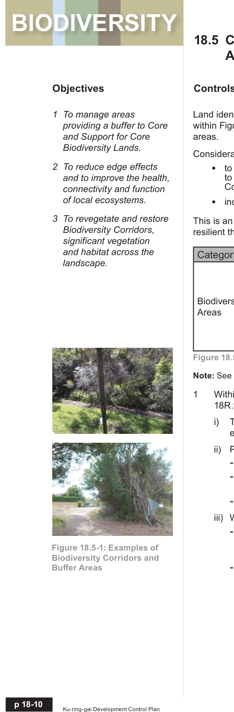

### 18.4	 CATEGORY - LANDSCAPE REMNANT

#### Controls

Landscape Remnant comprises areas that are more fragmented than

Support for Core Biodiversity Lands, which nevertheless contain Key

Vegetation Communities and support core areas (see Figure 18.4-1).

These areas act as stepping stones or habitat islands to facilitate the

movement of flora, fauna and genetic resources through the urban

landscape and across a range of topographies. They also provide

important community and aesthetic values.

| Category | Sub Category |
|---|---|
| Landscape Remnant | Larger Key Vegetation Community (KVC) patches or KVC in good to moderate condition Significant trees within Key Vegetation Communities |

#### Figure 18.4-1 Areas identified as Landscape Remnant

Note: See Part 18.8 for explanation of Greenweb categories. 1 Avoid locating development on land identified as - Landscape

Remnant; on the Greenweb map. (Refer to maps in 18R.1 of this

Part).

2 Vegetation retention and rehabilitation on sites that include land

identified as Landscape Remnant must be designed to improve

connectivity with existing vegetation and habitat. 3 Planting within land identified as Landscape Remnant on the

Greenweb map is to consist of:

i) not less than 50% locally native species;

ii)	 species that reflect the relevant vegetation communities within

the area; and

iii)	 a mix of groundcover, shrubs and trees, and is to exclude

monocultures.

### BIODIVERSITY

4 Where the site contains high species diversity or is dominated by

weeds within any stratum, preparation of a Vegetation Management

Plan by a suitably qualified person may be required. This plan must

identify ongoing initiatives to preserve, protect and promote the

environmental values of the land.

Note: Weeds are listed in Council’s Weed Management Policy, with updated

weed information available from the NSW Department of Primary Industries

(www.dpi.nsw.gov.au).

Note: Guidelines for Vegetation Management Plans are available on Council’s

website (www.krg.nsw.gov.au).

> [Picture on page 10: a picture, saved as a picture (images/part-18-biodiversity-page-10-1.gif, 150 dpi).]
> Words printed on the picture (title and legend, copied from the PDF):
> 1	 To manage areas
> and Support for Core
> Biodiversity Lands.
> connectivity and function
> of local ecosystems.
> Biodiversity Corridors,
> significant vegetation
> and habitat across the
> landscape.
> Biodiversity Corridors and
> Buffer Areas

Figure 18.5-1: Examples of

#### Objectives

providing a buffer to Core

2	 To reduce edge effects

and to improve the health,

3	 To revegetate and restore
