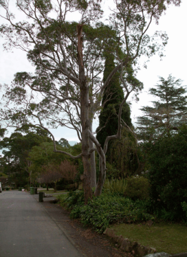

### 18.5	 CATEGORY - BIODIVERSITY CORRIDORS

### AND BUFFER AREAS

#### Controls

Land identified as Biodiversity Corridors and Buffer areas (as outlined

within Figure 18.5-1) includes both vegetation, cleared, disturbed or built

areas.

Consideration of these lands provides an opportunity:

• to undertake revegetation, rehabilitation or regeneration works,

to re-connect remnants with Greenweb, improving Biodiversity

Corridors;

• increase remnant size and buffering edge effects. This is an important aim as larger more consolidated remnants are more

resilient than fragmented or linear remnants.

| Category | Sub Category |
|---|---|
| Biodiversity Corridors and Buffer Areas | Buffer Areas for Core Biodiversity Lands & Support for Core Biodiversity Lands Biodiversity Corridor areas lacking vegetation |

#### Figure 18.5-1 Areas identified as Biodiversity Corridors and Buffer Areas

Note: See Part 18.8 for explanation of Greenweb categories. 1 Within Biodiversity Corridors and Buffer Areas (refer to maps in

18R.1 of this Part):

i) The siting and design of development must minimise edge

effects on Greenweb.

ii)	 Planting is to consist of :

- not less than 50% locally native species;

- species that reflect the relevant vegetation communities within

the area; and

- a mix of groundcover, shrubs and trees.

iii)	 Within Biodiversity Corridors (refer to maps in 18R.1 of this Part):

- landscaping and revegetation must be designed to consolidate

fragmented and linear vegetation and habitat areas within the

site and adjacent sites.

- the width of Biodiversity Corridors should be enhanced and

gaps and barriers reduced or minimised

#### Objectives

1	 To protect smaller canopy

remnant for habitat,

species diversity and

ecosystem services

across a range of

topographies.

2	 To maintain trees for the

services they provide to

human well-being. 3	 To improve air quality,

prevent soil erosion, assist

in improving water quality,

carbon sequestration,

storm water retention,

energy conservation and

noise reduction

> [Picture on page 11: a picture, saved as a picture (images/part-18-biodiversity-page-11-18.gif, 150 dpi).]

Figure 18.6-1: Examples of

#### Canopy Remnant
