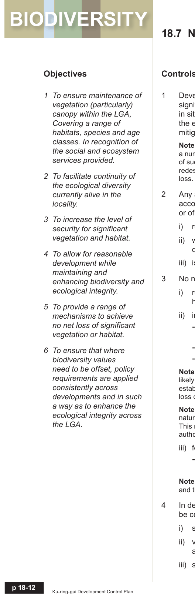

### 18.6	 CATEGORY - CANOPY REMNANT

#### Controls

Canopy Remnant comprise areas that contain Key Vegetation

Communities have little to no understorey and are smaller than those

mapped within the other four Greenweb categories included within the

Biodiversity Map of KLEP (see Figure 18.6-1).

In addition to their intrinsic value as communities of high conservation

priority, Canopy Remnant provide habitat for urban, transient or locally

mobile species. They support species diversity and ecosystem services

including maintenance of air and water quality, soil erosion, carbon

storage.

| Category | Sub Category |
|---|---|
| Canopy Remnant | Smaller Key Vegetation Community patches NOT in good to moderate condition |

#### Figure 18.6-1 Areas identified as Greenweb Canopy Remnant

Note: See Part 18.8 for explanation of Greenweb categories. 1 Retain trees identified as Canopy Remnant on the Greenweb map

(refer to maps in 18R.1 of this Part).

2 Planting within land identified as Canopy Remnant is to consist of:

i) not less than 30% locally native species;

ii)	 species that reflect the relevant vegetation communities within

the area; and

iii)	 a mix of groundcover, shrubs and trees and is to exclude

monocultures.

### BIODIVERSITY

> [Picture on page 12: a map, saved as a picture (images/part-18-biodiversity-page-12-1.gif, 150 dpi); the street names and other small labels are on the picture.]
> Words printed on the picture (title and legend, copied from the PDF):
> canopy within the LGA,
> Covering a range of
> habitats, species and age
> classes. In recognition of
> the social and ecosystem
> the ecological diversity
> currently alive in the
> security for significant
> vegetation and habitat.
> enhancing biodiversity and
> mechanisms to achieve
> vegetation or habitat.
> requirements are applied
> developments and in such
> ecological integrity across

#### Objectives

1	 To ensure maintenance of

2	 To facilitate continuity of

3	 To increase the level of

4	 To allow for reasonable

5	 To provide a range of

no net loss of significant

6	 To ensure that where

need to be offset, policy

a way as to enhance the
