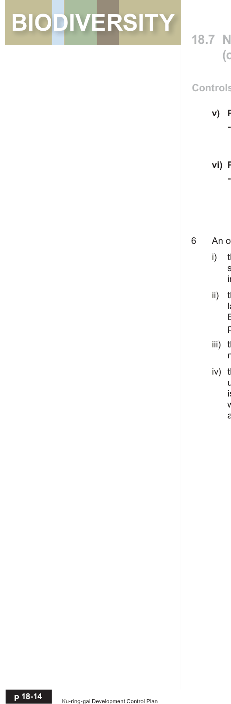

### 18.7	 NO NET LOSS OF BIODIVERSITY

#### Controls

1 Development proposals must seek to achieve no net loss of

significant vegetation or habitat. Retention of vegetation and habitat

in situ is the preferred method of biodiversity conservation. In

the event that loss of vegetation is unavoidable, the loss must be

mitigated and/or offset.

Note: Both informal compensatory measures and formal offsetting include

a number of ecological, administrative and financial risks. The inclusion

of such measures within a proposal does not preclude Council requiring

redesign of, or refusing consent to, a proposal on grounds of biodiversity

2 Any application for works within the Greenweb, must be

accompanied by a proposal to protect, enhance or create habitat on

or off site, where it:

i) requires the removal of native vegetation; or

ii)	 will negatively affect actual or potential habitat of fauna or flora;

or

iii)	 is likely to cause degradation to vegetation or habitat. 3 No net loss of significant vegetation or habitat may be achieved by:

i) retention and protection of existing significant vegetation and

habitat; or

ii)	 informal compensatory measures:

- planting and habitat creation, especially where it improves

connectivity;

- rehabilitation of degraded areas; or

- translocation of plants or soils;

Note: Where disturbance to intact, resilient natural soil profiles (that are

likely to contain a healthy native seedbank) is to occur, translocation to and

establishment within a viable recipient site is a key action towards no net

loss of significant vegetation or habitat.

Note: In certain circumstances Council may request that native flora, fauna,

natural features (e.g. rocks, logs) or viable soil profiles are translocated.

This material may be used by the proponent, Council or other relevant

authority to aid either in the offsetting site or other restoration program.

iii)	 formal offsetting measures:

- application of the Biodiversity Offsets Scheme in accordance

with Part 6 of the NSW Biodiversity Conservation Act 2016.

Note: Conditions will apply to how and where offset actions are applied,

and these will be determined by Council.

4 In determining the appropriate measures a number of factors must

be considered:

i) size and condition of the vegetation or habitat;

ii)	 vegetation or habitat significance, including its legislative status,

and its Greenweb category;

iii)	 scale and duration of the impact;

### (continued)

#### Controls

iv)	 current and future landscape context;

v)	 level of uncertainty; and

vi)	 any other mitigation measures proposed as part of the

development. Note: It is strongly recommended that for developments considering

offsetting that pre-lodgement discussions are held with Council. 5 Any proposal involving an offsetting mechanism, on or off site, must

be in accordance with the following principles:

i) Principle 1: Avoid, Minimise and Mitigate

- Offsetting will only be considered once all efforts to avoid,

minimise or mitigate any negative impacts have been

exhausted.

ii)	 Principle 2: Improve or Maintain Overall Biodiversity

- In order to achieve no net loss, offsetting must seek to

improve or maintain overall biodiversity.

- Offsetting must not be used as a justification for granting

approval to developments, where the cumulative impacts are

greater than the benefit to be obtained from the offset action.

- Offset sites are to be identified and selected in accordance

with regional and local conservation priorities. Offset sites

and actions must be assessed according to their long-term

viability.

iii)	 Principle 3: Like for Like

- The area which receives offset actions (the offset site)

must contain or restore the same ecological community or

threatened species/population habitat as the area which is

being adversely impact by the development or activity (the

impact site).

- Within areas where one vegetation community grades into

### BIODIVERSITY

another (ecotone areas) flexibility will be permitted. Similarly,

Council will consider offsetting to adjoining vegetation

communities where a benefit to the relevant community is

demonstrated.

- Where a proposal will impact an area of known breeding or

key habitat for threatened species, the offset site must include

known habitat for that species (i.e. the species is known to be

present).

- Offsets that are not like for like will only be considered where

no suitable ‘like for like’ offset is available or the alternate

offset will provide a net biodiversity benefit of equal or greater

ecological significance within the bioregion.

iv)	 Principle 4: Supplement Existing Protection and

#### Management

- Offsets must be supplementary and provide for increased

extent, improved condition and/or protection.

### (continued)

> [Picture on page 14: a picture, saved as a picture (images/part-18-biodiversity-page-14-2.gif, 150 dpi).]

#### Controls

v)	 Principle 5: Enforceability

- Offsets and their actions must be enforceable and include

monitoring and reporting to ensure that the actions have been

carried out, and are leading to positive biodiversity outcomes.

vi)	 Principle 6: The Precautionary Principle

- In conducting an offsetting action the precautionary principle

must be applied. This principle requires that a conservation

approach be taken, where there is uncertainty or lack of

scientific confidence in an action and there are threats of

serious or irreversible environmental damage.

6 An offsetting action will not be appropriate if:

i) the applicant fails to adequately demonstrate to Council’s

satisfaction that all measures to address the offsetting principals

in Clause 4 have been taken.

ii)	 the proposed development is an inappropriate use of the

land subject to the proposal, as assessed under the NSW

Environmental Planning & Assessment Act 1979 and any local

plans, policies or strategies.

iii)	 the applicant has failed to adequately demonstrate to Council the

need for the offsetting action.

iv)	 the environmental impact in the development site is

unacceptable. An example of how this may arise is where there

is a likelihood of irreplaceable loss of biodiversity values that

will not be adequately compensated by the proposed offsetting

actions.
