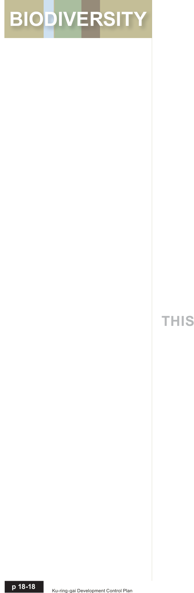

### 18.8	 EXPLANATION OF GREENWEB

### CATEGORIES AND SUB CATEGORIES

Further background on this mapping, including a detailed mapping

methodology is contained within the Ku-ring-gai Biodiversity and

Riparian Lands Study Version 5. Note: These categories are designed to be created in progressive order

as listed below (from top to bottom) as data from one layer may be needed

for those below. Where the criteria for an area fits within more than one

category, the category listed first in the order shown below applies.

#### Office of Environment and Heritage Protected Areas

Description: Formal reserves containing Office of Environment and

Heritage estate managed for the purpose of biodiversity protection

#### Ku-ring-gai Natural Areas

Description: Formal reserves consisting of areas managed by

Ku-ring-gai Council as Natural Areas under the NSW Local Government

Act 1993 for the purpose of biodiversity protection.

#### Core Biodiversity Lands

#### Regional Fauna Habitat

Description: Regional Fauna Habitat as mapped by Ku-ring-gai Council

consists of regionally important connected areas including private and

public land. These areas provide resources for threatened and non-

threatened fauna species and populations.

#### Key Vegetation Communities (KVC) adjoining Core Biodiversity

#### Lands

Description: Areas of KVC directly adjoining lands mapped as Core

Biodiversity Lands Local Fauna Habitat

Description: Local Fauna Habitat as mapped by Ku-ring-gai Council is

provided by isolated remnants located more centrally in the LGA. This

includes areas within private and public land ownership.

#### Vegetation within Core Riparian Zones and KVC’s adjoining

Description: All vegetation within Core Riparian Zones (see Part 18),

including native and non-native species, with the exception of Riparian

Category 3a (consisting of piped creeks).

### BIODIVERSITY

#### Support for Core

#### Biodiversity Lands

For Riparian Category 3a, mapped areas are limited to lands containing

KVC’s only AND KVC’s adjoining vegetation within Core Riparian Zones identified above. Note: Only Core Riparian Zone areas are used. This excludes the 10m buffers

applied to the Category 1 and 2 riparian lands.

#### All vegetation within Biodiversity Corridors

Description: All vegetation including non local / non-native species,

within Biodiversity Corridors as mapped by Ku-ring-gai Council. Note: Areas lacking vegetation within biodiversity corridors are included within

lands mapped as Biodiversity Corridors and Buffer Areas.

### CATEGORIES AND SUB CATEGORIES

### (continued)

|  | Larger Key Vegetation Community (KVC) patches or KVC in good to moderate condition Description: |
|---|---|
|  | Patches (areas of adjoining) KVCs that are ≥ 0.1ha in size; |
|  | OR |
|  | KVC vegetation of good or moderate condition. |
|  | Note: Good condition vegetation, includes: |
|  | • Canopy, midstorey and understorey in good condition. |
|  | • Regeneration occurring within all layers. |
| Landscape Remnant | • Native dominated within all layers. Moderate condition vegetation, includes: • Native medium to dense tree overstorey, with native shrub and ground layers, and • Native dominated within 2 layers. Significant trees within Key Vegetation Communities Description: Includes patches containing significant trees within KVCs identified by Ku-ring-gai Key Vegetation Community mapping. The mapping is not considered to capture every significant tree within the urban landscape. Factors considered in determining significance include; the presence of habitat (e.g. a hollow), provision of food for wildlife, and/or exceptional form or size. Buffer Areas for Core Biodiversity Lands and Support for Core Biodiversity Lands Description: Includes all areas within 8m of lands mapped as Core Biodiversity Lands or Support for Core Biodiversity Lands. Including both vegetated and non-vegetated areas that are not already included within categories listed above. |
| Biodiversity Corridors and Buffer Areas | Note: The buffering of Core Biodiversity Lands & Support for Core Biodiversity Lands required to create this layer, leaves a number of holes that are considered too small to inform planning decisions (less than 5 m2). These areas were removed. Biodiversity Corridor Areas Lacking Vegetation Description: This includes areas lacking vegetation, within Biodiversity Corridors as mapped by Ku-ring-gai Council. Note: Vegetated areas within biodiversity corridors are included within lands mapped as Support for Core Biodiversity Lands. |

### CATEGORIES AND SUB CATEGORIES

### (continued)

Smaller Key Vegetation Community Patches NOT in good to

moderate condition Description: Patches (areas of adjoining) KVC (excluding areas

containing vegetation in good or moderate condition) that are <0.1ha in

size. Note: Good condition vegetation includes:

• Canopy, midstorey and understorey in good condition.

#### Canopy Remnant

• Regeneration occurring within all layers.

• Native dominated within all layers. Moderate condition vegetation, includes:

• Native medium to dense tree overstorey, with native shrub and ground

layers, and

• Native dominated within 2 layers.

### BIODIVERSITY

### THIS PAGE IS INTENTIONALLY BLANK

> [Picture on page 18: a picture, saved as a picture (images/part-18-biodiversity-page-18-2.gif, 150 dpi).]

### 18R

### PART

#### 18R		 References

18R.1	 Greenweb Maps

### REFERENCES

### THIS PAGE IS INTENTIONALLY BLANK
