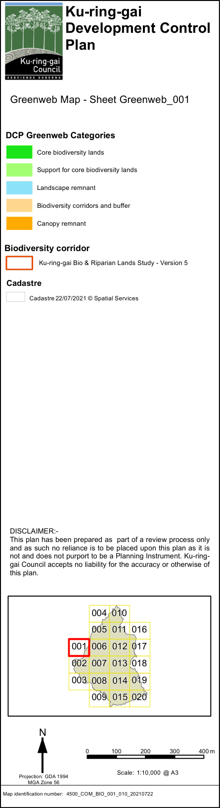
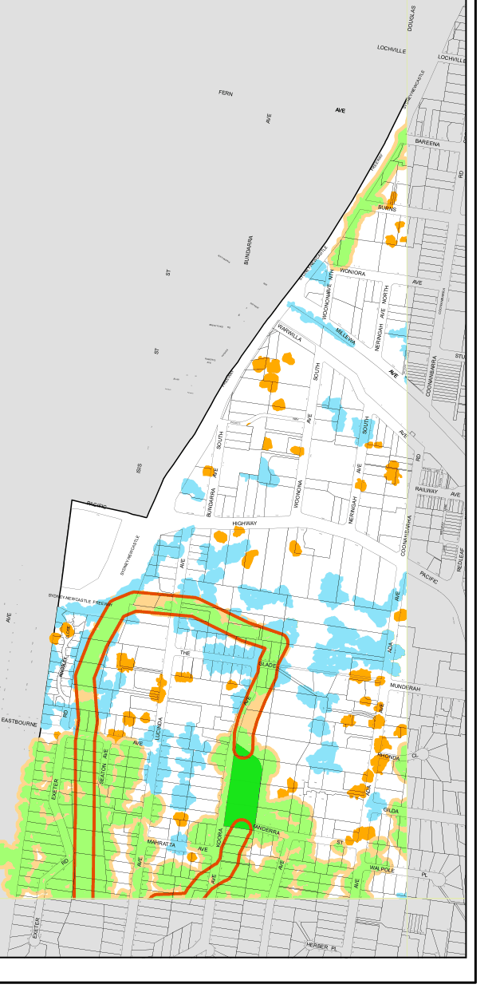
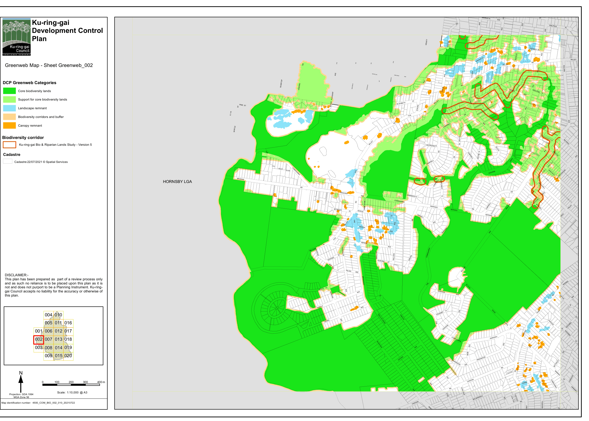

### 18R 	 References

### 18R.1 	Greenweb Maps

### REFERENCES

> [Picture on page 2: a picture, saved as a picture (images/part-18r-18r-references-18r-1-greenweb-maps-page-2-1.gif, 150 dpi).]

### Greenweb Map - Sheet Greenweb_ 001

### DCP Greenweb Categories

Core biodiversity lands Support for core biodiversity lands Landscape remnant Biodiversity corridors and buffer

### Canopy remnant

### Biodiversity corridor

### Ku-ring-gai Bio & Riparian Lands Study - Version 5

### Cadastre

### 22/07/2021

### Cadastre                      © Spatial Services

### DISCLAIMER:-

### This plan has been prepared as  part of a review process only

and as such no reliance is to be placed upon this plan as it is

### not and does not purport to be a Planning Instrument. Ku-ring-

gai Council accepts no liability for the accuracy or otherwise of

### this plan.

### 004 010

### 005 011 016

### 001 006 012 017

### 002 007 013 018

### 003 019

### 008 014

### 009 015 020

### N

#### SYDNEY-NEWCASTLE

#### FREEWAY

#### AVE

> [Picture on page 2: a map, saved as a picture (images/part-18r-18r-references-18r-1-greenweb-maps-page-2-31.gif, 150 dpi); the street names and other small labels are on the picture.]
> Words printed on the picture (title and legend, copied from the PDF):
> 37A 35 33 31
> 26 24 20
> 11   -    21
> 18 - 14
> BRENT FO RD
> STATION LAN E
> 19-21 17 15 11
> STATION 7-9 5 1-3
> 26-28 24 22 20
> 18 16 12-14
> 10 8 4-6 2
> 1693 - 1689
> 1687 1683 1677
> 10 12 14
> 9 11 15
> 5A No 7
> 27A 3 21
> 17C 15 4C
> 9 - 11
> 47 8-10 6
> 22 16 12 10A
> 16 5 5
> 6 4 2
> (4) (5) (6)

#### DOUGLAS

#### LOCHVILLE

#### LOCHVILLE

#### FERN

#### SYDNEY-NEWCASTLE 116

#### AVE

#### AVE

#### AVE

#### 30 28 BAREENA 22

#### FREEWAY

2 2B 4 4B 10

## 1 BURNS

#### BUNDARRA

#### ST

#### WONIORA

### HORNSBY LGA

#### SYDNEY-NEWCASTLE 10

#### AVE

#### NORTH AVE

#### AVE

#### WOONONA

#### WARWILLA MILLEWA 68

#### NERINGAH

#### STUART

#### AVE

#### AVE

#### SOUTH

## 3 FREEWAY

#### RD

#### COONANBARRA

#### COONANBARRA

#### WAY AVE

#### AVE 1

#### 8-14 SOUTH

#### ST

#### ISIS

#### AVE

## 2 RAILWAY

#### AVE

#### NTH

#### WOONONA

#### PACIFIC

#### BUNDARRA

#### SOUTH

#### AVE

#### NERINGAH

#### HIGHWAY

#### RD

#### COONANBARRA 41

#### AVE

#### AVE

#### REDLEAF

#### SYDNEY-NEWCASTLE

#### PACIFIC

#### SYDNEY-NEWCASTLE  FREEWAY

#### CLOSE

#### THE 16

#### GLADE

2

2E

2D

#### KINGSLEY

#### KINGSLEY

#### MUNDERAH

6

8

#### AVE

10

#### AVE

#### ADA

#### AVE

#### EASTBOURNE

37

35

39

#### AVE

41

## 15 AVE

45

#### CL

#### RHONDA

24

22

20

18

16

14

12

#### SEATON 51

#### ADA

#### EXETER

#### RD

#### GILDA

#### TANDERRA

#### ST

#### KOORA

## 30 AVE

#### MAHRATTA

#### RD

#### LUCINDA

#### AVE

#### WALPOLE

#### PL 18

#### AVE

#### AVE

#### HEWITT

#### HEWITT

#### EXETER

#### HERBER 2 ADA

#### FIELD

> [Picture on page 3: a picture, saved as a picture (images/part-18r-18r-references-18r-1-greenweb-maps-page-3-1.gif, 150 dpi).]

### Greenweb Map - Sheet Greenweb_ 002

### DCP Greenweb Categories

Core biodiversity lands Support for core biodiversity lands Landscape remnant Biodiversity corridors and buffer

### Canopy remnant

### Biodiversity corridor

### Ku-ring-gai Bio & Riparian Lands Study - Version 5

### Cadastre

### 22/07/2021

### Cadastre                      © Spatial Services

### DISCLAIMER:-

### This plan has been prepared as  part of a review process only

and as such no reliance is to be placed upon this plan as it is

### not and does not purport to be a Planning Instrument. Ku-ring-

gai Council accepts no liability for the accuracy or otherwise of

### this plan.

### 004 010

### 005 011 016

### 001 006 012 017

### 002 007 013 018

### 003 019

### 008 014

### 009 015 020

### N

> Words printed on the picture (title and legend, copied from the PDF):
> 71 18 17 47
> 17 10 1
> 96 94 92
> 75D 75C 1
> 90 93 27
> 1 3 18
> 17 2A 1
> 18 21 12
> 17 15 20
> 4 9 15
> 26 1 2
> 5 19 32
> 18 26 41
> 30 28 37
> 173 15 9
> 119 90 176
> 9 16 189
> 3 91 11
> 8 1/ 1 99
> 2/ 1 99
> 3/ 1 99
> 4/ 1 99 208
> 25 12 201
> 5/ 1 99
> 70 10 4
> 11 50 61A

## 6 ST

#### KOORA

## 30 AVE

#### MAHRATTA

## 7 PL

#### HEWITT

#### EXETER

#### PL

#### HERBER 2

## 3 ADA

#### FIELD

#### AMAROO 51

#### VALLEY

#### FOX

#### MAHRATTA

#### RD

#### VALLEY

#### ROLAND

#### AVE

## 121 LUCINDA

#### FOX

#### AVE

#### RD

#### RIVERTOP

#### AVE

#### RD

#### OSBORN

#### CYRUS

#### DENNIS

## 8 ADELONG

## 6 PL

#### AVE

#### ST

#### LUCINDA

#### VALLEY

#### ELIZABETH

#### PINE  ST

#### MOUNT   PLEASANT

#### AVE

#### ST

#### SOUTH

#### ADA

#### STRONE

### 6.1 W.

#### FOX

#### AVE

#### RD

#### AVE

#### DR

#### CAMPBELL

#### MYRTLE

#### CLYDE PL

#### MILDRED

#### VALLEY

#### CL

#### GEORGINA

#### SOUTH

#### AVE

#### DR

#### THE

#### BERILDA

#### AVE

#### DR

#### PL BOYNE

#### CAMPBELL

#### CRES

#### CAMPBELL

#### LISA

#### VALLEY

#### CLOSE

#### FOX

#### COOPER

#### COMENARRA

#### MONTEITH

#### BLYTHESWOOD

#### BROWNS

### HORNSBY LGA

#### CAMPBELL

#### RD

#### ROTHWELL

#### DR

#### PARKWAY

#### CL

#### RAINFOREST

#### WARWICK

#### PL

#### RD

#### CRES MITCHELL

#### PARKWAY

#### THE

#### COMENARRA
