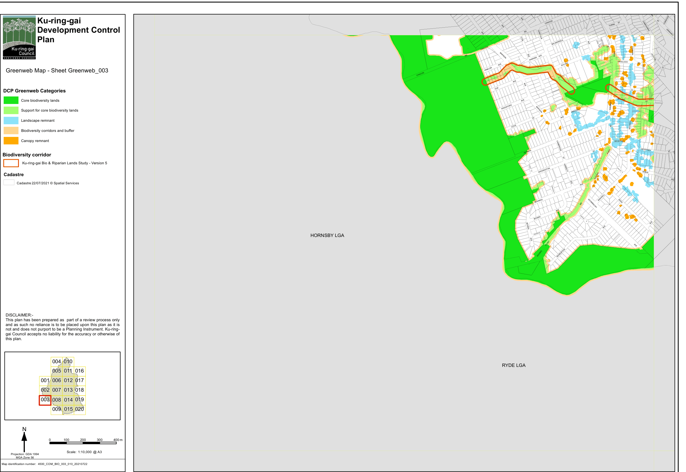
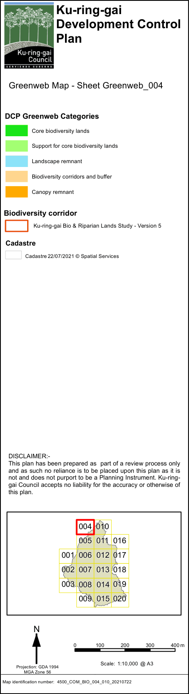
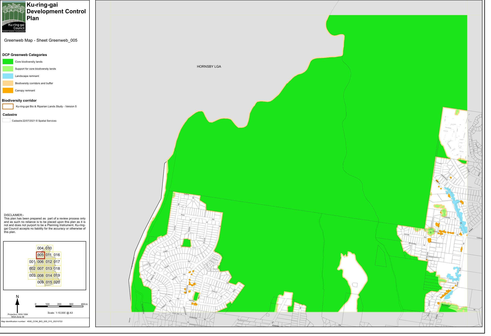

## 36 FINLAY

#### LANE 6.1W.

#### ROLAND

#### CAMPBELL

#### DR

#### MITCHELL

#### CL

#### SEYMOUR

#### KIOGLE

#### ST

#### NERANG

#### ST

#### ST

#### NERANG

#### CRES

#### TERRELL RD

#### THE

#### AVE

#### PDE

#### MOONA 18

#### 14 15 17 PDE

#### PARKWAY

#### FOX

#### VALLEY

#### KERELA 7 5

#### PL

#### AVE

#### BELTANA 2

#### MORONA WONGALEE

#### COMENARRA

#### MUTTAMA

#### KALLANG

#### ST

#### EURONG

## 32 JORDAN

#### EURONG 34

#### ST

#### AVE

#### AVE

#### AVE

#### ROLAND

## 29 AVE

#### TALGAI 44

## 39 BROADWAY

#### KISSING

#### THE

#### CL

#### ALETA 20

#### AVE

#### HOWSON

#### AVE

#### RD

#### ST

#### MORONA

#### MAY

#### WATTLE

#### PL

#### AVE

#### YANILLA

#### AVE

#### ROAD

### 20.12 W.

#### POINT

#### CL

#### STAINSBY

#### TAROOK

#### AVE

#### AVE

#### LEUNA

#### THE

#### FIELD OF MARS

#### DAWSON

#### ST

#### YERAMBA

#### CL

#### GIPPS

#### PL

#### HOWSON

#### KISSING

#### YERAMBA

## 139 PARKWAY

#### COMENARRA 106

#### ST

#### AVE 184 101

#### AVE

#### THE 99

#### RIVERVIEW

#### S

#### CK

#### HI

#### AVE

#### CROWN

#### PARKINSON

#### PARKINSON

#### AVE

#### ST

#### AVE

#### SATTERLEY 14

## 17 RD RD

#### AVE 5

#### ST

#### NIMBRIN

#### CANOON

#### FORWOOD

#### TURRA

## 18 COMENARRA

#### UNNAMED

#### CHISHOLM 31

#### LYON

#### BALMARINGA

#### CANOON

#### MAXWELL

#### POINT

#### AVE AVE

#### BARWON

#### HUDSON

> [Picture on page 4: a picture, saved as a picture (images/part-18r-18r-references-18r-1-greenweb-maps-page-4-1.gif, 150 dpi).]

### Greenweb Map - Sheet Greenweb_ 003

### DCP Greenweb Categories

Core biodiversity lands Support for core biodiversity lands Landscape remnant Biodiversity corridors and buffer

### Canopy remnant

### Biodiversity corridor

### Ku-ring-gai Bio & Riparian Lands Study - Version 5

### Cadastre

### 22/07/2021

### Cadastre                      © Spatial Services

### DISCLAIMER:-

### This plan has been prepared as  part of a review process only

and as such no reliance is to be placed upon this plan as it is

### not and does not purport to be a Planning Instrument. Ku-ring-

gai Council accepts no liability for the accuracy or otherwise of

### this plan.

### 004 010

### 005 011 016

### 001 006 012 017

### 002 007 013 018

### 003 019

### 008 014

### 009 015 020

### N

> Words printed on the picture (title and legend, copied from the PDF):
> 5/ 1 99
> 280 85 74
> 33 40 3
> 17 8 6
> 25A 15 253A
> 2 118 3
> 261 6 11
> 7 263 5
> 360 42 40

#### NIMBRIN

#### CANOON

#### FORWOOD

#### TURRA 29

## 18 COMENARRA

#### LYON

#### BALMARINGA

#### RD

#### CANOON

#### MAXWELL

#### POINT

#### AVE 4

#### BARWON

#### HUDSON

#### AVE

#### WARNER

#### HAVELOCK 5

#### ST

#### PARKWAY

#### AVE

#### AULUBA

#### CL

#### HINKLER

#### RD

#### CANOON

#### AVE

#### AVE ULM

## 264 ST

#### BULLER

#### AVE

#### ST 11

235 64 3 5 7 9

#### KISSING

#### KINGSFORD

#### PL

#### BARWON

#### PAROO AVE

#### ST

#### CHISHOLM

#### RD

#### ST

#### COVE

#### MAXWELL ST

#### GEOFFREY

#### GEOFFREY

#### ST

#### ST

#### VERNON

#### POINT

#### ST

#### CAMBRIDGE

#### SADDINGTON

#### ROBIN

## 4 KISSING

#### AVE

#### AVE

#### GARRETT

#### AVE

#### MAXWELL

#### BENNING

#### EDEN

## 3 RD

#### KOOMBALAH 8

#### AVE

#### BOWEN

#### AVE

#### AVE

#### BOWEN

### HORNSBY LGA

#### AVE

#### AVE

#### POINT

#### KISSING

## 49 ASHBURTON

### RYDE LGA

> [Picture on page 5: a picture, saved as a picture (images/part-18r-18r-references-18r-1-greenweb-maps-page-5-1.gif, 150 dpi).]

### Greenweb Map - Sheet Greenweb_ 004

### DCP Greenweb Categories

Core biodiversity lands Support for core biodiversity lands Landscape remnant Biodiversity corridors and buffer

### Canopy remnant

### Biodiversity corridor

### Ku-ring-gai Bio & Riparian Lands Study - Version 5

### Cadastre

### 22/07/2021

### Cadastre                      © Spatial Services

### HORNSBY LGA

### DISCLAIMER:-

### This plan has been prepared as  part of a review process only

and as such no reliance is to be placed upon this plan as it is

### not and does not purport to be a Planning Instrument. Ku-ring-

gai Council accepts no liability for the accuracy or otherwise of

|  | 004 | 010 |  |  |  |
|---|---|---|---|---|---|
|  | 005 | 011 | 016 |  |  |
| 001 | 006 | 012 | 017 |  |  |
| 002 | 007 | 013 | 018 |  |  |
| 003 | 008 | 014 | 019 |  |  |
|  | 009 | 015 | 020 |  |  |
| N |  |  |  |  |  |
| 0 |  | 100 | 200 | 300 | 400 m |
| GDA 1994 |  | Scale: 1:10,000 @ A3 |  |  |  |

### this plan.

### Projection:

> [Picture on page 6: a picture, saved as a picture (images/part-18r-18r-references-18r-1-greenweb-maps-page-6-1.gif, 150 dpi).]

### Greenweb Map - Sheet Greenweb_ 005

### DCP Greenweb Categories

Core biodiversity lands Support for core biodiversity lands Landscape remnant Biodiversity corridors and buffer

### Canopy remnant

### Biodiversity corridor

### Ku-ring-gai Bio & Riparian Lands Study - Version 5

### Cadastre

### 22/07/2021

### Cadastre                      © Spatial Services

### DISCLAIMER:-

### This plan has been prepared as  part of a review process only

and as such no reliance is to be placed upon this plan as it is

### not and does not purport to be a Planning Instrument. Ku-ring-

gai Council accepts no liability for the accuracy or otherwise of

### this plan.

### 004 010

### 005 011 016

### 001 006 012 017

### 002 007 013 018

### 003 019

### 008 014

### 009 015 020

### N

> Words printed on the picture (title and legend, copied from the PDF):
> 106 91 97
> 94 37 35
> 33 31 29
> 18 21 19 17
> 15 11 9 182
> 7 5 3
> 35 3 15
> 150 CHANTELLE CLOSE
> 3 2 17
> 10 148 1 20
> 31 PL ACE
> 144 29 30
> 17 23 40
> 5 9 6
> LAN E 10
> 17 10 10 8
> 96 1 2 3
> SI R RODEN 56
> CUTL ER CR.
> 15 17 19 21
> 86 25 CLOSE
> 9 4 2 40
> 6 8 4
> 1 8 4
> KI TTY 8
> SIR NEVILLE McNAMARA 2
> 11 9 8
> 7 3 STREET
> DRIVE 2 4 13
> 3 10 24
> CATALINA COURT 20
> PATHWAY 60 24 23
> MCTAGGART 28 26
> 3 - 7 5
> 3 7 22
> 3 13 15 17
> 1 - 25
> 7 5 3 1
> 6 4 2
> 29 20A 20B
> 24 24A 24B
> 16 11 388
> 10 384 361

### HORNSBY LGA

## 110 CURTIN 101 AVE

#### AVE

#### PAGE

#### AVE

#### PL 4 2

#### ST

#### CURTIN

#### FADDEN

#### PL

#### SCULLIN

#### PL 23 FORDE

#### AVE

#### CURTIN

## 21 FISHER

#### SYDNEY-NEWCASTLE

#### AVE

#### MIRROOL

#### ST

#### WATSON

#### URALBA

#### AVE

#### PL

#### CRES

#### CHIFLEY 16

#### GROSVENOR

#### CL

#### HOLT

#### AVE

#### BARTON 2A 2 4 8

#### AVE FORREST

#### COONANBARRA

#### GROSVENOR

#### MOUNT  VIEW     PL

#### CHUNOOMA

#### FREEWAY 153

#### ESK

#### BOWATER

## 17 CL

#### TAMAR

3

1 SI R FREDERI CK SC HER GER 6

SI R NEVILL E McNAM ARA

SI R JAMES RO LAND 18 5

WEL LING TO N PL ACE

88 SI R NEVILL E McNAM ARA

SI R JAMES RO LAND

#### DU FAUR 17

#### NAGLE

#### KIRKPATRICK 17

#### MURRUA 7 5

#### ST

4 8 10 12 14 16 18 20

4 8 14 5 1

#### 12 10 8 6 PL

#### HOPKINS

#### RD
