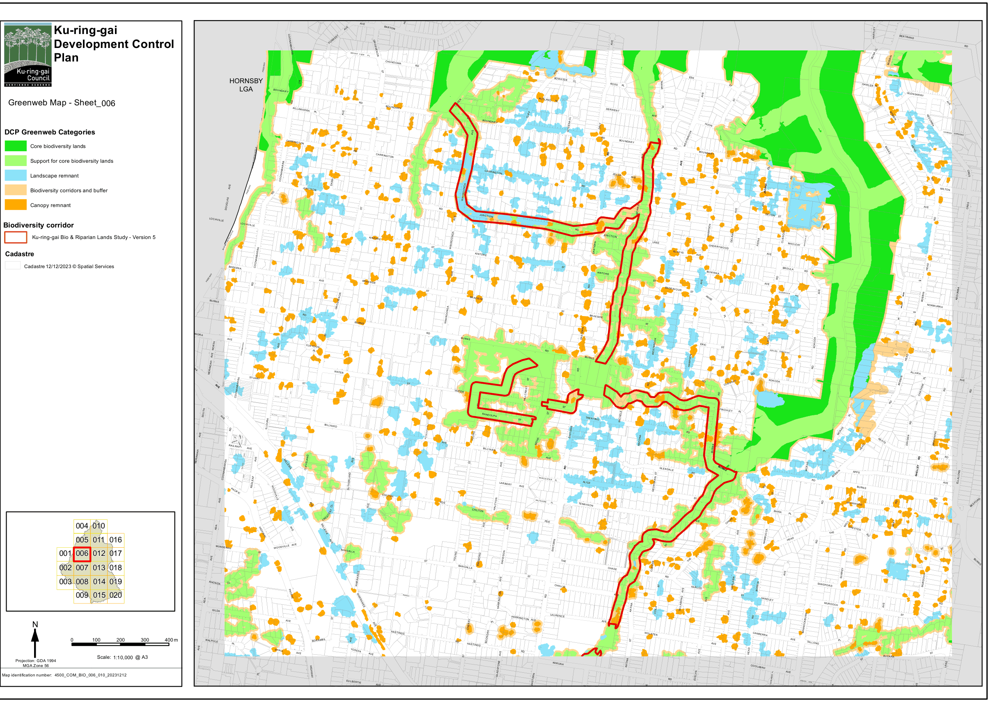

#### 1 14 16 18 20 BOBBIN

14 12 10 8 2

#### AVE

#### GWYDIR

#### CURAGUL

#### RD

#### CURAGUL

#### RD

#### PL

#### NENTOURA

#### RD

#### STONECROP

#### HEAD

#### BOBBIN

#### CL

#### HARTLEY

#### BERTRAND

#### BUNA CL

#### BOBBIN

> [Picture on page 7: a map, saved as a picture (images/part-18r-18r-references-18r-1-greenweb-maps-page-7-1.gif, 150 dpi); the street names and other small labels are on the picture.]
> Words printed on the picture (title and legend, copied from the PDF):
> 2A 2 4
> 16 14 9 7
> (1 9A )
> 8 6 2
> D EO DARAGARDENS
> 348 B 347
> (7 1A )
> PAT HWA Y
> 7 56 43
> (5 6 A )
> PAT HWA Y
> 1 3 5
> 51A 53A 55A
> 116- 11 8
> 111 132 A
> 31 35 37
> 2 1 8
> 185 -1 89
> GLAD YS LAN E
> 279 -2 81
> (2 98) 67
> 275 A 78
> 278 -2 80
> 272 -2 74
> 245 -2 47
> 11  -   21
> 18 - 1 4
> 51A 53 55
> 3/ 233 4/ 233
> 17- 19 61
> 119- 1 21
> M ILLEW A
> PAT HWA Y
> STU A RT
> PAT HWA Y
> 137 A 140
> BILLYA R D
> 12 - 1 4
> LA N E
> STAT IO N
> ILLO UR A
> 123 123 A
> 14 - 1 6
> 19- 21 15
> STAT IO N
> 11 7- 9
> 116 - 120
> 183 -1 85
> 18 4- 6
> 162 5- 16 27
> 1 156 A
> LA N E
> 183 -1 85
> 160 1 (8 )
> PAT HWA Y
> 161 4- 16 34
> No 1 0
> 1A 167 145
> GR O VE
> (1 533 )
> 48 50 52
> 11 12 10
> 73 71 69
> 1D (1 550 )
> 16 3- 5
> 52 (2 )
> (3 ) (4 )
> PRIN CES LAN E
> 89A LAN E

#### HOLT

#### BAR TON

#### HARTLEY

#### FORR EST

#### BER TRAN D

#### COONANBAR RA

## 5 GR OSVEN OR

#### MOUNT  V IEW     P L

#### BU NA CL

#### BOBBIN

#### RD

#### CHU NOOMA

#### ST

#### FREE WAY

#### ST

#### AVE

#### ESK

#### BOWATER

#### CL

#### RD

### HORNSBY

#### PL

#### ROSS

#### ST

#### PL

#### GAWLER

#### BOU NDAR Y

### LGA

#### AVE

#### GLEN GAR RY

#### ST

#### PL

#### RUTLAN D

#### RD

#### RD

#### AVE

#### LISTER 66A

#### TAM AR

#### PL

### Greenweb Map - Sheet_

### 006

#### KILLAWAR RA

#### DERWEN T

#### PL

#### AVE

#### AVE

#### CLIFF

#### ST

#### RD

#### BOU NDAR Y

#### BOU NDAR Y 78

#### KED UMBA

#### HUON
