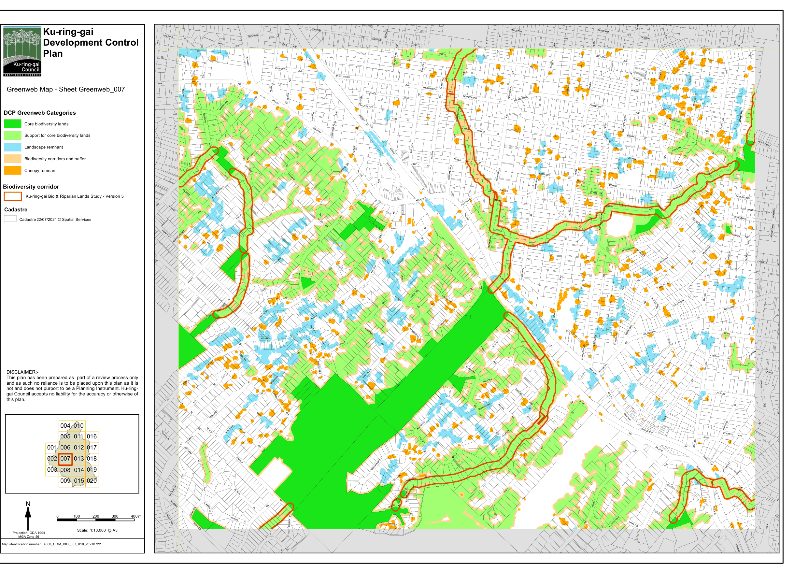
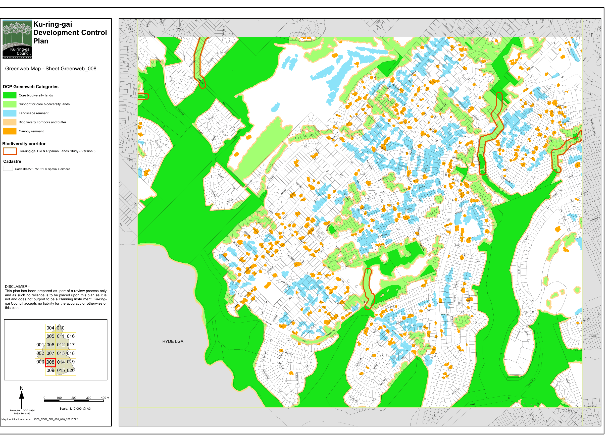

## 45 RD

#### CRES

#### AVE

#### PD E

#### RD

#### CHASE

#### KEN T

#### AVE

#### MALL

### 004 010

#### AVE

#### CHESTER

#### THE

## 22 RD

#### HIGH WAY

#### HEAD

#### RD 143

#### NAMBUC CA

#### AVE

#### MILLEWA

### 005 011 016

#### ST 65

#### WOODVILLE

#### AVE

#### MUN DERAH

#### ST

#### EASTER N

#### ST

### 001 006 012 017

#### AVE

#### AD A

#### AVE

#### YOU NG

#### THE 52A

## 19 RAYMON D

#### BU RN S

#### BAN GALLA

#### ST

#### BAN GALLA

#### CHASE

#### THE

#### CUD GEE

### 002 007 013 018

158 0 - 1 596

#### AVE

## 4 ST

#### RD

#### SU RR EY

#### RD

#### ST

#### CL

#### RHON DA

#### WAR RAWEE

### 003 019

#### MUR DOCH

### 008 014

#### ST

#### SAN DFOR D

#### BOBBIN

#### AVE

#### CHALLIS

#### ST

#### KAR LOO

#### RD

#### PACIFIC

### 009 015 020

#### AVE

#### HAND LEY

#### AD A

#### RD

#### AVE

#### WAR RAWEE

#### AVE

#### DAVID SON

#### AVE

#### HARR INGTON

#### BILLABON G

#### AVE

#### KATINA

#### GILDA 9

#### COILA

#### AVE

#### FAIRLAWN

#### AVE

#### ST

#### MUR DOCH

#### RD

#### ST

#### AVE

#### HARR INGTON

#### AVE

#### AVE

#### LAU RENC E

#### PL

#### AVE

### N

#### HASTINGS

#### WOLSTEN

#### CANBERR A

#### BOR AMBIL

#### BOON DAH

### 0 100 200 300 400 m 3

#### TALLONG

#### HASTINGS

#### MYALL

#### YOSEFA

#### HEAD

#### ST

#### CHER RY

#### BU CKRA

#### KAR UAH

#### KATINA

#### LAN E

#### COOLABAH

#### GLAD STONE

#### HIGH WAY

#### EVELYN

#### COOLABAH

## 6 EU LBERTIE

#### EASTER N

#### AVE 59

#### BAN NOCKBU RN

#### FIELD

#### BU CKRA

> [Picture on page 8: a map, saved as a picture (images/part-18r-18r-references-18r-1-greenweb-maps-page-8-1.gif, 150 dpi); the street names and other small labels are on the picture.]
> Words printed on the picture (title and legend, copied from the PDF):
> 18A 11 55
> 31 30 19 4
> 2 PRINCES LANE
> 14 16 18 20
> 18 16 12
> 26 24 20
> 23 21 14
> 20 - 28
> HAD DIN CL. 9-17
> 1440 - 1444
> 1 - 3
> HIG GS   LN
> 1311 1307 1305
> (1203 - 1209)
> 8  - 10
> 35A 2/29 28
> 7 2 3 8
> 1155 - 11 59
> 6 12 17
> 1151- 115 3
> 1147- 114 9
> RICHARD PORTER WAY
> 5 - 7
> 131 128 22
> 16A 20 10
> 19 5 3
> 23 2 1
> 95-97 GRANDVIE W
> 2 - 12
> 71A 42 64
> 3 - 5
> 24 18 6B
> 90 9 A
> 90 9 B
> 21 18 7
> 907 -9 09
> BLO OM SBURY

#### CHERRY

#### HASTINGS

#### WOLSTEN

#### CANBERRA

#### BORAMBIL

## 25 BOONDAH

#### TALLONG

#### HASTINGS

#### MYALL

#### YOSEFA

#### BUCKRA 35

#### KARUAH

#### KATINA

#### COOLABAH 18

#### AVE

#### GLADSTONE

#### HIGHWAY

#### EVELYN

#### RD

#### COOLABAH PL

## 6 EULBERTIE

#### AVE

#### AVE

#### BANNOCKBURN

#### RD

#### ADA

#### FIELD

#### PL

#### BRENTWOOD

#### PRINCES LANE BUCKRA

#### PRINCES 30

#### VALLEY

#### ADAMS

#### FOX 30

#### RD

#### AVE

#### GILROY RD

#### ST

#### BOBBIN

#### HEAD

#### ST

#### HEYDON

#### AVE

#### BRENTWOOD

#### FAIRLAWN

### Greenweb Map - Sheet Greenweb_ 007

#### ST.JAMES

#### ST

#### AVALON

#### EASTERN

#### RD

#### ROLAND

#### RD

#### LANE

#### BOOMERANG

#### AVE

#### ST

#### BOOMERANG

#### ST

#### AVE

#### EULBERTIE

#### CHERRY

#### MUSGRAVEST

#### LAUREL AVE

#### PENTECOST

#### ST

#### MARSHALL

## 135 RAGLAN

#### AVE

#### AVE

#### ST

### DCP Greenweb Categories

#### AVE

#### AVE

#### KU-RING-GAI

#### WINTON

#### ST

#### KING

#### AVE

#### TURRAMURRA

#### MERRIVALE

#### PENTECOST

#### PARK ST

#### CHERRY

### Core biodiversity lands

#### RD

#### PL

#### FITZROY

#### REELY

#### CHARLTON

#### AVE

#### BANNOCKBURN

## 64 ST

#### AVE

#### WONGA

#### WONGA

#### HIGHWAY

#### PACIFIC

#### ST

#### CRES

#### LOWTHER

#### AVE

### Support for core biodiversity lands

#### RD

#### BOURKE

#### OSWALD 3

#### ST

#### REELY

#### CL 18

#### AVE

#### MARSHALL

#### PENTECOST

#### RD

### Landscape remnant

#### ANTOINETTE

## 100 RD

#### MERRIVALE

#### RD

## 1 RAWSON

#### EASTERN

#### CHERRY

#### ST

#### ST

#### AVE

#### GILROY

#### CL

#### BLYTHESWOOD

## 94 CROWN

### Biodiversity corridors and buffer

#### ST

#### GILROY

#### AVE

#### RD

#### RD

#### RESERVOIR

#### WILLIAM

#### RD

#### WIRREANDA

### Canopy remnant

#### DR

#### LAMOND

#### CL

#### PACIFIC

#### NULLA

#### NULLA

#### ST

#### BERRILLEE

#### TURRAMURRA

#### KU-RING-GAI

#### ST

#### RAY

#### RUSHALL

#### ST RUSHALL

#### ST

#### RUSHALL

### Biodiversity corridor

#### ST

#### ROHINI

#### ST

#### AVE

## 49 ST

#### EDITH

#### ST

#### TURUGA

#### MILDRED

#### BLYTHESWOOD

### Ku-ring-gai Bio & Riparian Lands Study - Version 5

#### BOOLARONG

#### ST

#### HIGHWAY

#### KU-RING-GAI

#### ST

#### DENMAN

#### AVE

#### BIRUBI

#### AVE

#### STATION

#### LANE

#### BERILDA 18

### Cadastre

#### AVE

#### RD

#### ST

#### REYNOLDS

#### HEAD

#### BOBBIN

#### ST

#### WARRANGI

#### ST KATH Y

#### KORANGI

#### FINLAY

#### GREENDALE

#### DUFF 7C

#### PACIFIC

### 22/07/2021

### Cadastre                      © Spatial Services

#### REYNOLDS

#### ST

#### AVE

#### ALLEN

#### ST

#### BOYD

#### BANNOCKBURN

#### RD

#### SELWYN

#### RD

#### KORANGI

#### ST 3

#### AVE

#### FLOREY

#### MONTEITH

#### POINT

#### ST

#### RD

#### ST

#### ST

#### BLYTHESWOOD

#### AVE

#### ST

#### WOMERAH

#### BETTOWYND

#### ST

#### MERRIVALE

#### ROTHWELL

#### CL

#### LINDSAY

#### AVE

#### FLOREY

#### RD

#### CANISIUS

#### ORCHARD

#### CATALPA

#### HOLMES

#### JERSEY

#### CRES

#### RD

#### CL

#### AVE

#### TERRIGAL

#### KISSING

#### ST

#### NITHDALE

#### DUFF

#### WARRANGI

#### CRES

#### RD

#### HEAD

#### ST

#### FINLAY

#### HIGHWAY

#### MERRIVALE

#### RD

#### AVE

#### RD

#### AVE

#### 18 LEEDS 3

#### CRES

#### ST

#### WAMBOOL

#### PL

#### ST

#### STATION

## 22 ST

#### AVOCA

#### WARRAGAL

#### RD

#### CRES

#### RD

#### ROYSTON

#### ST

#### COLERIDGE

#### RD

#### CL

#### TELEGRAPH

#### ST

#### MONTROSE

#### ST

#### RD

#### CORNWALL

#### POINT

#### BOBBIN

#### ST

#### PACIFIC

#### TIMARU

#### RD

## 19 HOPE

#### MERRIVALE

#### TELEGRAPH

#### SWINDON

#### CL

#### KISSING

#### BARELLAN 51

#### CL

#### GRAHAM

#### BUNGALOW

#### RD

#### AVE

#### GODFREY

#### CRES

#### CATALPA

#### CATALPA

#### RD

#### RESERVOIR

#### AVE

#### ALBION

#### RD

#### RD

#### AVE

#### HEYSEN

#### CARSON ST

#### BANNOCKBURN

#### BORONIA

#### AVE

#### JUBILEE

#### POINT

#### AVE 12

#### ST 4A

#### RD

#### TELEGRAPH

#### KIMBARRA

#### CRES

#### SHAND

#### ORANA

#### HIGHWAY

#### WARRAGAL

#### ST

#### RD

#### MYOORA

#### ST

#### WARATAH

#### KISSING

#### CHURCH

#### RD

#### MAYFIELD

#### PACIFIC

#### STATION

#### ST

#### RD

### DISCLAIMER:-

### This plan has been prepared as  part of a review process only

and as such no reliance is to be placed upon this plan as it is

### not and does not purport to be a Planning Instrument. Ku-ring-

gai Council accepts no liability for the accuracy or otherwise of

### this plan.

#### ST

#### MAY

#### RD

#### AVON

#### WATTLE

#### AVE

#### AVE

#### ORANA

#### 37 34 2 RD

#### ARDEN

#### BEECHWORTH

#### KYWONG

#### PL

#### AVE

#### TAMBOON

#### YERAMBA

#### RD

#### LINDEN

#### HIGHWAY ALMA

#### RD

### 004 010

#### EDWARD

#### ST

#### AVE

#### ASHMORE

#### ST

#### KATE

#### AVON

#### WARATAH

#### ARILLA

#### RD

#### GRANDVIEW

#### RD

#### AVE

#### RD

#### MOCATTA

#### ALLAWAH

#### AVE

#### CL

#### ACACIA

#### KING

#### DAWSON

### 005 011 016

#### LAWLEY

#### ST

#### YERAMBA

#### PL

#### STATION

#### ST

#### AVE

#### TAYLOR

#### RD

### 001 006 012 017

#### PACIFIC

#### RD

#### AVE

#### YERAMBA

#### CRES

#### CRES

### 002 007 013 018

#### ST

#### CL

#### GRANDVIEW

#### AVE

#### BEECHWORTH

#### WELLESLEY

### 003 019

#### HIGHWAY

### 008 014

#### CL

#### DAKARA

## 15 QUADRANT

### 009 015 020

#### AVE 16

#### FERN

#### ST

#### AVON

#### KONDA 9

#### AVE

#### SATTERLEY 14

#### RD

#### ST ANDREWS

## 3 RD

#### MIMOSA

#### SOL 6

#### AN

#### ST

#### PYMBLE

#### RD

#### PL.

### N

#### TROON

#### DER

#### PL

## 3 CL

#### ST

#### NIMBRIN

#### PACIFIC

#### DR.

#### FORWOOD

#### RAND

#### HIGHLANDS

#### KURUK

#### COMENARRA

#### MORNA 5

#### LIVINGSTONE ORINOCO

#### VALE

#### MAXWELL

#### HIGHWAY

PA T H WA Y

#### HUDSON

#### CARINA

> [Picture on page 9: a map, saved as a picture (images/part-18r-18r-references-18r-1-greenweb-maps-page-9-1.gif, 150 dpi); the street names and other small labels are on the picture.]
> Words printed on the picture (title and legend, copied from the PDF):
> 25 15 16
> 1 - 7
> 6 11 33A
> 32 21 70
> 7-9 8   -   14
> 16 - 24
> 39 44 44A
> 48 HOLF ORD
> 41 LANE 70
> HOLF ORD 37
> 2 30 31
> 29 1B 8
> 2 CYN THIA
> YARR AN W ALK
> 22 61 59
> 51 8 147
> PHILIP 25 3
> 3 71 64-66
> 6 MALL 73
> 23 21 10
> 174 31 49
> 182 22 41
> 28 WINDSOR  WAL K
> 2-6 2 6 8
> 3.6 6W 8
> 5 4 3
> 34 4 11
> 7A 68 46

#### SOL 6

#### AN

#### PYMBLE

#### PL.

#### TROON

#### DER

#### PL 6

## 3 CL

#### NIMBRIN

#### PACIFIC

#### DR.

#### FORWOOD

#### RAND

#### KURUK

#### COMENARRA

#### MORNA 5

#### LIVINGSTONE ORINOCO

#### AVE

#### MAXWELL

#### HIGHWAY

PA T H WA Y

#### HUDSON

#### RD

#### CARINA

#### CARLOTTA

#### MONA

#### ST 21 PARKWAY 36

#### PL MILFORD

#### CL

#### PEMBROKE

#### BRIDGE

### Greenweb Map - Sheet Greenweb_ 008

#### COURALIE 78 PYMBLE

#### RD

#### DR

#### RD

#### AVE

#### PDE

#### PACIFIC

#### RAVENHILL

#### UNNAMED

#### THE

#### ST

### DCP Greenweb Categories

#### COURALLIE

## 64 GOLFERS

#### LANE

#### ST

### Core biodiversity lands

#### GOLFERS

#### ROAD

#### PDE

### Support for core biodiversity lands

#### MERRIWA

#### RYDE

#### LIVINGSTONE

#### VALE

### Landscape remnant

#### COMENARRA

#### AVE

#### ST

#### AVE

#### RAMSAY

#### NADENE

#### HESPERUS 2

#### MCINTYRE

### Biodiversity corridors and buffer

#### ST

#### CYNTHIA

#### RD

#### ST

#### ST

#### AVE

#### PL

#### RD

#### WARROWA

#### WARD

#### ST

### Canopy remnant

#### PARKWAY

#### BEANS  FARM  ROAD

#### ST

#### ST

#### CROSS

#### LATONA

## 3 GREENWAY

#### ROAD

#### GEOFFREY

#### EVANS

#### ST

#### PDE

#### AVE

### Biodiversity corridor

#### RD

#### CULTOWA

#### AVE

#### RYDE

#### DUMARESQ

#### ALKOOMIE PL

#### ST

### Ku-ring-gai Bio & Riparian Lands Study - Version 5

#### YARRARA

#### WYOMEE

#### LIVINGSTONE

#### ST

#### YARRAN

#### ROBIN

### Cadastre

#### AVE

#### MINNAMURRA

#### RD

#### AVE

#### INVERALLAN

### 22/07/2021

### Cadastre                      © Spatial Services

#### RIDGE

#### AVE

#### HAMILTON

#### ST

#### RYDE

#### AVE

#### PL 130

#### THE

#### MOREE

#### PARKER 11

#### MINNAMURRA

#### ANNABELLE 149

#### WYOMEE

#### KIPARRA

#### ST

#### CRAIGLANDS

#### DONCASTER

#### PL

#### AVE

#### CADOW

#### AVE

#### PL

#### AVE

#### AVE

#### TODMAN

#### ST JOHNS

#### CAWARRA

#### COMENARRA

#### ST

#### GRAYLING

#### AVE

#### IONA

#### RD

#### AVE

#### LIVINGSTONE

## 7 AVE

#### PARKWAY

#### LACHLAN

#### AVE

#### AVE

#### ST

#### VALE

#### ST 16

#### ST 36A

#### AVE

#### INVERALLAN

#### AVE

#### KENDALL

#### YALLEROI

#### YANKO 32

#### ST KOOYONG 38

#### MALORY

#### AVE

#### BUSHLANDS

#### ST

#### AVE

#### ST

#### LONG

#### BINA

#### AVE

#### RIDGE

#### LYNN

#### RD

#### YARRARA

#### ST

#### ARUNDEL

#### CRES

#### SHADDOCK

#### JUGIONG

#### RD

#### AVE YARRENNAN

#### AVE

#### ST. JOHNS

#### HILLARY

#### 147A KIPARRA

#### RD

#### ST

#### EPPLESTON

#### KENDALL

#### RD

#### PL

#### JUGIONG 25

#### ST

#### ST

#### EDENHOLME

#### AVE

#### ST

#### LOVAT

## 37 LOFBERG

#### RD

#### RD

#### RD

#### LOFBERG

#### ST

#### PL

#### TRISTANIA

#### WALLALONG

#### ST JOHNS

#### PL

#### WARRABRI

#### YANKO

#### YANKO

#### RYDE

#### PATTERSON

#### AVE

#### DUNEBA

## 4 AVE

#### RD

#### WALLALONG

#### APOLLO

#### AVE

#### AVE

#### DUNEBA

#### DUNOON

#### AVE

#### RD

#### AVE

#### RD

#### PDE

#### PL

#### COMBE

#### RD

#### KAMILAROY

### DISCLAIMER:-

### This plan has been prepared as  part of a review process only

and as such no reliance is to be placed upon this plan as it is

### not and does not purport to be a Planning Instrument. Ku-ring-

gai Council accepts no liability for the accuracy or otherwise of

### this plan.

#### CRES

ESM T F OR ELE C PU R P 9

#### AVE

#### PL

#### AVE

#### DOYLE

#### DUNOON

#### DIANA

#### CRES

#### VICTORIA

#### AVE

## 112 RIDGELAND

#### AVE

#### AVE

#### AVE

#### ANDREW

#### WALLALONG 82

## 197 BANDALONG

#### CONGHAM

#### JOHNS

#### GILLIAN

#### ST

### 004 010

#### CRES

#### YANKO

#### WALLALONG

#### SPENCER

### 005 011 016

## 1 AVE

#### AVE

#### CRES

### RYDE LGA

#### BINGARA 6

### 001 006 012 017

## 4 AVE

#### BORONGA

### 002 007 013 018

#### BORONGA

#### AVE

#### CRES
