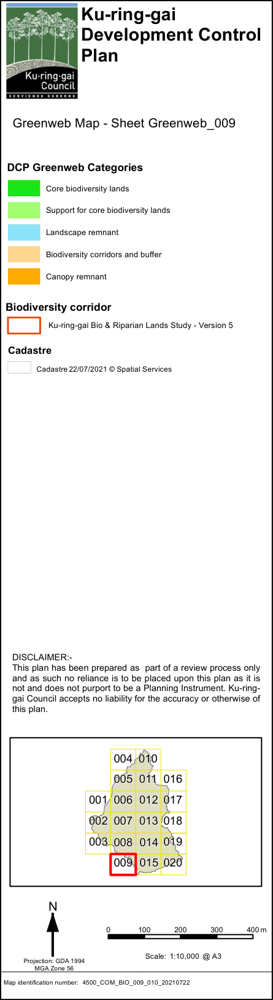
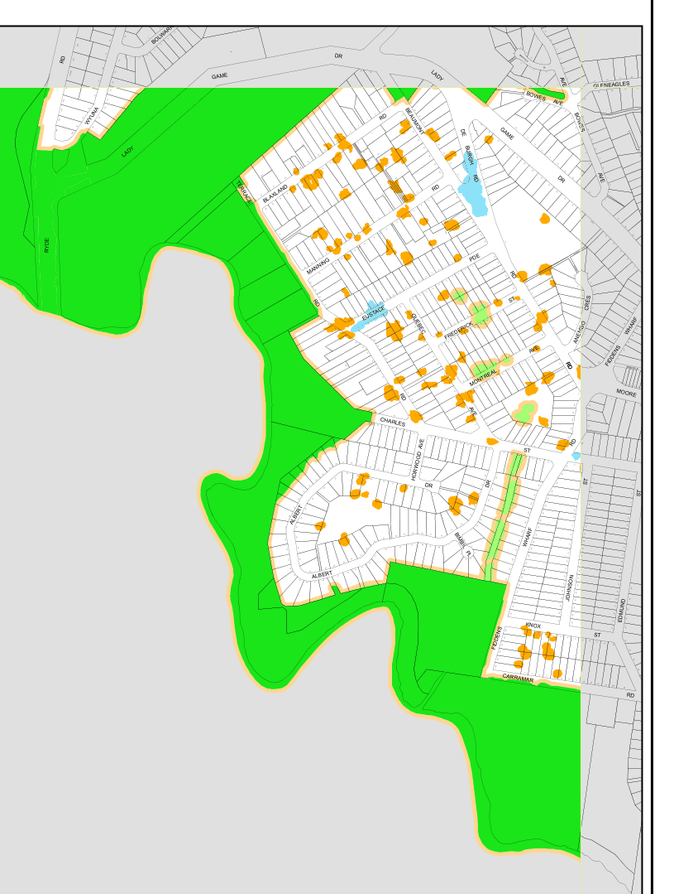
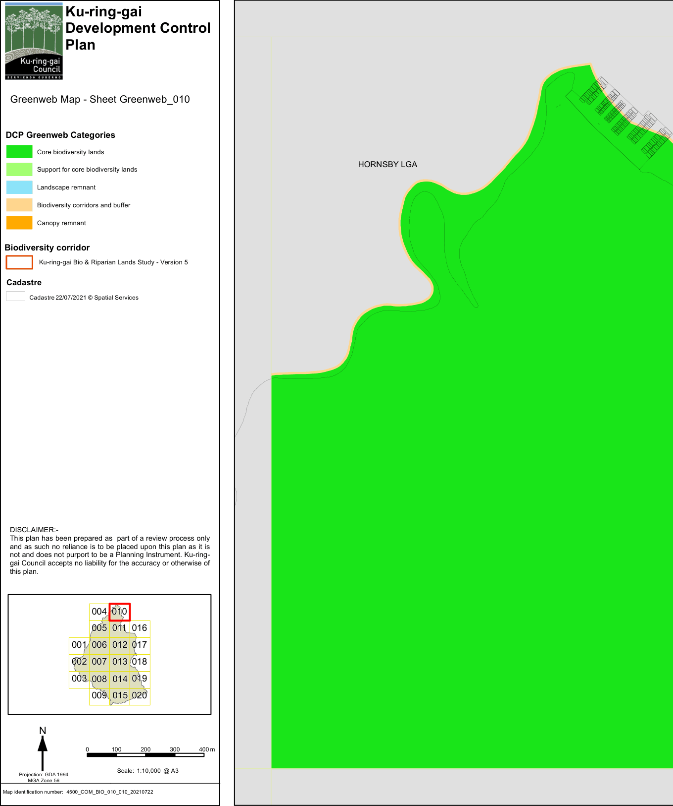
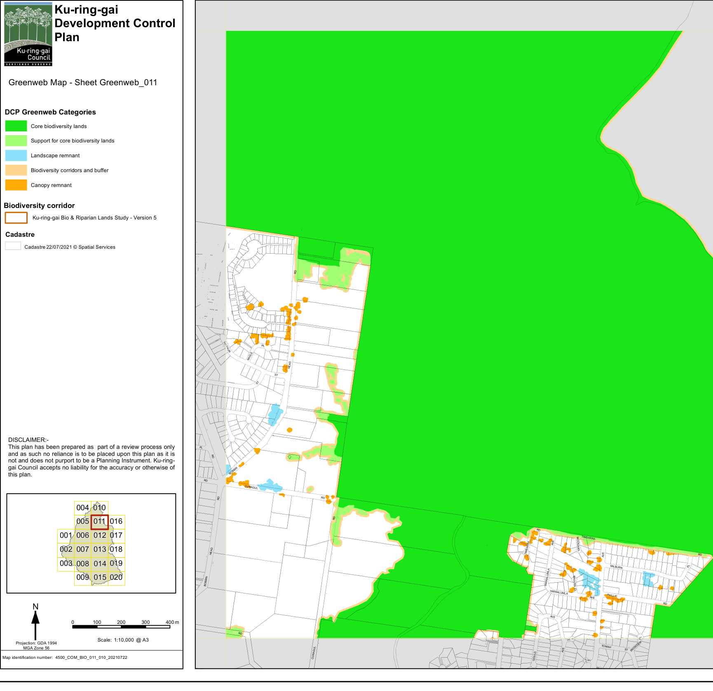

#### 72 4 ST

#### RD

#### GLOUCESTER

### 003 019

### 008 014

## 66 KOOLOONA

#### AVE

#### ST

#### CAMIRA

#### BORONGA 14

#### RD

### 009 015 020

#### GLOUCESTER

#### HEREFORD

#### GURIN

#### PL

#### KOOLOONA

#### BUSHLANDS

### N

#### AVE

#### BOLWARRA

#### DR

#### RYDE

#### 5 3 AVE

#### HAMPSHIRE

#### GAME

## 30 GLENEAGLES

#### BOWES

#### RD 31

#### WYUNA

#### BOWES

#### BEAUMONT

#### LADY

#### GAME

#### LADY

#### BURGH

#### DE

> [Picture on page 10: a picture, saved as a picture (images/part-18r-18r-references-18r-1-greenweb-maps-page-10-1.gif, 150 dpi).]

### Greenweb Map - Sheet Greenweb_ 009

### DCP Greenweb Categories

Core biodiversity lands Support for core biodiversity lands Landscape remnant Biodiversity corridors and buffer

### Canopy remnant

### Biodiversity corridor

### Ku-ring-gai Bio & Riparian Lands Study - Version 5

### Cadastre

### 22/07/2021

### Cadastre                      © Spatial Services

### DISCLAIMER:-

### This plan has been prepared as  part of a review process only

and as such no reliance is to be placed upon this plan as it is

### not and does not purport to be a Planning Instrument. Ku-ring-

gai Council accepts no liability for the accuracy or otherwise of

### this plan.

### 004 010

### 005 011 016

### 001 006 012 017

### 002 007 013 018

### 003 019

### 008 014

### 009 015 020

### N

> [Picture on page 10: a map, saved as a picture (images/part-18r-18r-references-18r-1-greenweb-maps-page-10-28.gif, 150 dpi); the street names and other small labels are on the picture.]
> Words printed on the picture (title and legend, copied from the PDF):
> 5 70 33
> 7A 68 46
> 27B 12 4C
> 5 12 46
> 17 10 30
> 24 14 12
> 38 36 35
> 30 33 31 29
> 25 11 3
> 1 7 15
> 2 6 14

#### BOLWARRA

#### DR

#### 5 3 AVE

#### HAMPSHIRE

#### GAME

#### LADY

#### 7 RD 31

#### WYUNA

#### LADY

#### RD

#### BURGH

#### DE

#### AVE

#### BOWES

#### DR

#### GAME

#### RD

#### BLAXLAND

#### TERRACE

#### RYDE

#### MANNING

#### RD

#### BEAUMONT

#### RD

#### RD

#### CRES

#### PDE

#### EUSTACE

#### QUEBEC

#### ST

#### FREDERICK

#### ANEMBO

#### WHARF FIDDENS BRADFIELD

#### RD

#### RD

#### AVE

#### MONTREAL

#### MOORE

#### RD

#### AVE

#### CHARLES

46 44 42 40 37

#### RD

#### ST

26 24 22 20 18 16

#### AVE HORWOOD

#### DR

#### DR

#### ALBERT

#### WHARF

#### BIMBIL

#### PL

#### ALBERT

#### ST

#### JOHNSON

#### ST

#### EDMUND

#### KNOX

#### ST

#### FIDDENS

#### RD

#### CARRAMAR

### RYDE LGA

> [Picture on page 11: a picture, saved as a picture (images/part-18r-18r-references-18r-1-greenweb-maps-page-11-1.gif, 150 dpi).]
> Words printed on the picture (title and legend, copied from the PDF):
> 1003
> 1001
> 1002

### Greenweb Map - Sheet Greenweb_ 010

### DCP Greenweb Categories

### Core biodiversity lands

### HORNSBY LGA

Support for core biodiversity lands Landscape remnant Biodiversity corridors and buffer Canopy remnant

### Biodiversity corridor

### Ku-ring-gai Bio & Riparian Lands Study - Version 5

### Cadastre

### 22/07/2021

### Cadastre                      © Spatial Services

### NORTHERN BEACHES LGA

### DISCLAIMER:-

### This plan has been prepared as  part of a review process only

and as such no reliance is to be placed upon this plan as it is

### not and does not purport to be a Planning Instrument. Ku-ring-

gai Council accepts no liability for the accuracy or otherwise of

### this plan.

### 004 010

### 005 011 016

### 001 006 012 017

### 002 007 013 018

### 003 019

### 008 014

### 009 015 020

### N

> [Picture on page 12: a map, saved as a picture (images/part-18r-18r-references-18r-1-greenweb-maps-page-12-1.gif, 150 dpi); the street names and other small labels are on the picture.]
> Words printed on the picture (title and legend, copied from the PDF):
> 66 74 76 78
> SI R RODEN 65
> CUTL ER CR.
> BO ULEVARDE 46
> 9 4 2
> 6 4 6
> 10 36 7
> 1 8 HARRISON STRATTON
> KI TTY 8
> 30 12 15
> DRIVE 2 4 13
> CATALINA COURT 20
> 8 3 1
> 3 - 7
> 3 7 22
> 3 13 418B
> 15 17 385
> 1 - 25 7
> 24 15 2 234

### Greenweb Map - Sheet Greenweb_ 011

### DCP Greenweb Categories

Core biodiversity lands Support for core biodiversity lands Landscape remnant Biodiversity corridors and buffer

### Canopy remnant

### Biodiversity corridor

### Ku-ring-gai Bio & Riparian Lands Study - Version 5

### Cadastre

### 22/07/2021

### Cadastre                      © Spatial Services

### DISCLAIMER:-

### This plan has been prepared as  part of a review process only

and as such no reliance is to be placed upon this plan as it is

### not and does not purport to be a Planning Instrument. Ku-ring-

gai Council accepts no liability for the accuracy or otherwise of

### this plan.

### 004 010

### 005 011 016

### 001 006 012 017

### 002 007 013 018

### 003 019

### 008 014

### 009 015 020

### N

96 1 2 3 69 71 73 75 77

SI R FREDERI CK SC HER GER 6

SI R NEVILL E McNAM ARA DRIVE

#### RD

SI R NEVILL E McNAM ARA

#### PL

#### DU FAUR 17

#### NAGLE

#### HEAD ST ST

4 10 12 14 16

#### PL

#### RD

#### BOBBIN

22 24 26 26B 26A
