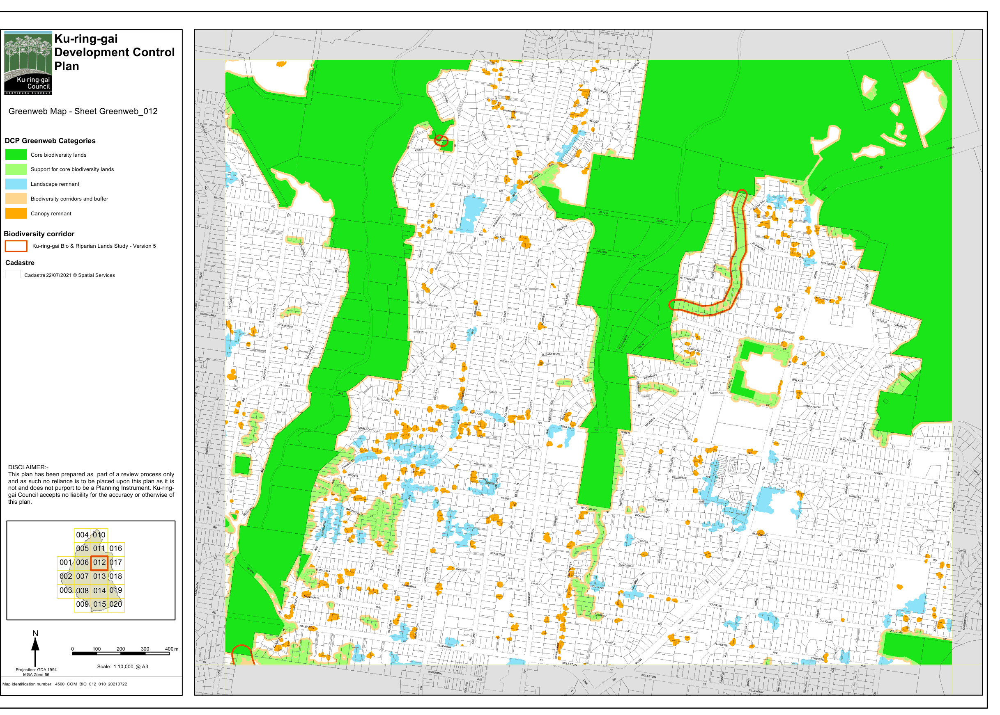

#### 9A RD

#### CURAGUL

#### RD

#### RD

#### HEAD

#### BOBBIN

#### RD

#### CURAGUL

### NORTHERN BEACHES LGA

#### RD

#### 38A CL

#### MOONAH

#### TIMBARRA

#### RD

#### TIMBARRA

#### AVE

#### PL

## 1 MILBURN

#### AVE

#### YARRALUMLA

#### 22 11 9 CL

#### MAJURA YARRALUMLA

#### 10 8 PHILLIP

#### AVE

#### RD

#### AVE 43

#### TOMAH

#### SNOWDEN

#### GOULD

#### WHITMONT

#### WARRIMOO

> [Picture on page 13: a map, saved as a picture (images/part-18r-18r-references-18r-1-greenweb-maps-page-13-1.gif, 150 dpi); the street names and other small labels are on the picture.]
> Words printed on the picture (title and legend, copied from the PDF):
> 1 8 7
> 22 17 14
> 15 9 2
> 7 5 3
> 2 5 DRIVE 26
> 12 10 6 23
> 9 1 3
> 45 406 406B
> 149 11A 15
> 7 9 13
> 304 61 68
> 47 45 43
> 3 3 5 9
> 114 16 21
> 5 3 1
> 34 43 2
> 11 15 17 19
> 15 11 9
> 16 14 12 94
> 22 20 18 6
> 12 3A 3
> 1 4 6 8
> 19 21 14
> 39 4A 48
> 8/37 3/37 4/37
> 52 61 70
> 22 (Bunda bah)
> 24 - 24B
> 46A 50 12
> 102 - 118
> 17 - 19

#### AVE 222

#### 30 208A TOMAH

#### SNOWDEN

#### AVE

#### CURAGUL

#### GOULD

#### WHITMONT

#### CRES

#### WAIPORI

#### WARRIMOO

#### GLENGARRY 28

#### AVE

### Greenweb Map - Sheet Greenweb_ 012

#### 1 PRIORY 12

## 202 CL

#### ST

#### CRAIG

#### KEDUMBA

#### GOULD

#### ROBINA
