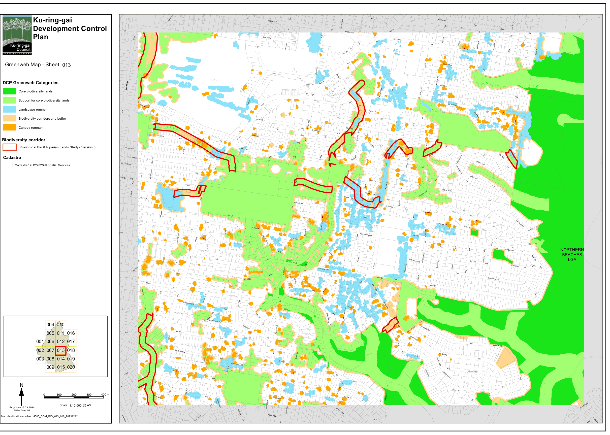

## 54 ST

#### AVE

#### RD

## 39 WARRABINA

#### WILLIS

### 001 006 012 017

#### RD

#### BUNDABAH

#### AVE

#### BANOOL

#### BINNOWEE

#### AVE

#### BURNS

#### AVE

#### LUTON

#### AVE

### 002 007 013 018

#### AVE

#### AVE

#### BINA

#### LINCOLN

#### PL

#### CL

#### OTTWAY

#### RD

#### KAREN

#### DOUGLAS

#### OXLEY 29 2

#### WARRA

#### RD

#### KENTHURST

#### RD

#### AVE

#### AVE

#### CARBEEN

#### MURDOCH

### 003 019

### 008 014

#### RD

#### AVE

#### BIMBURRA

#### BIMBURRA

## 19 KAROOM

## 4 MUNGARRA

#### ST 12

#### ST

#### AVE

#### HUME

#### MEMORIAL

#### NEWLYN

#### DOUGLAS

#### AVE

### 009 015 020

#### WARRIMOO

#### RD

#### RD

#### GARRICK

#### TAMBU

#### RD

#### VALE

## 6 RD

#### CL GWYN

#### KILLEATON

#### AVE

#### CAMBOURNE

#### ST

#### DOUGLAS

#### ST

## 94 ATHENA

#### PL

#### CARBEEN

#### DOUGLAS

#### PL

#### MARCOALA

#### AVE

#### AVE

#### BENAROON

#### BENAROON

### N

#### ST

#### ST

#### COLLINS

## 18 MYRTLE

#### FLINDERS

7.3 2 / 3. 66 W.

#### PL CARINGAL

ESM T F OR SER VI C ES

#### KILLEATON

#### KENTHURST

#### MATTHEW CL

#### FLINDERS

#### ST 81

#### MONA

#### KILLEATON

#### KILLEATON

#### KANOONA

#### DAINTON

#### LINK 263

## 140 ST

#### HILL

#### OAK

#### BRIAR

#### SHANNON

#### TREGENNA

#### COLLINS

#### KILLEATON 147

#### LUCIA

#### STURT

#### ACRON

> [Picture on page 14: a map, saved as a picture (images/part-18r-18r-references-18r-1-greenweb-maps-page-14-1.gif, 150 dpi); the street names and other small labels are on the picture.]
> Words printed on the picture (title and legend, copied from the PDF):
> 3 103 A
> 102 - 118
> 10- 10 A
> PAT HWA Y
> 17 - 1 9
> (2 38- 2 40)
> 132 -1 38
> 151 153 1
> 1  - 27
> 251 -2 57
> 7 - 11
> 220 -2 22 247
> 14 - 1 6
> 212 -2 16
> 241 -2 45 5
> 15 - 1 7
> 235 1- 13
> VILLAGE  G REEN
> 204 A 233
> GI LL OTT
> 213 -2 31
> STAN LE Y
> 19 8- 10
> 1 9 2 C
> 9 - 15
> 166 -1 72
> 18 8 A
> CO WAN LA NE
> 17- 19 12
> 187 -1 89
> 183 - 18 5
> LAN E 4
> 3 - 7
> CRESTA CL 12
> 116- 11 8
> 161 -1 63
> 165 - 16 7
> 148 - 15 2
> 48 - 4 6
> 2 47 49
> 131 -1 35
> 30 - 3 2
> PAT HWA Y
> 22 24 26
> 8 10 12
> PAT HWA Y
> WAL LI S PL
> SUT TO N PL
> M IRI 54 12
> 1 (3 9)
> 8 6 4
> GR A NT
> GR A NT
> 60 - 7 0
> 8 14 17
> MO R IAL
> AN NEMAR IE
> 2B RID DL ES 5
> 89 9 3
> WAT ER BO ARD
> VA R. W
> 9 7 5 3
> 49 44 46
> BO LT ON
> 17- 19 15
> 3 5 6 1
> 1 8 10
> AN TH ONY
> A1 7 A1 9
> 62 - 6 4
> 15 24 28
> 59 16 19
> 32 34 36
> 16 18 18A
> (4 1) 11C
> 11D 11F 21C 21B
> 31 33 37
> ON S LO W
> PAT HWA Y
> WAUG O OL A
> PAT HWA Y
> PAT HWA Y 7
> 6 8 8A
> M ETZ LER

#### MA RCOALA

#### BEN AROON

## 53 COLLINS

#### MYRTLE

#### FLIN DERS

#### CARINGAL

7\. 3 2 / 3. 6 6 W.

## 64 KILLEATON

#### KEN THU RST

#### MATT HE W CL

#### FLIN DERS

#### MONA

#### CL

#### KILLEATON

#### KILLEATON

#### AVE

#### KAN OON A

#### RD

#### DAIN TON

#### LINK

#### 140 ST 127

#### HILL

#### OAK

#### BR IAR

#### RD

#### SH ANNON

#### COLLINS

#### TREGE NNA

#### KILLEATON 147

#### LU CIA

#### PL

#### STURT

#### AC RON

#### 194 196 198 200 ST

(2 28  -  232 )

#### VALE

### Greenweb Map - Sheet_

### 013
