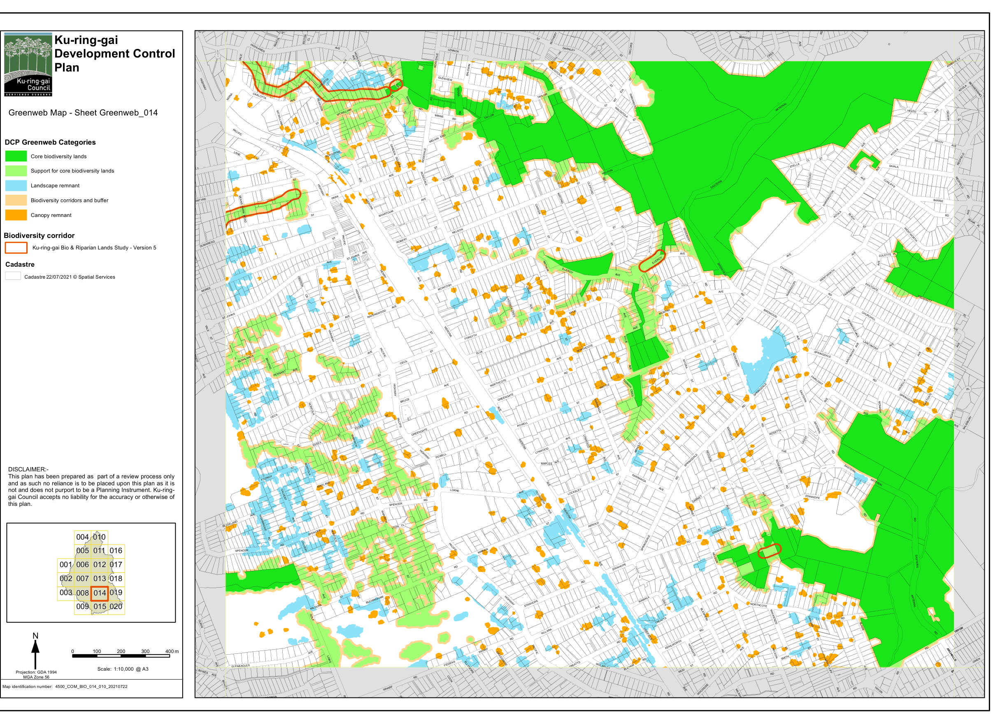

## 39 ROTH ER Y

#### ST

#### WILTON

#### AN ATOL

#### DARN LEY

#### HIGH LAN DS

#### LEN NOX

#### ST

#### TAYLOR S

#### CRES

#### HIGH LAN DS 8

#### ROSEDALE

#### KIMBERLEY

#### BALD WIN

#### WAU GOOLA

#### ASH LEY

#### GLEN VIEW

#### GR

#### CARLOTTA

#### HIGH WAY

#### KOOLA

#### IDA

#### BEN WERR IN

#### MIN NS

> [Picture on page 15: a map, saved as a picture (images/part-18r-18r-references-18r-1-greenweb-maps-page-15-1.gif, 150 dpi); the street names and other small labels are on the picture.]
> Words printed on the picture (title and legend, copied from the PDF):
> 32A 5 10
> 1 - 7
> 1 - 7
> 25 77 7
> 12 2B 5A
> 2 - 6
> 7 17 22
> 7-9 8   -   14
> 16 - 24
> 3   -   11
> (3 1 )
> (2 5 )
> 24 - 26
> 28  -  30
> -7 8 8
> 39 26 29
> 30 - 34
> EDW ARD S
> 112 2 8
> LAN E 38
> 1 - 7
> 657 - 661
> 3 1 47
> SARNIA CR 26
> 36 - 40
> KI LLARA  PL
> 2 - 4
> 17A 26 15
> 20 - 26
> 2 - 4
> 1 - 9
> 2 - 4
> CAITH NES S
> 7 2 510
> 2 1A SLA DE
> 15 - 19
> COM MO NWEALTH

#### BARCOO

#### WILTON

#### ROTHERY

#### ANATOL

#### DARNLEY

#### LENNOX

#### TAYLORS

#### HIGHLANDS 6

#### BALDWIN

#### WAUGOOLA

#### ASHLEY

## 14 ST

#### GLENVIEW

#### ST

#### GR

## 2 CARLOTTA

#### HIGHWAY

PA T H WA Y

#### KOOLA

#### ST

#### CL

#### BENWERRIN

#### ST

#### ST TAYLOR

#### CARLOTTA

#### MONA

#### IDA MT.

#### AVE

#### MINNS

#### ST
