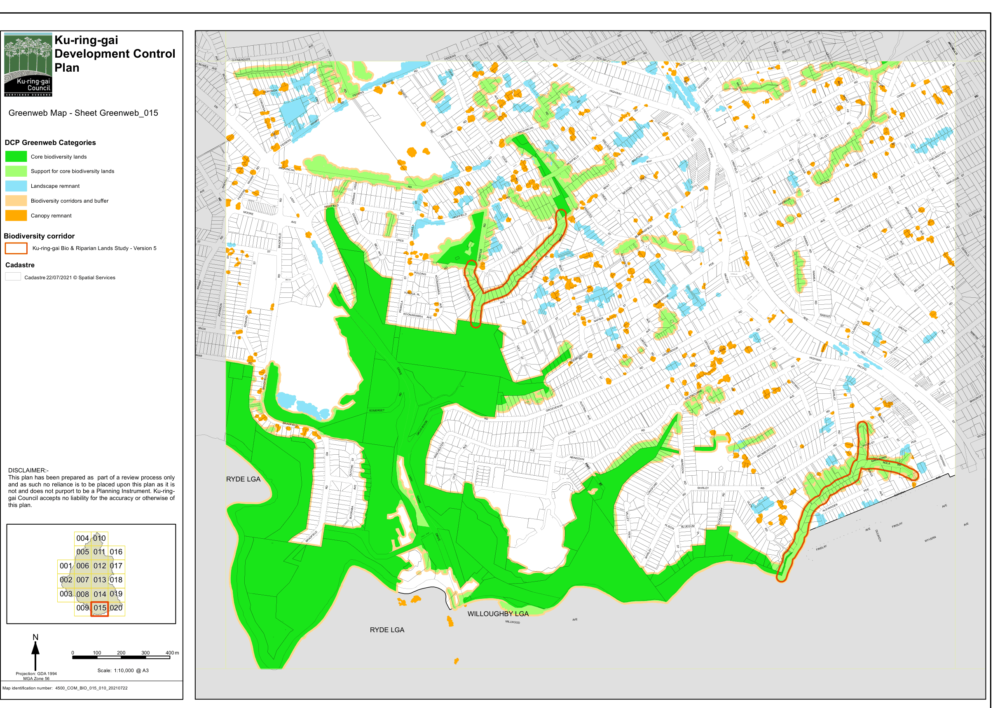

#### 16A AVE

#### EASTERN

#### RD

#### RD

### 001 006 012 017

#### STANHOPE

#### ST

#### WARWICK

### 002 007 013 018

#### RD 21

#### RD

### 003 019

### 008 014

#### CALVERT

#### AVE

#### ST ST

#### NORFOLK

## 23 KIAMALA

#### BUCKINGHAM

#### HIGHWAY

#### CRES

#### ARTERIAL

#### STANHOPE

#### NORTHCOTE

#### MILDURA

### 009 015 020

#### RD 17

#### TREATTS

#### MACKENZIE 17

#### DANGAR

#### GURIN

#### SLADE

## 18 RD

#### TRYON

#### TRYON

#### RD

#### AVE

#### KILLARA

#### RD

#### LINDFIELD

#### RD

### N

#### KENILWORTH

#### ST

#### ST

#### RD

#### BLENHEIM

#### NELSON

#### SMITH

#### ARCHBOLD

#### ARCHBOLD

#### GRASSMERE

#### TREATTS

#### RD

#### WOLSELEY

#### ELEHAM

#### OWEN

#### REID

#### ELLSMORE

#### RD 11A

#### HIGHGATE

#### COOK 15

#### LIGHTCLIFF

#### ST

#### TRYON

#### WOODSIDE

#### MILRAY

#### GOLF

#### LINKS

#### CORONGA

#### HIGHWAY

#### WHARF

#### FIDDENS

#### FIDDENS

#### WHARF PRINCE

> [Picture on page 16: a map, saved as a picture (images/part-18r-18r-references-18r-1-greenweb-maps-page-16-1.gif, 150 dpi); the street names and other small labels are on the picture.]
> Words printed on the picture (title and legend, copied from the PDF):
> 2 1A SLA DE
> 15 - 19
> COM MO NWEALTH
> 23 (H owar d)
> LAN E 406
> 37 LAN E
> KO CHIA LAN E
> 2 342 11
> WOO DFO RD
> 6 2 8
> 6 - 10
> 6 - 8
> 15 5 1
> SQ UADRON                         CT
> 5 - 7
> BEACON SF IELD
> 12  - 16
> 39 & 1A
> 25 23 33
> STRICKL AND LANE
> (210 - 214)
> 20 17A 9
> (159) OLIVER  LANE
> BAYSWAT ER LAN E
> 14 5 4
> ROSEVI LLE    LANE
> LA N E
> M I LE
> 90 88 86
> 100 96 94 92
> 3 - 5
> D.P.          280 062
> 79A 73A 67A
> 1 - 3
> 15 - 17 6
> 6 - 8
> 4 7 6
> 3 109 6
> 5 - 7
> PUBLIC    RO AD
> 37 82 80

#### LINDFIELD

#### KENILWORTH

#### NELSON

#### SMITH

#### GRASSMERE

#### TREATTS

#### WOLSELEY

#### ELEHAM

#### REID

#### ELLSMORE

#### HIGHGATE

#### RD

#### WHARF 27

#### AVE

#### AVE

#### LIGHTCLIFF

#### TRYON

#### WOODSIDE

#### RD

#### RD

#### LINKS

#### CORONGA

#### HIGHWAY

#### WHARF

#### FIDDENS

#### FIDDENS

#### OWEN

#### RD

#### RD

#### AVE
