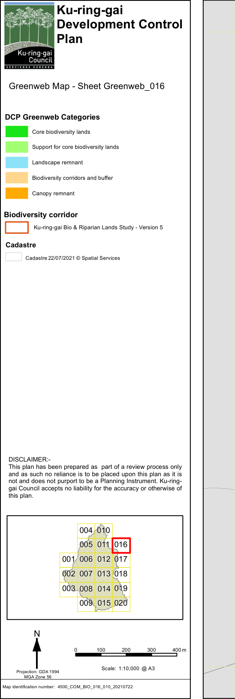
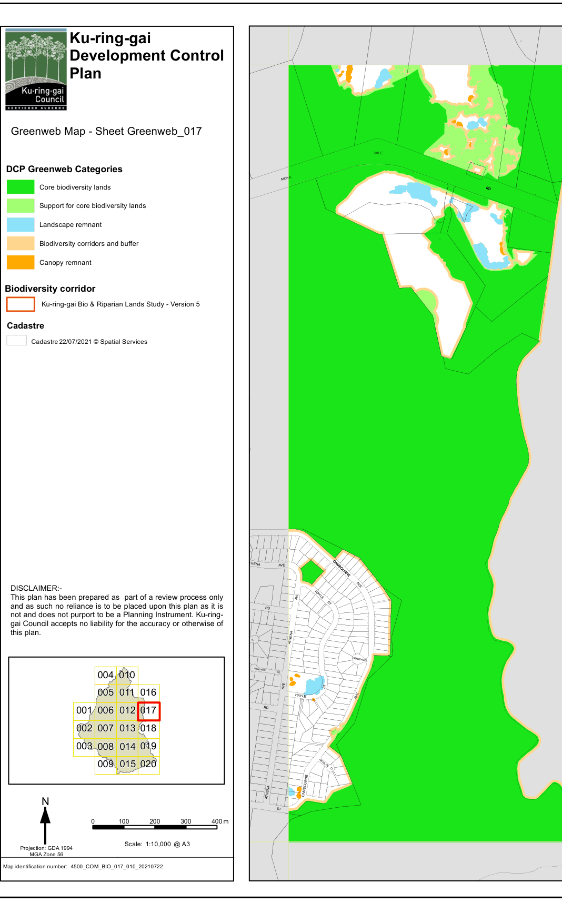

## 5 ALISON

#### AVE

#### RD

#### GLEN

#### PL

#### VIEW

#### DRIVE

#### DULWICH

#### BRADFIELD

#### WYVERN

### 004 010

#### ST

## 61 FINDLAY

### 005 011 016

#### CL 124

#### SHIRLEY

### 001 006 012 017

### 002 007 013 018

### 003 019

### 008 014

### 009 015 020

### WILLOUGHBY LGA

#### AVE

#### MILLWOOD

### RYDE LGA

### N

> [Picture on page 17: a picture, saved as a picture (images/part-18r-18r-references-18r-1-greenweb-maps-page-17-1.gif, 150 dpi).]

### Greenweb Map - Sheet Greenweb_ 016

### DCP Greenweb Categories

Core biodiversity lands Support for core biodiversity lands Landscape remnant Biodiversity corridors and buffer

### Canopy remnant

### Biodiversity corridor

### Ku-ring-gai Bio & Riparian Lands Study - Version 5

### Cadastre

### 22/07/2021

### Cadastre                      © Spatial Services

### NORTHERN BEACHES LGA

### DISCLAIMER:-

### This plan has been prepared as  part of a review process only

and as such no reliance is to be placed upon this plan as it is

### not and does not purport to be a Planning Instrument. Ku-ring-

gai Council accepts no liability for the accuracy or otherwise of

### this plan.

### 004 010

### 005 011 016

### 001 006 012 017

### 002 007 013 018

### 003 019

### 008 014

### 009 015 020

### N

> [Picture on page 18: a map, saved as a picture (images/part-18r-18r-references-18r-1-greenweb-maps-page-18-1.gif, 150 dpi); the street names and other small labels are on the picture.]
> Words printed on the picture (title and legend, copied from the PDF):
> 15 17 19
> 79 75 71
> 53 18 30
> 44 19 20
> 47 25 26
> 45 27 5
> 28 52-54 46
> 85 87 89
> 108 110 112

### Greenweb Map - Sheet Greenweb_ 017

### DCP Greenweb Categories

Core biodiversity lands Support for core biodiversity lands Landscape remnant Biodiversity corridors and buffer

### Canopy remnant

### Biodiversity corridor

### Ku-ring-gai Bio & Riparian Lands Study - Version 5

### Cadastre

### 22/07/2021

### Cadastre                      © Spatial Services

### DISCLAIMER:-

### This plan has been prepared as  part of a review process only

and as such no reliance is to be placed upon this plan as it is

### not and does not purport to be a Planning Instrument. Ku-ring-

gai Council accepts no liability for the accuracy or otherwise of

### this plan.

### 004 010

### 005 011 016

### 001 006 012 017

### 002 007 013 018

### 003 019

### 008 014

### 009 015 020

### N

#### VALE

#### MONA

#### RD

#### RD

### NORTHERN BEACHES LGA

#### ATHENA AVE

#### CAMBOURNE

#### CAMBOURNE

## 2 AVE
