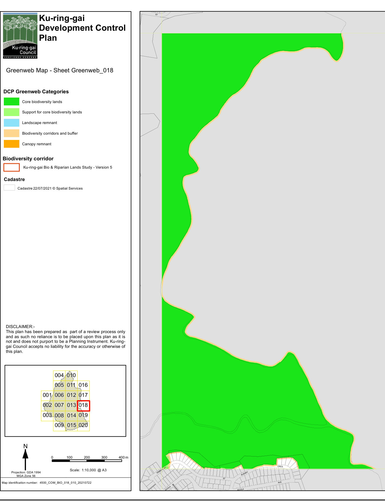
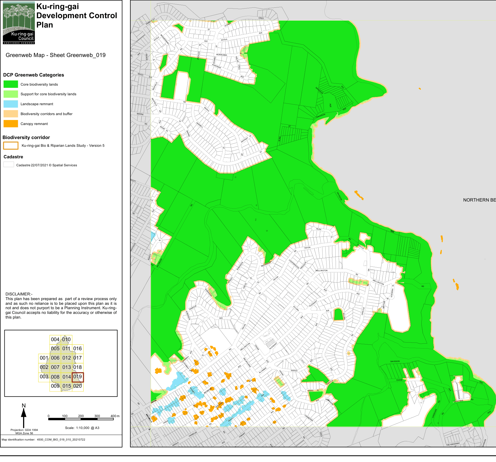

## 97 CL

#### NEWLYN

## 2 CAMBOURNE

#### ATHENA

#### ST

> [Picture on page 19: a picture, saved as a picture (images/part-18r-18r-references-18r-1-greenweb-maps-page-19-1.gif, 150 dpi).]

### Greenweb Map - Sheet Greenweb_ 018

### DCP Greenweb Categories

Core biodiversity lands Support for core biodiversity lands Landscape remnant Biodiversity corridors and buffer

### Canopy remnant

### Biodiversity corridor

### Ku-ring-gai Bio & Riparian Lands Study - Version 5

### Cadastre

### 22/07/2021

### Cadastre                      © Spatial Services

### DISCLAIMER:-

### This plan has been prepared as  part of a review process only

and as such no reliance is to be placed upon this plan as it is

### not and does not purport to be a Planning Instrument. Ku-ring-

gai Council accepts no liability for the accuracy or otherwise of

### this plan.

### 004 010

### 005 011 016

### 001 006 012 017

### 002 007 013 018

### 003 019

### 008 014

### 009 015 020

### N

### NORTHERN BEACHES LGA

#### ALBANY

#### ST 3

#### KOOLA

#### KOOLA

#### BENWERRIN

> [Picture on page 20: a map, saved as a picture (images/part-18r-18r-references-18r-1-greenweb-maps-page-20-1.gif, 150 dpi); the street names and other small labels are on the picture.]
> Words printed on the picture (title and legend, copied from the PDF):
> 19 21 23 25
> 98 97 3
> 5 4 6
> 85 5 9
> 1 3 6
> 12 14 3
> 19 21 23 25
> 8 29 31
> 41 43 24
> 19 36 33 57
> 70 76 77
> 53 74 75
> 57 59 69
> 38 36 34 31
> 10 6 5
> 221 223 225
> 60 74 9
> 56 76 146
> PATH WAY 173
> 11 15 20
> 2 22 24
> 25 44 41
> WEL LING TO N
> 3 84 139

### Greenweb Map - Sheet Greenweb_ 019

### DCP Greenweb Categories

Core biodiversity lands Support for core biodiversity lands Landscape remnant Biodiversity corridors and buffer

### Canopy remnant

### Biodiversity corridor

### Ku-ring-gai Bio & Riparian Lands Study - Version 5

### Cadastre

### 22/07/2021

### Cadastre                      © Spatial Services

### DISCLAIMER:-

### This plan has been prepared as  part of a review process only

and as such no reliance is to be placed upon this plan as it is

### not and does not purport to be a Planning Instrument. Ku-ring-

gai Council accepts no liability for the accuracy or otherwise of

### this plan.

### 004 010

### 005 011 016

### 001 006 012 017

### 002 007 013 018

### 003 019

### 008 014

### 009 015 020

### N

19 17 15 11 2

#### ALBANY
