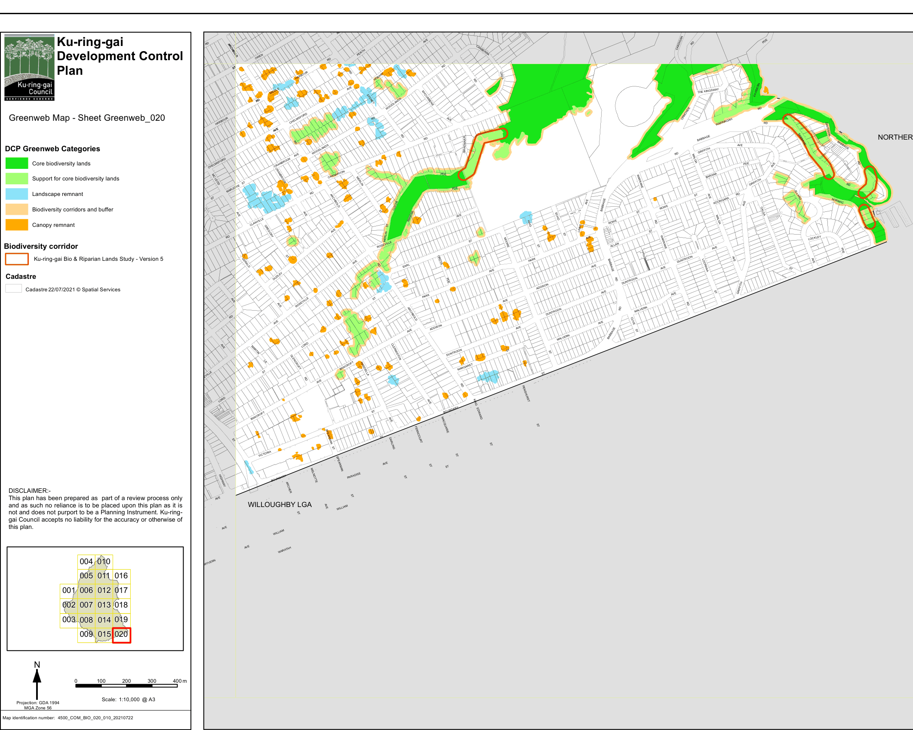

## 14 ST

#### AVE

#### DAVIDSON

#### LOOMBAH

## 8 AVE

#### MELBOURNE

#### AVE

#### LOOMBAH 129

#### AVE

## 1 KAROO

#### AVE

#### ALLAMBIE

#### CRANA

#### CHASE 2

#### PDE

#### CARLYLE

#### AVE

#### PL

#### NAMOI

#### SYDNEY

#### BRISBANE

#### AVE

#### RD

#### ORM

#### AVE

#### ORMONDE

#### 2A RD

#### ONDE

#### TRYON

#### TRYON

#### RD

#### RD

#### AVE

#### ADELAIDE

#### PDE

#### RD

#### RD

#### CARDIGAN

#### PERTH

#### ST

#### AVE

#### HOBART

#### THE KINGSWAY

#### HARBOUR

#### MIDDLE

#### DAVIDSON

#### SYDNEY

#### MYCUMBENE

> [Picture on page 21: a map, saved as a picture (images/part-18r-18r-references-18r-1-greenweb-maps-page-21-1.gif, 150 dpi); the street names and other small labels are on the picture.]
> Words printed on the picture (title and legend, copied from the PDF):
> 73 67 65
> BRI DGE  PASSAGE
> NO RM AC WALK
> PA TH WA Y
> 15 53 38
> 55 40 11
> 81 30 2A
> 39 & 1A
> 19 18 2
> MA RG ARE T
> ROSEVI LLE    LANE
> 1A 79A 82
> (2 - 12)
> 31-35 BANCRO FT
> (22 - 30) 35
> 17 - 25
> 5 - 15 16
> 26A 19-21 3

#### ADELAIDE

#### PDE

#### CARDIGAN

#### PERTH

#### CRES

#### HOBART

#### RD

#### AVE

#### THE KINGSWAY

#### HARBOUR

#### MIDDLE

#### DAVIDSON

#### RD

#### RD

#### SYDNEY

#### MYCUMBENE

#### WOODLANDS

#### ORMONDE

#### RD 7

#### AVE

### Greenweb Map - Sheet Greenweb_ 020

#### CHELMSFORD

#### RD

#### HARBOUR

#### WARRINGAH

#### RD

#### AVE

#### AVE

#### DAVIDSON

#### RD

#### RD

#### BABBAGE 71 69

### NORTHERN BEACHES LGA

#### RD 10

#### BABBAGE

#### AVE

#### BABBAGE

#### PL BRAEMAR 8

### DCP Greenweb Categories

#### GRIFFITH

#### WOODLANDS

#### RD

#### AVE 1A

#### RD

#### PDE

### Core biodiversity lands
