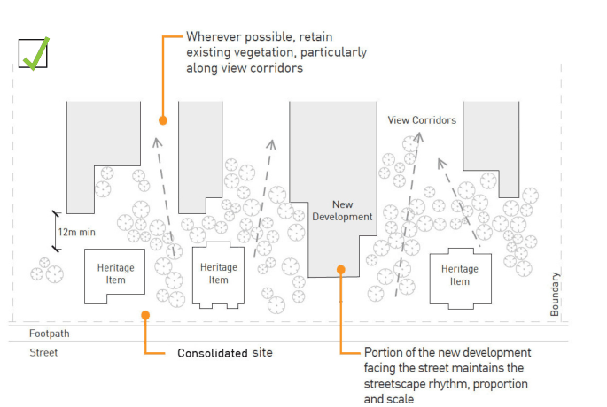

### 19A.1  SUBDIVISION AND SITE CONSOLIDATION

### FOR NEW DEVELOPMENT WITHIN AN

### HCA

#### Controls

1 Applications for subdivision and site consolidation within an HCA is

discouraged and will only be considered if the application:

i) will have no adverse affect the significance of the HCA;

ii)	 retains the typical block width characteristics and historic

subdivision pattern of the area, including rear lanes;

iii)	 the setting and curtilage of Heritage Items or significant

buildings in the vicinity, including important structures and

landscape elements, are retained;

iv)	 vistas and views to and from Heritage Items and contributory

properties, especially the principal elevations of buildings, are

not interrupted or obscured;

v)	 the landscape quality of the streetscape is retained;

vi)	 the contours and any natural features of the site have been

retained and respected;

vii)	 will not result in future development which will adversely affect

the significance, character or appearance of the HCA.

2 Subdivision or consolidation will not generally be permitted where

the setting or curtilage of any Heritage Items and contributory

properties within or adjoining the site, would be compromised. 3 Applications for subdivision and site consolidation within an HCA will

require a curtilage assessment.

#### Objectives

1	 To ensure new

subdivisions and lot

consolidations do not

have an adverse impact

upon the curtilage and

setting of Heritage Items. 2	 To encourage the

incorporation of Heritage

Items into larger

consolidated development

sites.

3	 To ensure that new

development respects

and conserves the

Heritage Item, its garden

setting, its streetscape

and important views. 4	 To avoid isolation of

Heritage Items within new

developments. 5	 To provide a visual

transition between

medium/high density

residential development

and the Heritage Item.

### 19A

### OF A HERITAGE ITEM

#### Controls

1 Subdivision of a Heritage Item will only be supported where:

i) the subdivision does not adversely affect the cultural significance

of the Heritage Item;

ii)	 evidence of the historical setting, landscape and subdivision

pattern can be recognised and/or retained.

2 Subdivision or consolidation will not be permitted where the curtilage

and setting of a Heritage Item and significant buildings within or

adjoining the site, would be compromised.

Note: Applications for subdivision and site consolidation of a Heritage Item will

require a curtilage analysis within the Heritage Impact Statement with particular emphasis on the potential impact on garden settings.

#### Heritage Items within consolidated development sites zoned

medium to high density

3 The following controls apply for consolidated sites that include a

Heritage Item:

i) Consolidated development sites that include Heritage Items are

to provide for conservation works to the building and its setting

as part of the redevelopment.

ii)	 Isolation of a Heritage Item within the new development will not

be supported. Refer to Figure 19A.2-1, 19A.2-2

iii)	 The distance or setback of new development from the Heritage

Item is to consider the curtilage and setting of the item and

informed by the CMP.

iv)	 Buildings, structures and garden settings that contribute to

the significance of the Heritage Item are to be retained and

sensitively incorporated into the development proposal.

v)	 The existing garden setting of the Heritage Item is to be

enhanced and extended into the new development. Wherever

possible, existing vegetation is to be retained, particularly along

view corridors and street frontages.

vi)	 New development is to be broken down in bulk and scale to

minimise dominance over the Heritage Item.

vii)	 New buildings to be articulated to respond to the significance

of Heritage Items to achieve an appropriate transition in height,

bulk and scale.

viii)	The front setback of the new development is to be greater than

that of the Heritage Item. Refer to Figure 19A.2-3

ix)	 Key views to and from the Heritage Item are to be conserved as

part of the development. Refer to Figure 19A.2-3.

### SUBDIVISION AND SITE CONSOLIDATION

Note: An consolidated development site is defined for the purposes of the

DCP as the joining of a number of lots to form a single site for the purposes of

development.

Note: Under Clause 5.10 of KLEP, a CMP may be required to guide development

to ensure that the significance of the Heritage Item is retained and conserved.

### OF A HERITAGE ITEM (continued)

Street Footpath

New Development

Consolidated site

Isolated site

Single storey Heritage Item

Footpath Street

#### Figure 19A.2-1:

New development has excluded the Heritage Item and created an

isolated site.

Street Footpath

View Corridors

New development broken down in bulk and scale to minimise dominance over Heritage Item

Consolidated site

Garden setting extended into new development

Heritage Item

Boundary

Boundary

Footpath Street

#### Figure 19A.2-2:

#### New development has integrated the Heritage Item into an consolidated

site.

> [Picture on page 8: a picture, saved as a picture (images/part-19-heritage-items-heritage-conservation-areas-page-8-33.gif, 150 dpi).]

#### Figure 19A.2-3:

New development and Heritage Item integrated on an

consolidated site.

### 19B
