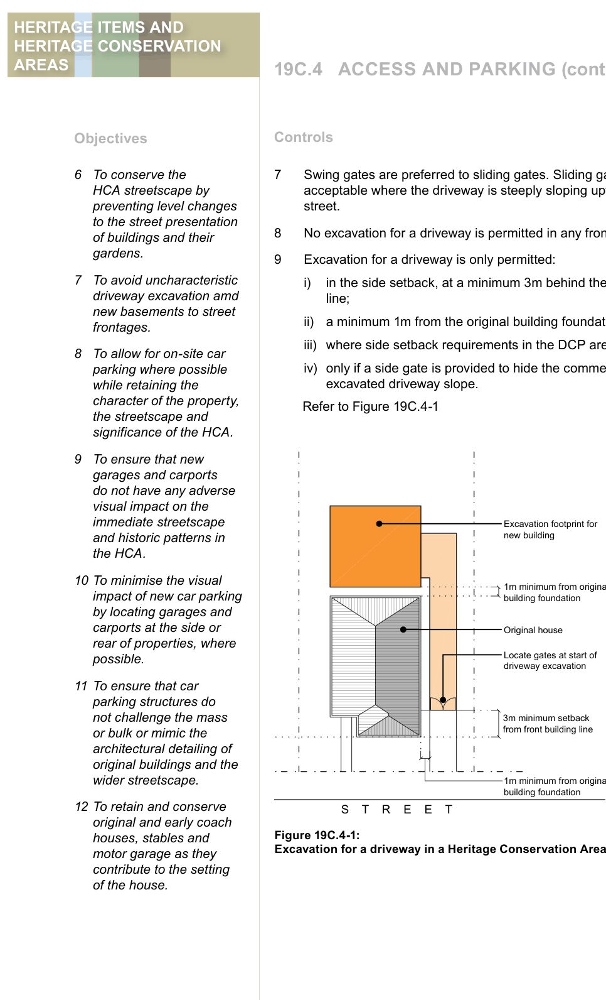

### 19C.4  ACCESS AND PARKING

#### Further controls that may apply SECTION A

Part 4B.1 - Vehicle Access

#### SECTION C

Part 22 - General Access and

Parking

#### Controls

#### Objectives

#### Equitable Access

Additional Requirements for Alterations and Additions 1 Modifications and alterations to provide access and mobility are to:

1	 To ensure that

modifications to provide

access do not adversely

affect significant built

fabric of either individual

buildings or the HCA as a

whole.

i) explore all options to achieve the statutory requirements in the

least obtrusive manner possible;

ii)	 involve the least demolition of significant fabric;

iii)	 be reversible;

iv)	 preserve fabric of higher significance if a compromise is

required.

Note: Access requirements apply for public buildings and residential flat

buildings; they are not generally required for dwelling houses. Note: Access solutions will be unique to each property and will be assessed on their individual merits. Note: Refer to Disability Discrimination Act 1991. Note: Refer to Australian Standard 1428.

#### Driveways

2 Original and existing rear lane or side entry vehicle access is to be

retained and/or utilised where rear and side lanes exist.

2	 To allow for on-site car

parking where possible

while retaining the

character of the property,

the streetscape and

significance of the HCA.

3 Where original concrete wheel strips exist, they are to be retained

with grass in between.

3	 To ensure that driveways

do not have any adverse

visual impact on the

immediate streetscape

and historic patterns in

the HCA.

4 New parking areas, garages and driveways are to be designed

carefully so that they do not dominate the principal elevations or

detract from the immediate streetscape and incorporate provisions

for landscaping. 5 The siting of new driveways are to be consistent with the established

pattern in the immediate streetscape and the HCA as a whole.

4	 To minimise the visual

impact of new car parking

by locating it at the side

or rear of properties,

where possible.

### DEVELOPMENT WITHIN HCAS

6 Double garages should only be accessed by a single driveway.

Finishes to new or refurbished driveways are to match original

driveway finishes or be appropriate to the architectural style of the

HCA. Painted, coloured, stamped or stenciled concrete, pavers,

aggregate, pebblecrete or cobblestones are not to be used for new

driveways or driveway elements.

5	 To ensure battle-axe

driveways make a

positive contribution to

the streetscape and the

HCA.

> [Picture on page 22: a map, saved as a picture (images/part-19-heritage-items-heritage-conservation-areas-page-22-1.gif, 150 dpi); the street names and other small labels are on the picture.]
> Words printed on the picture (title and legend, copied from the PDF):
> 6	 To conserve the
> HCA streetscape by
> preventing level changes
> to the street presentation
> of buildings and their
> 7	 To avoid uncharacteristic
> driveway excavation amd
> new basements to street
> parking where possible
> while retaining the
> character of the property,
> the streetscape and
> significance of the HCA.
> garages and carports
> visual impact on the
> and historic patterns in
> by locating garages and
> rear of properties, where
> parking structures do
> not challenge the mass
> architectural detailing of
> original buildings and the
> original and early coach
> houses, stables and
> motor garage as they
> contribute to the setting
> of the house.
> excavated driveway slope.
> Refer to Figure 19C.4-1
> Excavation footprint for
> 1m minimum from original
> Locate gates at start of
> 3m minimum setback
> from front building line
> 1m minimum from original
> Excavation for a driveway in a Heritage Conservation Area

Figure 19C.4-1:

#### Objectives

8	 To allow for on-site car

9	 To ensure that new

do not have any adverse

10	To minimise the visual

impact of new car parking

carports at the side or

11	To ensure that car

or bulk or mimic the

12	To retain and conserve

### 19C.4   ACCESS AND PARKING (continued)

#### Controls

7 Swing gates are preferred to sliding gates. Sliding gates may only be

acceptable where the driveway is steeply sloping upward from the

8 No excavation for a driveway is permitted in any front setback. 9 Excavation for a driveway is only permitted:

i) in the side setback, at a minimum 3m behind the front building

ii)	 a minimum 1m from the original building foundation;

iii)	 where side setback requirements in the DCP are met;

iv)	 only if a side gate is provided to hide the commencement of the

### 19C.4   ACCESS AND PARKING (continued)

#### Controls Battle-axe Driveways

10 Battle-axe Driveways including battle-axe handles are to be

constructed of materials such as bitumen, gravel, stone flagging or

concrete wheel strips and incorporate provisions for landscaping.

#### New Garages and Carports

11 Where it is physically possible, new car parking is to be consistent

with the historic placement of parking structures on the site. 12 Garages and carports are not permitted forward of the building line

and are to be located at least 1m minimum behind the existing front

building line, preferably to the rear of the main building. 13 New carport and structures are to pay regard to existing and original

features of dwellings, such as windows, doors, string coursing. 14 Only in exceptional circumstances and where a dwelling has a side

setback of less than 3m, a hard stand area forward of the building

line formed of suitable materials may be considered appropriate. 15 New double garage doors are to be divided by a central mullion or

constructed as two doors separated by a pier. 16 New double garages are to be located behind the rear building line

to avoid being a visually dominant element within the streetscape. 17 Original existing building fabric, including verandahs and balconies,

are not to be altered to provide a carparking structure or hard stand

area.

#### Original Coach Houses, Stables and Garages

18 Where original and early garages, coach houses and stables

survive, they should be retained and conserved. 19 Original garage doors, usually boarded timber, are to be retained

and conserved, where possible. Where replacement doors are

proposed to original or early garage structures, they are to be similar

in colour, materials and detail of the original.

### DEVELOPMENT WITHIN HCAS

#### Objectives

1	 To retain significant

materials and details

within HCAs. 2	 To ensure that the

materials and colours of

new work complements

the identified character of

the HCA

3	 To ensure that the

selection of materials

and colours for new

work is based on an

understanding of the

materials, finishes and

colours predominant

within the HCA. 4	 To encourage the removal

of paint from originally

unpainted surfaces. 5	 To ensure new

development respects

the character of, and

minimises the visual

impact upon, the HCA

and its streetscapes.

6	 To encourage the

recovery of the original

character of contributory

properties when

undergoing additions and

alterations
