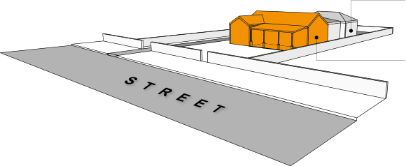
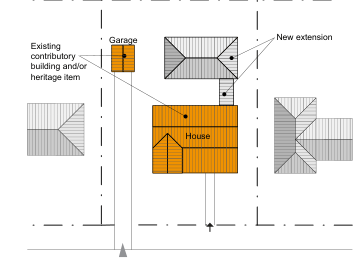

### 19C.5  BUILDING DESIGN

#### Controls Materials, Colours and Details

1 Significant unpainted brickwork, sandstone and blockwork is not to

be rendered, coated or painted.

2 The removal of later layers of paint from original face brickwork and

stonework is encouraged. Chemical stripping of paint from face

brickwork is encouraged.

3 Natural and recessive colour schemes are encouraged for rendered

and painted finishes, especially on sites rated as neutral or

uncharacteristic.

4 Contemporary materials are permitted for new work where the

detailing, proportions, texture and colour range blend with the

existing character of the HCA.

Additional Requirements for Alterations and Additions 5 Development applications for alterations and additions within an

HCA require a materials board and details of the colour scheme and

finishes to be submitted.

6 Significant materials and finishes such as decorative timber features,

tiles, shingles, relief work, mouldings, incised designs in render,

ashlar markings, tuckpointing and rough-cast stucco, are to be

retained and repaired.

7 Significant materials, finishes and details are to be retained and

repaired using traditional techniques where possible.

Additional Requirements for New Buildings 8 Materials used for new buildings are to be similar to, or compatible

with, the original buildings in the HCA.

9 Development applications for new buildings are to provide a material

board and details of colour scheme and finishes. 10 New buildings are to incorporate architectural language such as

massing, proportions, coursing lines, materials and finishes, which

are sympathetic to and complement the predominant character of

the HCA.

11 New building colour schemes are not to detract from colour schemes

in the streetscape and not to be in visual contrast with the colours

of the contributory properties in the HCA. Recessive colours and

traditional materials are preferred.

### 19C.5  BUILDING DESIGN (continued)

#### Controls

#### Objectives

#### Repairs, Maintenance and Restoration

Requirements for Alterations and Additions 12 The repair and maintenance of contributory properties is

encouraged. 13 The reconstruction of altered, missing or removed original features,

details and elements is supported where evidence exists of the

earliest state of the fabric. 14 In repairing the fabric of external surfaces, matching materials are

to be used. Sourcing old and salvaged building materials for like-for-

like matching of existing materials is preferred to the use of modern

equivalents. 15 The removal of intrusive later additions is encouraged. Note: Refer to KLEP Clause 5.10. Note: Refer to SEPP (Exempt and Complying Development Codes).

#### Verandahs

Requirements for Alterations and Additions

7	 To ensure the retention

and encourage

reinstatement of early

verandah and balcony

forms.

16 In altering existing buildings, original verandahs and porches to

the front and side elevations of contributory properties are to be

retained where contributing to the significance of the property. 17 Reinstatement of open front verandahs, where they have been

enclosed, is recommended. 18 New verandahs are not to compete with the importance of the

original built form and are to be simple in design and based on

existing detail or an understanding of appropriate designs for each

period or style. 19 Infilling or enclosure of verandahs and conversion to less reversible

uses, such as bathrooms or kitchens, is not permitted.

#### Doors and Windows

Requirements for Alterations and Additions

8	 To protect the original

fabric and details of

doors and windows of

contributory properties.

### DEVELOPMENT WITHIN HCAS

20 Original doors and windows to front and side elevations of

contributory properties are to be retained where contributing to the

significance of the property (Refer to figure 19C.5-1). 21 The repair and restoration of original doors and windows to front and

side elevations of contributory properties is encouraged. Authentic

reconstruction of missing doors and windows using traditional

materials, styles and craftsmanship is encouraged. 22 New doors and windows in additions and alterations are to be

compatible with the proportions, position, size and detailing of

#### Objectives

9	 To prevent excavation

and alteration to existing

ground levels in the front

setbacks in the HCA. 10	To avoid the introduction

of uncharacteristic

elements, such as

basements, basement

garages and excavated

driveways that alter the

street presentation of the

house and garden.

### 19C.5 BUILDING DESIGN (continued)

#### Controls

existing doors and windows.

23 New windows to front and side elevations of contributory properties

are to be appropriate in form and material for the style of the

house (based on original fabric or photographic evidence or on the

evidence of original houses of the same style in the streetscape). 24 The retention, repair and restoration of original leadlight and

coloured glass window and door panes is encouraged. 25 If sound attenuation is required, double glazing fitted to existing

windows is encouraged. Alternatives to double-glazing, where there

is no impact on principal elevations, are encouraged.

> [Picture on page 26: a picture, saved as a picture (images/part-19-heritage-items-heritage-conservation-areas-page-26-26.gif, 150 dpi).]
> Words printed on the picture (title and legend, copied from the PDF):
> STREET

> [Picture on page 26: a picture, saved as a picture (images/part-19-heritage-items-heritage-conservation-areas-page-26-27.gif, 150 dpi).]
> Words printed on the picture (title and legend, copied from the PDF):
> New extension
> Garage
> Existing
> contributory
> building and/or
> heritage item
> House

New extension

Existing building

STREET

#### Figure 19C.5-1:

#### Retain original doors and windows to front and side elevations (coloured

orange) of contributory properties.

26 Original sunhoods, blinds, awnings and skirts to principal elevations

are to be retained and repaired.

#### Basements

27 Excavation in the front setback is not permitted. 28 No basement is to be located under or within 1m of the original

building fabric.

#### Objectives

11	To discourage the use

of window and door

grilles and to encourage

alternative security

measures which do

not detract from the

appearance of individual

buildings and the HCA as

a whole.

### 19C.5 BUILDING DESIGN (continued)

#### Controls

29 A Structural Management Plan is to be submitted for all basements

to demonstrate it will be structurally sound and have no impact to the

existing building or neighbouring buildings and to any structure or

tree in the vicinity.

#### Security Grilles

30 Security bars, mesh or roller shutters to visible elevations are not

permitted.

31 Traditional timber shutters may be acceptable if shutters were

original to the building.

32 The removal of security bars, mesh or roller shutters to windows

which detract from the streetscape is encouraged. 33 Where additional security is required, passive measures such as

mortice deadlocks, window locks and alarm systems are to be used. 34 Where there is no alternative, the installation of external security

bars is acceptable provided the design responds to the glazing bars

of the window or door.

### DEVELOPMENT WITHIN HCAS

#### Objectives

1	 To retain the character

of the original roof forms

within the HCA. 2	 To protect the original

fabric and details of roofs

and chimneys. 3	 To ensure that structures

attached to roofs do not

have an adverse impact

on the character and

significance of individual

buildings, the immediate

streetscape and the HCA.
