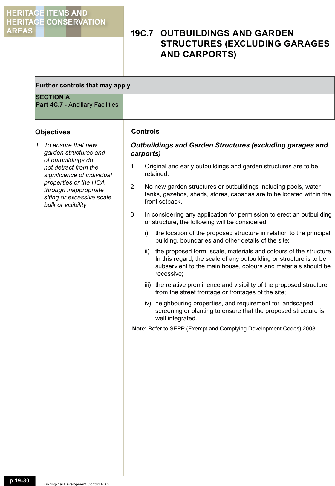

### 19C.6  ROOF FORMS AND STRUCTURES

### ATTACHED TO ROOFS

#### Controls Roofs, Chimneys and Dormers

1 Fireplaces and chimneys are important building elements within

HCAs and are to be retained.

2 Roof forms and details vary widely according to building type and

architectural style, and this variety of forms makes an important

contribution to the visual complexity of the HCA and are to be

retained.

3 The original principal roof form is to be retained to the extent that

it can be interpreted. The roofs of alterations and additions are to

have a separate linked section. New roof forms for new work will be

considered where they are complementary in design, not visible from

the public domain (see Figure 19C.6-1) and follow historic practices,

such as rear skillion roofs (see Figure 19C.1-1). 4 Dormer windows are not to be used on the street-facing roof

elevations. Skylights are to have a low profile and be flush with the

roof surface.

5 Slate roofs are to be conserved, repaired and retained wherever

possible, with complete replacement when necessary. 6 Where inappropriate retiling has occurred replacement of concrete

roof tiling with unglazed terracotta Marseilles pattern roof tiling is

encouraged.

7 Appropriate roofing materials are profiled terracotta tiles, slate and

other original roofing materials. Replica flat slate and concrete roof

tiles are not permitted.

No ‘pop top’ roofs

#### Figure 19C.6-1:

#### No ‘pop top’ roofs visible from public domain.

Additional Requirements for Alterations and Additions 8 On original buildings, new or replacement roof materials are to

match, like-for-like, original roof materials in texture, pattern and

colour.

### 19C.6  ROOF FORMS AND STRUCTURES

### ATTACHED TO ROOFS (continued)

Controls Skylights, Solar Panels, Solar Water Heaters, Antennae and

#### Other Roof Infrastructure

Note: For placement of solar panels, solar water heating, antennas etc on

Heritage Items refer to Chapter 2, Division 4 of Part 2.3 of SEPP (Transport and

Infrastructure) 2021.

### DEVELOPMENT WITHIN HCAS

> [Picture on page 30: a map, saved as a picture (images/part-19-heritage-items-heritage-conservation-areas-page-30-1.gif, 150 dpi); the street names and other small labels are on the picture.]
> Words printed on the picture (title and legend, copied from the PDF):
> garden structures and
> of outbuildings do
> not detract from the
> significance of individual
> properties or the HCA
> siting or excessive scale,
> bulk or visibility
> Note: Refer to SEPP (Exempt and Complying Development Codes) 2008.
