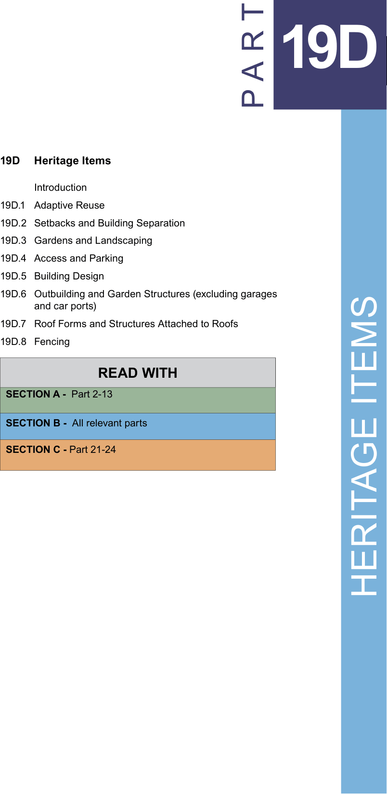

### 19C.9  SECONDARY DWELLINGS WITHIN HCAS

#### Controls

1 Generally, proposals for a secondary dwelling within an HCA will

only be considered if the proposal:

i) will have no adverse impact on the significance of the HCA;

ii)	 the rhythm of buildings in the streetscape is retained;

iii)	 the setting and curtilage of any Heritage Item or significant

buildings in the vicinity, including important structures and

landscape elements, are retained;

iv)	 vistas and views to and from Heritage Items and contributory

properties in the vicinity, especially the principal elevation of the

buildings, are not interrupted or obscured;

v)	 the landscape quality of the streetscape is retained;

vi)	 the contours and any natural features of the site have been

retained and respected.

2 Applications for secondary dwellings within the HCA require a

curtilage assessment within the Heritage Impact Statement, with

particular emphasis on garden settings.

### DEVELOPMENT WITHIN HCAS

### THIS PAGE IS INTENTIONALLY BLANK

> [Picture on page 35: a picture, saved as a picture (images/part-19-heritage-items-heritage-conservation-areas-page-35-1.gif, 150 dpi).]
> Words printed on the picture (title and legend, copied from the PDF):
> Introduction
> and car ports)

### 19D

### 19D
