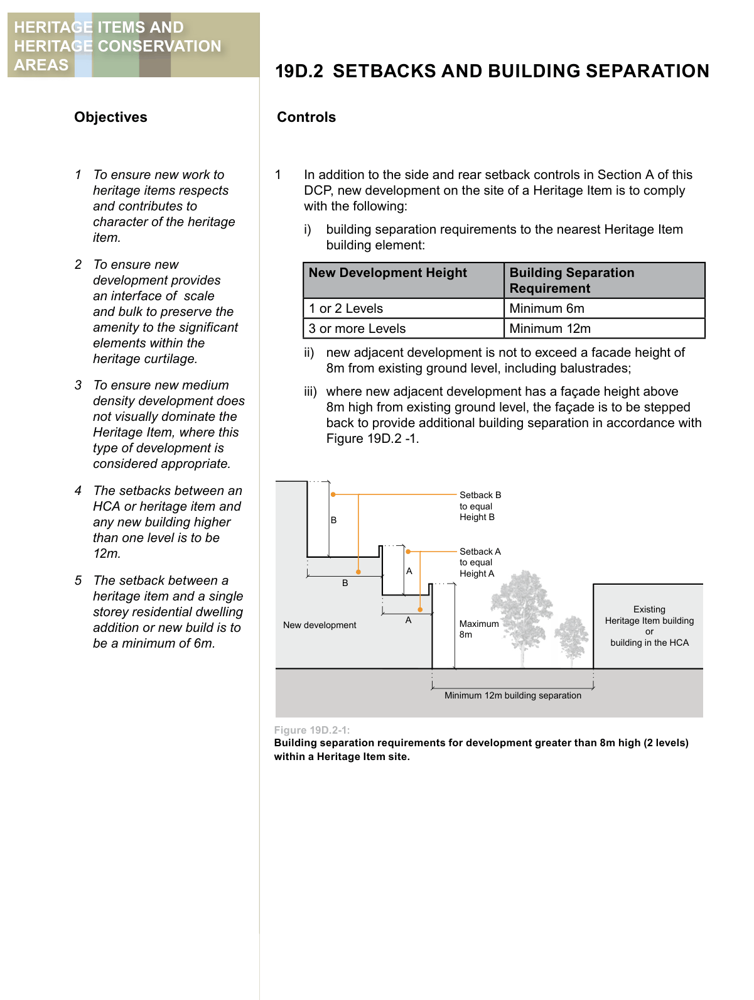

### 19D.1  ADAPTIVE REUSE

#### Controls

1 Development involving adaptive reuse of a Heritage Item requires

the preparation of a Conservation Management Plan (CMP) by an

experienced consultant to guide change and ensure conservation of

the Heritage Item.

2 In accordance with Clause 5.10.10 of the KLEP, Council will consider

variations to other development standards, including car parking

requirements, in order to achieve desirable heritage and planning

outcomes.

### HERITAGE ITEMS

> [Picture on page 38: a map, saved as a picture (images/part-19-heritage-items-heritage-conservation-areas-page-38-1.gif, 150 dpi); the street names and other small labels are on the picture.]
> Words printed on the picture (title and legend, copied from the PDF):
> heritage items respects
> and contributes to
> character of the heritage
> 2	 To ensure new
> an interface of  scale
> amenity to the significant
> elements within the
> density development does
> not visually dominate the
> Heritage Item, where this
> type of development is
> any new building higher
> storey residential dwelling
> Heritage Item building
> building in the HCA
> Minimum 12m building separation
> Building separation requirements for development greater than 8m high (2 levels)
> within a Heritage Item site.

Figure 19D.2 -1.

Figure 19D.2-1:

#### Objectives

1	 To ensure new work to

and bulk to preserve the

3	 To ensure new medium

4	 The setbacks between an

HCA or heritage item and

than one level is to be

5	 The setback between a

heritage item and a single

addition or new build is to

be a minimum of 6m.
