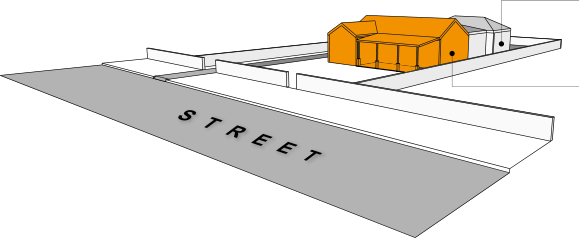
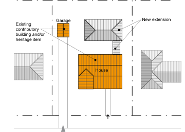

### 19D.5  BUILDING DESIGN

#### Controls Alterations and Additions – External

1 All works to a Heritage Item are to comply with the controls in this

section regardless of whether the property is located in an HCA

or not.

2 Development applications for works to a Heritage Item require a

materials board and details of the colour scheme and finishes to be

submitted.

3 New work to Heritage Items may be identifiable as new; however,

works are to respect and have minimal impact on the property

heritage significance.

4 All significant built features of a Heritage Item are to be retained and

conserved.

5 Original materials, finishes and details are to be retained and their

repair using traditional techniques in encouraged. 6 Alterations and additions are to respect the scale, form, height,

location, materials and colours of the Heritage Item. 7 Alterations and additions are be located at the rear or side of the

building to maintain the integrity of the prominent elevations and

streetscape contribution.

8 Extensions, alterations and additions are not to visually dominate or

compete with the original scale of the existing buildings to which they

are added.

#### Objectives

4	 To ensure alterations and

additions do not dominate

the Heritage Item. 5	 To ensure the significant

internal spaces and

features of a Heritage

Items are identified,

retained and conserved. 6	 Encourage the re-

instatement of missing

elements, where known,

and the removal of later

unsympathetic changes.

7	 To prevent excavation

and alteration to existing

ground levels in the front

setbacks of heritage

items that alter the street

presentation of the house

and garden.

8	 To prevent the

introduction of

uncharacteristic

elements, including

basements and basement

garages, on heritage item

sites.

#### Controls

9 Alterations and additions to a Heritage Item site are to respect the

heritage significance and predominant architectural character of the

Heritage Item by having similar massing, style, form, proportions and

arrangement of parts to the building itself. Extensions and additions

are to be kept at or below the existing roof ridge height. Refer to

Figure 19D.5-1.

rear addition is

kept below the

existing ridgeline

i) Skillion or lean-to

rear addition is

kept below the

existing ridgeline

addition

rear addition is

kept below the

existing ridgeline

addition

addition

ii)	 Linked pavilion

addition

single storey linked pavillion

addition

addition

single storey linked pavillion

single storey linked pavillion

addition

two storey linked pavillion on a sloping block

addition

addition

two storey linked pavillion on a sloping block

two storey linked pavillion on a sloping block

iii)	 Integrated wing

new wing

new wing

addition

new wing

addition

new integrated wing

addition

new integrated wing

### HERITAGE ITEMS

new integrated wing

#### Figure 19D.5-1:

#### Examples of forms for rear additions to a Heritage Item.

10 The re-instatement of missing elements and details, where known,

and the removal of past unsympathetic changes, is encouraged.

#### Alterations and Additions - Internal

11 Major internal alterations resulting in the loss of significant interior

details, finishes, built fabric, room layout and original floor plan are

unlikely to be supported unless it can be demonstrate that there is no

adverse impact on heritage significance.

12 All significant interior spaces and fabric of Heritage Items are to be

retained and conserved.

13 Original materials, finishes and details are to be retained and their

repair using traditional techniques in encouraged.

#### Controls

#### Objectives

14 The re-instatement of missing elements and details, where known,

and the removal of past unsympathetic changes, is encouraged. Note: Refer to SEPP (Exempt and Complying Development Codes). Note: Refer to KLEP Clause 5.10

#### Views

15 New development on the site of a Heritage Item is to demonstrate

that it will not reduce or impair important views to and from the

Heritage Item from the public domain.

#### Excavation

16 Excavation, including new or extended basements, are not permitted

on Heritage Item sites.

#### Verandahs

17 Original verandahs and porches to the front and side elevations of

contributory properties are to be retained where contributing to the

significance of the property.

9	 To ensure the retention

and encourage

reinstatement of early

verandah and balcony

forms.

18 Reinstatement of open front verandahs, where they have been

enclosed, is recommended. 19 New verandahs are not to compete with the importance of the

original built form and are to be simple in design and based on

existing detail or an understanding of appropriate designs for each

period or style. 20 Infilling or enclosure of verandahs and conversion to less reversible

uses, such as bathrooms or kitchens, is not permitted.

#### Doors and Windows

10	To protect the original

fabric and details of doors

and windows of heritage

items.

21 Original doors and windows to front and side elevations of heritage

items are to be retained where contributing to the significance of the

property (Refer to figure 19D.5-2). 22 The repair and restoration of original doors and windows to front

and side elevations of heritage items is encouraged. Authentic

reconstruction of missing doors and windows using traditional

materials, styles and craftsmanship is encouraged. 23 New doors and windows in additions and alterations are to be

compatible with the proportions, position, size and detailing of

existing doors and windows. 24 New windows to front and visible side elevations of heritage items

are to be appropriate in form and material for the style of the

house (based on original fabric or photographic evidence or on the

evidence of original houses of the same style in the streetscape). 25 The retention, repair and restoration of original leadlight and

coloured glass window and door panes is encouraged.

#### Objectives

11	To discourage the use

of window and door

grilles and to encourage

alternative security

measures which do

not detract from the

appearance of the

heritage item.

#### Controls

> [Picture on page 45: a picture, saved as a picture (images/part-19-heritage-items-heritage-conservation-areas-page-45-11.gif, 150 dpi).]
> Words printed on the picture (title and legend, copied from the PDF):
> STREET

New extension

Existing building

> [Picture on page 45: a picture, saved as a picture (images/part-19-heritage-items-heritage-conservation-areas-page-45-14.gif, 150 dpi).]
> Words printed on the picture (title and legend, copied from the PDF):
> New extension
> Garage
> Existing
> contributory
> building and/or
> heritage item
> House

STREET

#### Figure 19D.5-2:

#### Retain original doors and windows to front and side elevations (coloured

orange) of heritage items.

26 If sound attenuation is required, double glazing fitted to existing

windows is encouraged. Alternatives to double-glazing, where there

is no impact on principal elevations, are encouraged. 27 Original sunhoods, blinds, awnings and skirts to principal elevations

are to be retained and repaired.

#### Security Grilles

### HERITAGE ITEMS

28 Security bars, mesh or roller shutters to visible elevations are not

permitted.

29 Traditional timber shutters may be acceptable if shutters were

original to the building.

30 The removal of security bars, mesh or roller shutters to windows

which detract from the streetscape is encouraged. 31 Where additional security is required, passive measures such as

mortice deadlocks, window locks and alarm systems are to be used. 32 Where there is no alternative, the installation of external security

bars is acceptable provided the design responds to the glazing bars

of the window or door.

#### Objectives

1	 To ensure that new

garden structures

and of outbuildings

do not detract from

the significance of a

heritage item through

inappropriate siting or

excessive scale, bulk or

visibility.
