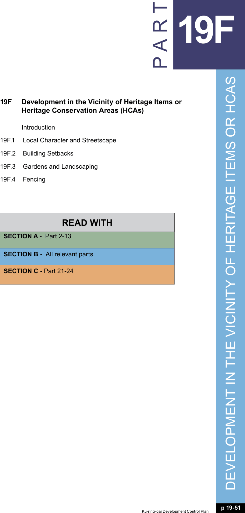

### 19E.1  SECONDARY DWELLINGS WITHIN HCAS AND

### HERITAGE ITEMS

#### Controls

#### General

1 Generally, proposals for a secondary dwelling within an HCA or on

the site of a Heritage Item will only be considered if the proposal:

i) has no adverse impact on the significance of the HCA or

Heritage Item;

ii)	 maintains the rhythm of buildings in the streetscape;

iii)	 retains the setting and curtilage of the Heritage Item itself, or

any Heritage Item or significant buildings in the vicinity, including

important structures and landscape elements;

iv)	 does not interrupt nor obscure vistas and views to and from

Heritage Items and contributory properties in the vicinity,

especially from the principal elevation of the buildings;

v)	 the landscape quality of the HCA streetscape and Heritage Item

setting is retained;

vi)	 the contours and any natural features of the site have been

retained and respected.

2 Applications for secondary dwellings within the HCA require a

curtilage assessment within the Heritage Impact Statement, with

particular emphasis on garden settings.

> [Picture on page 51: a picture, saved as a picture (images/part-19-heritage-items-heritage-conservation-areas-page-51-1.gif, 150 dpi).]
> Words printed on the picture (title and legend, copied from the PDF):
> Introduction

### 19E

### 19F

19F		 Development in the Vicinity of Heritage Items or

#### Heritage Conservation Areas (HCAs)

19F.1	 	Local Character and Streetscape 19F.2	 	Building Setbacks 19F.3	 	Gardens and Landscaping 19F.4	 	Fencing

### READ WITH

SECTION A -  Part 2-13

SECTION B -  All relevant parts

SECTION C - Part 21-24

### DEVELOPMENT IN THE VICINITY OF HERITAGE ITEMS OR HCAS

This section applies to development on sites that either directly adjoin

or are in the vicinity of a Heritage Item or an HCA. This part also applies

to a situation where the Heritage Item is not incorporated into new

consolidated development, as per 19A of this Part. This part provides

guidance to meet the objectives in the KLEP.

The term “in the vicinity” not only means immediately adjoining a Heritage

Item or HCA, but depending on site context, can be extended to include

other sites with a high visual presentation due to landform, size or location

of the Heritage Item.

The controls in this part are in addition to the controls in Sections 19A,

19B, 19C and 19D and are to be read in conjunction with them.
