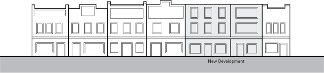

### 19F.1  LOCAL CHARACTER AND STREETSCAPE

#### Objectives

1	 To consider the impact on

the historic curtilage and

setting of the Heritage

Item or HCA and related

heritage features such

as views, streetscape

context, historical

subdivisions, garden

settings, alienated trees

and other landscape

features.

2	 To retain the significance

of Heritage Items or

HCAs in their settings. 3	 To ensure that the scale

of new development does

not dominate, detract

from or compete with

Heritage Items or HCAs

in the vicinity.

4	 To ensure that new

development respects

and conserves the

significance of any nearby

Heritage Items or HCA

and their settings. 5	 To ensure that new

development does not

visually dominate the

adjoining or nearby

Heritage Item or HCA. 6	 To ensure that the scale

of new development in the

vicinity of a heritage item

and HCA is in harmony

with the streetscape

and does not dominate,

detract from or compete

with the Heritage Item or

HCA.

#### Controls

#### General

1 All development in the vicinity of a Heritage Item or HCA is to

include a Heritage Impact Statement (HIS). The HIS is to address

the effect of the proposed development on a Heritage Item or HCA

and demonstrate that the proposed works will not adversely impact

upon significance, including any related heritage features within the

identified curtilage and setting.

#### Built form

2 Development on sites that either directly adjoin or are in the vicinity

of a Heritage Item or an HCA is to have regard to:

i) the form of the existing building or buildings including height,

roofline, setbacks and building alignment;

ii)	 dominant architectural language such as horizontal lines and

vertical segmentation;

iii)	 proportions including door and window openings, bays, floor-to-

ceiling heights and coursing levels;

iv)	 materials and colours;

v)	 siting and orientation;

vi)	 setting and context;

vii)	 streetscape patterns.

#### Retail/Mixed Use Setting

3 New development adjacent to or in the vicinity of a Heritage Item or

HCA within a retail/mixed use setting such as an existing row of two-

storey shops, are to:

i) retain the existing characteristics of the street including the

setback, height and rhythm of facades, and is to be sympathetic

to the materials and detailing of the earlier facades.

ii)	 retain a pedestrian building scale at the street level and to set

back any levels that are higher than the adjacent Heritage Item

or HCA.

> [Picture on page 53: a picture, saved as a picture (images/part-19-heritage-items-heritage-conservation-areas-page-53-74.gif, 150 dpi).]
> Words printed on the picture (title and legend, copied from the PDF):
> New Development

#### Figure 19F.1-1:

#### The infill building reinforces the street’s rhythm of facades by re-

interpreting the existing architectural lines such as parapet height,

window openings, awnings and vertical segmentation to reflect existing

building widths.

### DEVELOPMENT IN THE VICINITY OF HERITAGE ITEMS OR HCAS

#### Objectives

7	 To protect significant

views and vistas to and

from the Heritage Item or

HCA.

### 19F.1  LOCAL CHARACTER AND STREETSCAPE

### (continued)

#### Controls

#### Views

4 New development in the vicinity of a Heritage Item or HCA is to

demonstrate that it will not reduce or impair important views to and

from the Heritage Item from the public domain.

#### Objectives

1	 To ensure new work in

the vicinity of a Heritage

Item or HCA respects

and contributes to the

established streetscape

patterns through careful

siting of new buildings. 2	 To ensure new

development provides

an interface of scale

and bulk to preserve the

amenity to the adjacent

Heritage Item or building

within a HCA. 3	 To ensure new medium

and high density

development does not

visually dominate the

Heritage Item or building

within the HCA.
