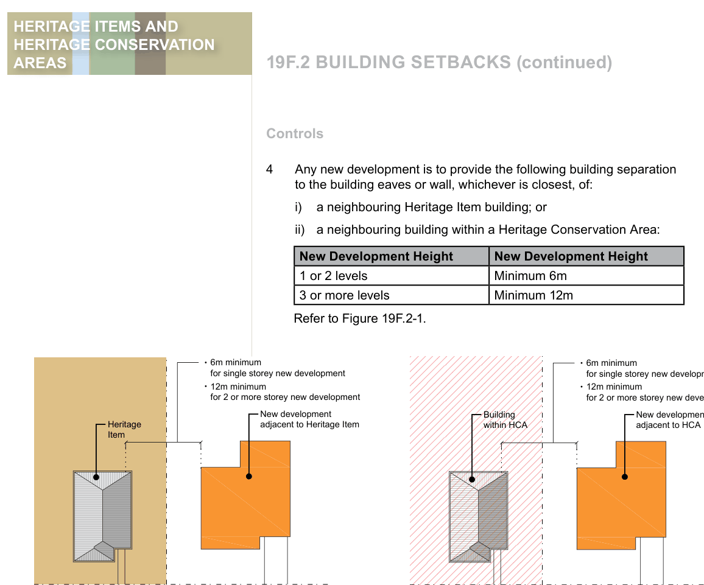
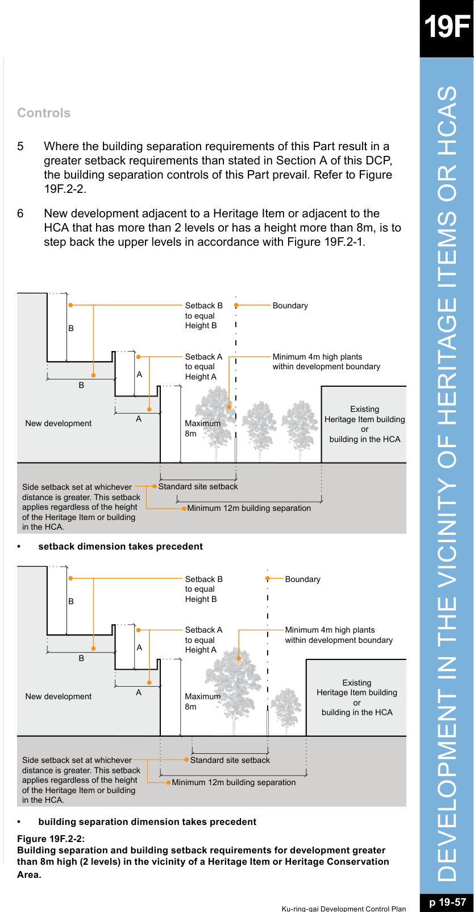

### 19F.2  BUILDING SETBACKS

#### Controls Setbacks

1 The front setback of development adjacent to a Heritage Item or

buildings within an HCA is to be greater than that of the Heritage

Item or building within the HCA. Where variations in setbacks exist,

the larger setback will apply.

#### Residential Context

2 All medium and high density development is to have a stepped

facade to any common boundary with a Heritage Item or building

within the HCA. The facade is to be stepped back above an 8m

height from natural ground level as per Figure 19E.2-1. Facades

greater than 8m high will not be permitted adjacent to a Heritage

Item or building with an HCA.

3 In addition to the side and rear setback controls in Section A of this

DCP, new development adjacent to a Heritage Item or building within

an HCA, is to comply with the following:

i) adjacent developments are to have a minimum 12m building

separation to the Heritage Item or building in the HCA (more if

setback requirements are not met within the 12m) as per Figure

19D.3-1;

ii)	 adjacent development is to not exceed a facade height of 8m

from existing ground level, including balustrades;

iii)	 adjacent development with a building mass above 8m high from

existing ground level is to be stepped back an additional 6m from

the Heritage Item as per Figure 19D.3-1;

Where variations in setbacks exist the larger setback will apply.

### DEVELOPMENT IN THE VICINITY OF HERITAGE ITEMS OR HCAS

> [Picture on page 56: a map, saved as a picture (images/part-19-heritage-items-heritage-conservation-areas-page-56-1.gif, 150 dpi); the street names and other small labels are on the picture.]
> Words printed on the picture (title and legend, copied from the PDF):
> Refer to Figure 19F.2-1.
> for single storey new development
> for 2 or more storey new development
> for single storey new development
> for 2 or more storey new development
> adjacent to Heritage Item
> adjacent to HCA

### 19F.2 BUILDING SETBACKS (continued)

#### Controls

4 Any new development is to provide the following building separation

to the building eaves or wall, whichever is closest, of:

i) a neighbouring Heritage Item building; or

ii)	 a neighbouring building within a Heritage Conservation Area:

| New Development Height | New Development Height |
|---|---|
| 1 or 2 levels | Minimum 6m |
| 3 or more levels | Minimum 12m |

STREET

STREET

#### New Development adjacent to a Heritage Item

#### New Development adjacent to a building in the HCA

Figure 19F.2-1 Building separation of new development adjacent to Heritage Items and HCAs.

> [Picture on page 57: a map, saved as a picture (images/part-19-heritage-items-heritage-conservation-areas-page-57-1.gif, 150 dpi); the street names and other small labels are on the picture.]
> Words printed on the picture (title and legend, copied from the PDF):
> Minimum 4m high plants
> within development boundary
> Heritage Item building
> building in the HCA
> Standard site setback
> Minimum 12m building separation
> Side setback set at whichever
> distance is greater. This setback
> applies regardless of the height
> of the Heritage Item or building
> in the HCA.
> • setback dimension takes precedent
> Minimum 4m high plants
> within development boundary
> Heritage Item building
> building in the HCA
> Standard site setback
> Minimum 12m building separation
> Side setback set at whichever
> distance is greater. This setback
> applies regardless of the height
> of the Heritage Item or building
> in the HCA.
> • building separation dimension takes precedent
> Building separation and building setback requirements for development greater
> than 8m high (2 levels) in the vicinity of a Heritage Item or Heritage Conservation

Figure 19F.2-2:

#### Controls

5 Where the building separation requirements of this Part result in a

greater setback requirements than stated in Section A of this DCP,

the building separation controls of this Part prevail. Refer to Figure

6 New development adjacent to a Heritage Item or adjacent to the

HCA that has more than 2 levels or has a height more than 8m, is to

step back the upper levels in accordance with Figure 19F.2-1.

### DEVELOPMENT IN THE VICINITY OF HERITAGE ITEMS OR HCAS

#### Objectives

1	 To ensure that new

development does not

impact on the landscape

character and garden

setting of any nearby

Heritage Item or HCA.
